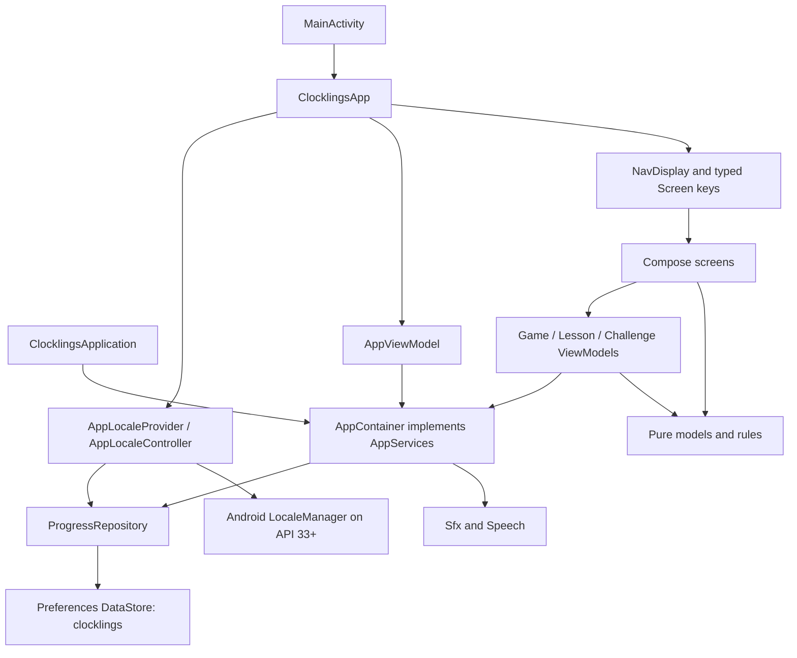
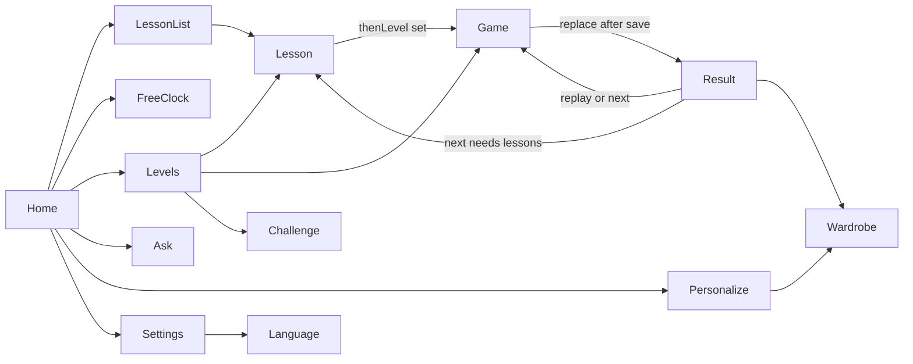

# Clocklings — Technical Reference and Development Handoff

**Repository snapshot:** 26 October 2026, branch `codex/localization-settings`, commit `50875a1e0d1e6933839924e5761f6c6c61f788c3`. The working tree was clean before this document was added. This document describes that implementation; later changes must be checked against source.

**Purpose:** A repository-specific guide to the complete application: product behavior, screens, architecture, data, rendering, localization, platform boundaries, tests, build tooling, review priorities, and unresolved decisions. It is an orientation reference, not a replacement for inspecting code or an authorization to implement proposals.

**Authority:** Owner instructions and [AGENTS.md](AGENTS.md) govern scope and working rules. Current source governs implemented behavior. [STATUS.md](docs/implementation/STATUS.md) records decisions and dated validation reports. The [product plan](docs/superpowers/plans/2026-10-20-public-clock-learning-app.md) distinguishes approved requirements from proposals; detailed specifications do not automatically approve features.

## Contents

- [A. Identity, scope, and evidence](#a-identity-scope-and-evidence)
- [B. Complete feature inventory](#b-complete-feature-inventory)
- [C. Architecture and initialization](#c-architecture-and-initialization)
- [D. UI and UX reference](#d-ui-and-ux-reference)
- [E. Navigation and user journeys](#e-navigation-and-user-journeys)
- [F. State, concurrency, and lifecycle](#f-state-concurrency-and-lifecycle)
- [G. Models, storage, and recovery](#g-models-storage-and-recovery)
- [H. Platform integrations and audio](#h-platform-integrations-and-audio)
- [I. Monetization and entitlements](#i-monetization-and-entitlements)
- [J. Permissions, security, and privacy](#j-permissions-security-and-privacy)
- [K. Stack and dependency configuration](#k-stack-and-dependency-configuration)
- [L. Localization and teaching language](#l-localization-and-teaching-language)
- [M. Accessibility and device compatibility](#m-accessibility-and-device-compatibility)
- [N. Tests and validation evidence](#n-tests-and-validation-evidence)
- [O. Development, CI, and release procedures](#o-development-ci-and-release-procedures)
- [P. Error and edge-case reference](#p-error-and-edge-case-reference)
- [Q. Known limitations and documentation discrepancies](#q-known-limitations-and-documentation-discrepancies)
- [R. Critical code review map](#r-critical-code-review-map)
- [S. Navigable source reference](#s-navigable-source-reference)
- [T. Current development state and unresolved questions](#t-current-development-state-and-unresolved-questions)
- [U. Instructions for future assistants](#u-instructions-for-future-assistants)

## A. Identity, scope, and evidence

### Application identity

| Property | Implemented or documented value | Evidence |
| --- | --- | --- |
| Launcher/app name | Clocklings | `app/src/main/res/values/strings.xml`, manifest |
| Intended Google Play title | Clocklings: Learn to Tell Time | Owner requirements and product plan; not a verified live listing |
| Namespace/application ID | `fi.clocklings` | `app/build.gradle.kts` |
| Version | `versionCode = 1`, `versionName = "1.0"` | `app/build.gradle.kts` |
| Platform | Android, minimum API 26; compile and target API 37 | `app/build.gradle.kts` |
| UI | Kotlin, Jetpack Compose, one activity, portrait declaration, light theme | `MainActivity`, manifest, `ClocklingsTheme` |
| Languages | English, Finnish, one shared Swedish; device-language option | `AppLanguage`, locale resources/configuration |
| Runtime data | One local progress/settings store; no accounts or separate learner profiles | `ProgressRepository` |
| Release status | Development implementation with historical debug validation; publication and signed release readiness not established | `STATUS.md`; no Play Console evidence inspected |

Clocklings teaches analog time through short demonstrations, multiple-choice reading questions, hand-setting exercises, free clock manipulation, and shared play. Best practice results earn up to fifteen stars that unlock companion clothing. Users can choose six companions or no companion, change clock artwork, set a companion name, choose 12/24-hour display, and use optional local speech and sound effects.

The intended audience is children learning to tell time, with optional adult/shared participation. The plan's approximate age range is a proposal, not a confirmed Play age declaration. There is no implemented age collection, parental identity, school curriculum mapping, or Teacher Approved flow.

### Evidence categories and investigation limits

- **Implemented:** Derived from inspected production code/configuration. A static trace establishes control flow, not that every device renders or behaves correctly.
- **Historical validation:** Explicitly attributed to dated entries in `STATUS.md` or language-review documentation. Those checks were not rerun merely to create this document.
- **Potential concern:** A concrete code boundary requiring further investigation; not a reproduced defect unless explicitly stated.
- **Planned/unresolved:** Supported by planning/decision documents but not present in the implementation.
- **Unavailable:** Cannot be established from this repository investigation, such as current Play Console configuration or actual speech quality on a physical device.

The investigation inventoried tracked repository files and inspected the application entry points, all screen flows, state owners, domain logic, persistence, localization, audio, shared UI/rendering architecture, build configuration, manifests, scripts, test inventory and relevant test implementations. Rendering registries and shared drawing/animation code were inspected; this is not a claim of a pixel-by-pixel review of every artwork path or screenshot. Existing plans were compared with code and the dated status record. Private local configuration, credentials, signing material, external dashboards, and the original application's workspace were not inspected.

The production tree contains 86 Kotlin files. The test inventory contains 31 JVM Kotlin files with 185 `@Test` methods, and 21 instrumentation Kotlin files with 75 `@Test` methods, including helper files. These are source counts, not passing test counts.

For this documentation task, `tools/check-localization.ps1` ran successfully. No Gradle build, JVM test suite, instrumentation suite, emulator session, security scan, Sonar upload, or release validation was executed. Final documentation validation checks source-link existence and repository diff scope. No application implementation was changed.

## B. Complete feature inventory

Every implemented feature below uses local state/storage and requires no app-requested dangerous permission. Speech additionally depends on a suitable installed Android TTS voice; its availability is optional. Tests listed are existing coverage, not results from this documentation task. Test paths are mapped in [N](#n-tests-and-validation-evidence).

| Feature and access | Processing and persistence | States, restrictions, recovery | Main implementation and tests |
| --- | --- | --- | --- |
| Launch introduction | Animated clock/companion/title overlay; session-level saveable completion | Tap to skip; underlying UI semantics/focus blocked; reduced-motion timeline; not persistent first-install onboarding | `IntroScreen.kt`, `IntroTimeline.kt`; `IntroTimelineTest`, `IntroOverlayTest` |
| Home | Real local time refreshed every ten seconds; localized time, companion and total stars | Hidden companion card for `NONE`; companion customization remains reachable; waits for initial settings/progress | `HomeScreen.kt`; `AppFlowTest`, `PersonalizationFlowTest` |
| Lesson library | Nine authored lessons, pages, demos, one quiz per lesson; completion IDs persisted | Day lesson hidden in 12-hour mode; quiz mistakes disable choices, successful quiz unlocks next action | `LessonScreens.kt`, `LessonCatalog.kt`, `LessonViewModel`; lesson/domain/localization tests |
| Automatic pre-level lessons | `introPlan` selects incomplete lessons for a level and optional day lesson | Intro-shown markers saved when starting the route, before completing the lessons; top-bar skip enters game | `Lessons.kt`, `AppViewModel.startLevel`, `Navigator`; `LessonsTest`, `GameViewModelTest` |
| Explore/free clock | Drag hands in five-minute steps, randomize, read words/digits, listen, toggle guides | No scoring; saveable time; 24-hour conversion retains an afternoon representation when enabled | `FreeClockScreen`, `ClockFace`; `AppFlowTest`, `ClockSurfaceStateTest`, `LanguageSettingsTest` |
| Practice level selection | Five levels from whole hours to exact minutes; best stars and lesson shortcuts | All levels immediately available; no sequential lock or mastery gate | `LevelsScreen`, `Levels`; `LevelsTest`, `AppFlowTest` |
| Practice round | Ten distinct tasks alternating READ/SET; two-stage error feedback; best-of-level star update | First wrong answer gives hint; second reveals answer; correct answer advances after delay; active round not durably saved | `GameScreen`, `GameViewModel`; `GameViewModelTest`, `ActiveLocaleStateTest` |
| Result/rewards | Three-star display, preserved best, newly unlocked items, companion celebration, replay/next/dress | One to three stars per completed round; aggregate best max 15; previewing new clothes does not equip them | `ResultScreen`, `Progress`, `Wardrobe`; `VisibleUnlocksTest`, `AppFlowTest`, `ComposeStabilityRegressionTest` |
| One-minute challenge | Sixty-second read-only multiple-choice round; best score persisted | Levels 0–3 only; delayed feedback/next question; no stars or item unlocks; no persisted active countdown | `ChallengeScreen`, `ChallengeViewModel`; `ChallengeViewModelTest`, `ChallengeScreenTest`, `ActiveLocaleStateTest` |
| Play together | Setter chooses time, hands over hidden-answer question, reveals answer, swaps player number | No recorded answer, score, player name, or correctness judging; time/phase/player are saveable | `AskScreen`; `AppFlowTest`, `LanguageSettingsTest`, `ClockSurfaceStateTest` |
| Companion choice | Human, cat, dog, robot, dragon, dinosaur, none; choice persisted | All choices free; previous names/outfits are retained per species | `AppearanceScreen`, `Personalization`; `PersonalizationFlowTest` |
| Companion color | Original/blue/green/purple for non-human companions; settings persisted per species | Human uses its own artwork/clothing colors; `NONE` has no wardrobe | `WardrobeScreen`, `PersonalizationPreferences`; `PersonalizationTest` |
| Clothing and names | 98 items across six catalogs; star thresholds; per-kind outfit/name persisted | Required human slots cannot be removed; optional slots toggle; name input limited to 16 characters and trimmed | `WardrobeScreen`, `Wardrobe`, `CompanionItems`; `WardrobeTest`, `CompanionItemsTest`, `PersonalizationStorageTest` |
| Clock styles | Seven named styles plus custom; custom has 48 combinations; persisted settings | All styles share clock geometry, red hour hand, blue minute hand; no unlock cost | `AppearanceScreen`, `ClockThemeArt`, `ClockAppearance`; `PersonalizationFlowTest`, galleries |
| Settings | Language entry, 12/24-hour choice, guides, effects switch, speech status, reset | Pending writes disable affected controls; IOException shown; persisted state drives UI | `SettingsScreen`, `AppViewModel`; `AppSettingsTest`, `SettingsErrorTest` |
| Language choice | Device/default plus English/Finnish/Swedish; platform storage on API 33+, DataStore on older Android | Loading/error/retry at locale initialization; failed selection remains retryable; locale changes stop speech | `LanguageScreen`, `AppLocaleController`; controller, locale and active-state tests |
| Reset progress | Confirmation clears progress, names, clothing, best challenge and lesson markers | Preserves display/audio/help/language/appearance settings; no undo/import recovery; IO failure retains dialog/error | `ResetProgressDialog`, `AppViewModel.resetProgress`, repository; `AppSettingsTest`, `LanguageSettingsTest` |
| Optional read-aloud | Local offline-eligible voice reads localized clock/lesson text | Hidden when unavailable; no replay of missed requests; navigation/background/language changes stop playback | `Speech`, `Texts.kt`; `SpeechTest`, `OfflineVoiceTest` |
| Sound effects | Generated OK/BAD/POP/TICK PCM, recorded WIN and companion voice clips (`res/raw`); gated by sound setting | Track/init failures degrade to silence; enabling sound can play a forced confirmation pop | `Sfx`, `ToneSynth`; `ToneSynthTest` |

Not implemented: account management, authentication, multiple learner profiles, billing, ads, cloud sync, analytics, crash reporting SDK, user-visible history/log, import/export, backup UI, notifications, widgets, everyday timers/routines, achievements beyond current star/clothing progression, or a parent PIN/gate. Absence is based on source/configuration inventory, not on a claim about transitive library internals.

## C. Architecture and initialization

### Modules and layers

[`settings.gradle.kts`](settings.gradle.kts) includes only `:app`. There are no separate feature, domain, data, or shared Android modules. Package separation supplies the boundaries:

| Directory | Responsibility |
| --- | --- |
| `app/src/main/java/fi/clocklings/` | Activity/application, app composition, typed routes, navigator |
| `domain/` beneath that root | Clock mathematics, language rules, task generation, lesson models, progress and wardrobe rules |
| `data/` | Preferences DataStore serialization and compatibility fallbacks |
| `audio/` | Android speech adapter, generated PCM effects, recorded clip playback |
| `ui/` | App state owner, text adapters, screens and screen ViewModels, locale bridge, shared controls, Canvas art and theme |
| `app/src/main/res/` | Three-language UI resources, fonts, launcher/splash/theme XML, backup and locale declarations |
| `app/src/test/` | JVM domain/repository/ViewModel/rendering-math tests and fakes |
| `app/src/androidTest/` | Compose UI, real activity/storage/locale and Android audio-adapter tests |
| `config/`, `tools/`, `.github/`, `.deepsec/` | Development checks and automation, not runtime features |
| `docs/` | Decisions, historical evidence, language review and proposals |

The implementation is a pragmatic Compose/ViewModel/repository design with manual service construction. It has unidirectional state updates in its ViewModel-backed screens, but does not impose a single reducer or a use-case/interactor layer everywhere. Small screens use local Compose state. There is no Hilt/Koin, Room, Retrofit, Firebase, LiveData, or XML-layout screen architecture in the inspected source.



### Initialization trace

1. [`ClocklingsApplication`](app/src/main/java/fi/clocklings/ClocklingsApplication.kt) lazily creates `AppContainer`, using application context and the `Context.preferencesDataStore` delegate named `clocklings`.
2. `AppContainer` owns the repository, sound synthesizer/player, speech adapter, and an application-lifetime `SupervisorJob + Dispatchers.Default` scope. It observes sound settings eagerly. `AppServices` is the narrow interface used by ViewModels and test fakes.
3. [`MainActivity.onCreate`](app/src/main/java/fi/clocklings/MainActivity.kt) enables edge-to-edge, chooses light system-bar styling, and calls `setContent { ClocklingsApp(...) }`.
4. [`ClocklingsApp`](app/src/main/java/fi/clocklings/ClocklingsApp.kt) obtains `AppViewModel`, wraps composition in locale and theme providers, and collects settings/progress using `collectAsStateWithLifecycle`. Initial null model values prevent rendering feature content before data is ready.
5. The root provides app state, personalization and confetti hosts, creates a saveable Navigation 3 back stack starting at Home, and supplies saveable-state and ViewModel-store entry decorators. A session introduction overlays the content until complete/skipped.
6. Language effects update speech. Resume refreshes voice availability; changes of top destination stop existing speech. `MainActivity.onPause` calls the container's pause behavior to stop sound and speech.

The application scope and audio engines are deliberately longer-lived than a destination. A screen ViewModel belongs to its navigation entry. The locale bridge supplies localized resources without replacing the activity's ViewModel/lifecycle owners. These ownership distinctions matter for recreation, navigation, and cleanup.

## D. UI and UX reference

### Screen inventory and composition

All feature screens are Compose functions; there are no XML activity/fragment layouts. The main shared layout is `ScreenScaffold` in [`Layout.kt`](app/src/main/java/fi/clocklings/ui/components/Layout.kt): a safe-inset, vertically scrollable column. There is no bottom navigation or drawer. Appearance has two local tabs, not independent navigation destinations.

| Route / composable | Visible hierarchy and actions | State owner |
| --- | --- | --- |
| `Screen.Home` / `HomeScreen` | Settings chip; rainbow hero/title/tagline; current-time card; optional companion/name/stars; Learn, Explore, Practice, Together, My Companion entries; clock-style chip | Root progress/settings; local current-time loop |
| `Screen.LessonList` / `LessonListScreen` | Back/title; lesson entries with completion state; day lesson conditional on 24-hour setting | Root progress/settings and localized catalog |
| `Screen.Lesson` / `LessonScreen` | Back or skip; page progress dots; demonstration clock; explanatory panel and changing caption; replay/listen; previous/next or quiz options/feedback | `LessonViewModel` per entry |
| `Screen.Levels` / `LevelsScreen` | Back/title; five level cards with sample clock, description, best stars and relevant lesson shortcuts; challenge entry | Root progress/settings |
| `Screen.Game` / `GameScreen` | Back/help; ten-task progress; clock; READ options or SET instruction and Done; hint/praise/reveal/Next | `GameViewModel` per entry; remembered clock state |
| `Screen.Result` / `ResultScreen` | Result heading; animated three stars; companion; score/best explanation; newly unlocked item previews; replay/next/dress/levels actions | Route snapshot plus current personalization; local celebration state |
| `Screen.FreeClock` / `FreeClockScreen` | Back/help; interactive clock; words and numeric time; hand legend; Listen when possible; random-time button | Saveable time and mode transition state |
| `Screen.Challenge` / `ChallengeScreen` | START score/best/instructions and start; RUN timer bar, clock and choices; END result/best/replay | `ChallengeViewModel` per entry |
| `Screen.Ask` / `AskScreen` | Player instruction; SET editable clock/random; ASK hidden answer; REVEALED words/digits/listen; reveal/swap actions | Saveable phase, setter number and time |
| `Screen.Personalize` / `AppearanceScreen` | Companion/clock tabs; large preview; selection grid; wardrobe link or custom-clock controls | Root settings; saveable selected tab |
| `Screen.Wardrobe` / `WardrobeScreen` | Companion/name field; stars; non-human color choices; slot headings; clothing thumbnails, selection/lock/threshold state | Root progress/settings; local name field |
| `Screen.Settings` / `SettingsScreen` | Language panel; 12/24-hour radio group/example; guides/effects switches; speech status; reset panel and error text | `AppViewModel.settingsAction`, root settings, locale controller |
| `Screen.Language` / `LanguageScreen` | Device-language option plus three named language radio rows; pending/failed selection | `AppLocaleController.selection` |

The intro is an overlay, not a route. Reset is a Material 3 `AlertDialog`, not a screen. No implemented bottom sheets, overflow menus, login forms, purchase dialogs, or permission dialogs were found.

### Lesson content and interaction

[`LessonCatalog.kt`](app/src/main/java/fi/clocklings/ui/lesson/LessonCatalog.kt) creates localized lesson content over the pure models in [`Lessons.kt`](app/src/main/java/fi/clocklings/domain/Lessons.kt). Persistent IDs remain Finnish identifiers for compatibility; user-visible titles are resources.

| ID | Topic | Explanation pages | Quiz clock time | Automatic level association |
| --- | --- | ---: | ---: | --- |
| `viisarit` | Hour and minute hands | 3 | 04:00 (identify short red hand) | 0 |
| `kierros` | Full revolution and hour progression | 3 | 03:00 (one-hour concept) | 0 |
| `tasan` | Whole hours | 3 | 09:00 | 0 |
| `puoli` | Half hours and language-specific reference | 4 | 05:30 | 1 |
| `vartti` | Quarter hours | 3 | 06:45 | 2 |
| `ylivaille` | Past/to reasoning | 3 | 04:10 | 2 |
| `viisi` | Five-minute increments | 3 | 08:40 | 3 |
| `minuutit` | Individual minutes | 2 | 03:07 | 4 |
| `vrk` | Day and 24-hour context | 3 | 19:00 | Added when 24-hour mode requires it |

There are 27 explanation pages plus nine quizzes. The demo DSL supports waits, clock moves, highlights, under/over overlays and captions. `DemoStep.Say` updates the caption; it is not automatic TTS. Listen reads lesson text and current caption when available. Replay cancels/restarts the demo and stops speech.

Quiz choices are shuffled; the authored first correct choice is tracked separately from visual order. Wrong answers are disabled and produce a hint. Correct answers produce praise/confetti, mark the lesson complete asynchronously and permit continuing. Previous-page navigation can reset the page/quiz state. A language change reconstructs localized content and restarts an active explanation demo; an active quiz retains choice ordering and wrong-answer state.

The half-hour demonstration points to the current hour in English and the next hour in Finnish/Swedish. This is teaching behavior, not just translated labels. Follow the catalog and formatter together when changing content.

### Practice and result behavior

[`Levels.kt`](app/src/main/java/fi/clocklings/domain/Levels.kt) defines five levels with minute steps 60, 30, 15, 5 and 1. A round targets ten distinct times with alternating READ and SET tasks. Task generation weights newly introduced minute positions: half-hour, quarter-hour, non-quarter five-minute, then non-five-minute values. Reading questions target three distinct choices. Confusions include nearby hours, past/to mirrors and swapped-hand interpretations; 24-hour choices may include the other half of the day. `makeTasks` stops after 500 draw attempts and returns the collected list without a fill-to-ten fallback; `optionsFor` limits its random fallback to 300 attempts. Other random helpers use rejection sequences without these guards. The normal ten-task/three-choice contract is tested, but should not be described as a hard guarantee for every injected Random implementation.

`GameViewModel` handles answer state centrally. A first READ error disables that choice and gives a hint; a second reveals the correct answer and exposes Next. SET compares hands modulo twelve hours, so 03:30 and 15:30 are equivalent hand positions. A first error identifies the problematic hand; a second moves the clock to the answer over 1,400 ms and permits Next. Correct answers play OK, choose praise, trigger celebration and advance after 1,500 ms. Repeated disabled/busy input is ignored.

A completed round earns three stars for at most one mistake, two for at most three, otherwise one. Only each level's best result counts toward the total, capped at fifteen. Completion reads prior progress, writes a best-preserving update, then emits result navigation. The result route carries the level, earned stars, previous best and total stars before completion. `ResultScreen` derives the after-total and newly unlocked items from that snapshot. Newly shown clothing appears in a temporary companion celebration; it is not automatically equipped.

There is no persisted question history, response-time history, adaptive mastery model or level locking. See [P](#p-error-and-edge-case-reference) for completion-write failure behavior.

### Challenge and shared play

The challenge uses `START`, `RUN`, `END` state, a monotonic `System.nanoTime` deadline and a sixty-second timer job. It generates READ tasks from levels 0–3, avoiding an immediately repeated time. A correct answer increments score and advances after 380 ms; a wrong answer reveals the answer and advances after 1,300 ms. A busy guard prevents duplicate answers. Ending cancels pending advancement, saves a better best score, and plays the win sound. It has no star/clothing rewards.

Together uses `SET`, `ASK`, `REVEALED`. The setter selects a five-minute time; the question phase removes time-answer semantics and Listen. Revealing restores words/digits/speech and celebrates. The next action swaps setter 1/2 and returns to setting, retaining the current time. The app does not hear, grade or store a player's spoken response.

### Personalization and artwork

[`Personalization.kt`](app/src/main/java/fi/clocklings/domain/Personalization.kt) defines `CompanionKind`, `CompanionColor`, `ClockTheme`, `CustomClock` and `Personalization`. Defaults are human companion and rainbow clock. Named themes are Classic, Rainbow, Space, Forest, Ocean, Garden and Workshop, plus Custom. Custom combines four palettes, three frames, two numeral styles and two hand styles (48 combinations); geometry remains unchanged.

Human clothing has 18 items: three free required defaults and fifteen star unlocks. Each of five non-human catalogs has 16 items: one free item and fifteen unlocks. Human required slots are HAIR, DRESS and SHOES; HEAD/EXTRA are optional. Non-human slots are HEAD/NECK/EXTRA. Clothing is selected by stable item ID, not by resource name or translated title. Stars are thresholds, never spent. The registry and defaults live in [`Wardrobe.kt`](app/src/main/java/fi/clocklings/domain/Wardrobe.kt) and [`CompanionItems.kt`](app/src/main/java/fi/clocklings/domain/CompanionItems.kt).

The wardrobe displays locked items with lock/required-star descriptions and no click action. Clicking an equipped optional item removes it; required human items remain equipped. Names are entered with `BasicTextField`, word capitalization and an IME Done action. The UI takes sixteen string characters and trims before persistence; there is no separate Save button. This is not a grapheme-aware name policy or repository-level length guarantee.

Art is generated in Compose Canvas, not downloaded, stored as 3D models or played as video. `CompanionView` fits a species rig into the requested canvas or slot crop. Human art uses a 200×340 design grid; the shared animal frame uses 240×300. `CompanionRig`, `ItemArt`, `ArtPart` and `ItemLayer` attach clothing to animated body/head/wing/hand/antenna transforms. Layering supports behind/front/over-ear/screen art, including ear clipping. Full-character views and cropped wardrobe previews deliberately have different clipping needs.

`CompanionPose`/`CompanionMotion` drive blink, breath, sway, head tilt and species motion. Celebration uses a spin then hop sequence, while reduced motion uses static/immediate state. Shared vinyl rendering supplies upper-left lighting, highlight/shade tones, shadows and cached brushes. Source-derived appearance is pastel, rounded and shaded; no new visual screenshot review was performed for this document.

### Shared design system

| Area | Implementation and behavior |
| --- | --- |
| Theme | `ui/theme/Theme.kt`: custom light Material 3 theme; no dark/dynamic-color branch |
| Color | `SkColors`: pale pink `#FFF5FA` background, `#FFE1EF` dots, dark purple `#3A2453` text, white surfaces, pink line, red `#E64980` hour hand, blue `#228BE6` minute hand; gold/positive/hint tokens |
| Typography | `Type.kt`: Fredoka medium/semibold/bold display and Nunito semibold/bold/extrabold body; `SkType` includes 17 sp body, 22 sp title, 28 sp clock words, 26 sp question, 19 sp lesson, 21 sp button, 34 sp result |
| Spacing | `SkDimens`: 16 dp gutter, 10 dp screen gap, 8/12/16/18 dp recurring gaps, panel/card padding, 2/3 dp borders |
| Shapes | `SkShapes`, `components/Shapes.kt`: rounded cards/buttons/options/item tiles, authored cloud/rainbow geometry |
| Controls | `Buttons.kt`: `SkButton`, chips/options and `DepthSurface` use pressed offset/shadow treatment; appearance is not a stock Material button/ripple skin |
| Panels/display | `Panels.kt`, `Display.kt`: content cards, clock words/digits, stars, progress dots, feedback and timer bar |
| Icons | `Icons.kt`: authored UI icons; launcher icons are separate resource XML |
| Feedback | Hint/praise panels, disabled/selected styling, wrong-answer shake, star pop, confetti and companion celebrations |

The main scaffold computes clock size from available width and a fraction of height. `TopBar` puts its title on a separate row below 360 dp content width or above 1.3 font scale. Home/appearance grids reduce columns for narrow or large-font layouts; wardrobe/color grids also reduce columns at their own thresholds. These thresholds use available content width, which is narrower than device width after insets/padding.

`WordSafeText` can shrink selected titles/tiles/pills to 68% of the nominal size in 0.5 sp steps. Lesson prose and answer options instead wrap. Do not describe the app as universally preserving nominal text size at 200% font scale. Artwork numeral sizes are resolved in the fixed clock drawing grid and scaled with Canvas, not ordinary body-text layout.

### Input, transient states and motion

The clock's pointer input selects a hand by touch position, ignores the center dead zone, follows circular drag and snaps to the active minute step. Hour movement remains continuous with minute position. Accessibility custom actions nudge time without drag. The clock can hide its time description for unanswered questions. Help includes colored sectors, minute markers and 24-hour inner numbers; past/to wording is English-only because Finnish/Swedish half-hour references differ.

`ClockSpec` uses a 400×400 design coordinate system centered at (200, 200). The full view extends from -34 over 468 units to leave room for outer minute labels; the mini view starts at 12 over 376 units. `ClockFace` layers the themed rim, face/help sectors, lesson underlays, ticks/numbers/day context, hands/pin and lesson overlays. The hour angle advances continuously at half a degree per minute; the minute angle advances six degrees per minute. Mini clocks omit the full help/day presentation. Theme changes replace rim/motif/numeral/hand styling without changing task mathematics or hand-angle correctness. This shared renderer is used by live Home clocks, lessons, tasks, previews and screenshots, so changes can affect all of them.

Settings radio/switch rows expose roles and whole-row interaction with a 48 dp minimum. Pending setting writes disable controls; read failures may show a locale retry screen before app content. Missing speech removes Listen and explains availability in Settings. No companion is an intentional selection, not an error/empty collection. Quiz and clothing disabled states prevent unsupported actions.

Reset confirmation is local `remember(language)` state. Activity recreation or language change dismisses it. Cancel/dismiss remains possible while a reset write is pending; dismissing the dialog does not cancel an already launched write. Success closes it after persistence; IOException shows error text and permits retry.

[`Motion.kt`](app/src/main/java/fi/clocklings/ui/Motion.kt) centralizes reduced-motion information used by animation code. The intro timeline is about 3.15 seconds normally and 1.2 seconds in reduced motion; tap skips it. Confetti is decorative, with bounded particle lifetime. The challenge timer remains a real-time progress display even with reduced motion. These behaviors do not establish full vestibular accessibility or spoken-feedback usability; see [M](#m-accessibility-and-device-compatibility).

## E. Navigation and user journeys

### Typed destination contract

[`Screen.kt`](app/src/main/java/fi/clocklings/Screen.kt) defines serializable `NavKey` implementations and an explicit `ScreenSavedState` polymorphic registration. The complete route payloads are:

| Destination | Payload |
| --- | --- |
| Home, Settings, Language, FreeClock, LessonList, Levels, Challenge, Ask, Wardrobe | None |
| Lesson | `queue: List<String>`, `thenLevel: Int?` |
| Game | `level: Int`, `round: Long` |
| Result | `level: Int`, `stars: Int`, `previousBest: Int`, `starsBefore: Int` |
| Personalize | `clocks: Boolean = false` |

The round identifier is based on `System.nanoTime` to make a new game entry distinct. The lesson queue contains stable IDs; it is not serialized rendered prose. `HomeDestination.kt` still uses inherited enum names (`KOULU`, `VAPAA`, `PELAA`, `KYSY`, `NUKKE`, `CLOCK_STYLES`, `SETTINGS`) to map home actions; those names are not visible translations.



### Stack operations and back behavior

[`Navigator.kt`](app/src/main/java/fi/clocklings/Navigator.kt) wraps the mutable back stack. `push` adds entries; `pop` retains the bottom Home; `replace` replaces the top while preserving a root; `popTo` returns to the last matching entry or reconstructs a route above Home. `startLevel` selects lessons or a game based on the supplied queue.

- **Fresh launch:** Locale/data initialize, Home becomes available, introduction runs or is skipped. There is no mandatory setup form. Default preferences apply until changed.
- **Learn:** Home → lesson list → lesson. Previous/next moves within the lesson ViewModel; completing the queue returns to the list unless a level continuation is present.
- **Practice:** Home → levels → optional introductory lessons → game → result. Game-to-result uses replacement so Back does not revive the finished game. Replay/next also replace the result entry; next may first insert required lessons.
- **Lesson skip distinction:** A pre-game lesson's explicit top-bar skip starts its game. System Back uses `NavDisplay`'s ordinary pop instead. These are distinct implemented actions.
- **Dress reward:** Result replaces itself with wardrobe; returning to levels uses `popTo`. Clothing selection changes persistent progress; celebration preview alone does not.
- **Appearance shortcuts:** Home can enter Personalize on either tab via `clocks`; changing tabs is local state. Wardrobe Back returns through the actual stack.
- **Settings/language:** Home → settings → language; selection may recreate activity on modern Android. The navigation stack and per-entry state are saveable; settings reset confirmation intentionally is not.
- **Leaving a screen:** Top destination changes stop speech. Removing a destination clears its ViewModel and cancels its `viewModelScope` work.

There is no authored deep-link graph, external navigation argument parser, browser route, or notification route. Incoming launcher access does not provide arbitrary serialized `Screen` payloads.

### Interruption and restoration contract

Navigation 3 saves destination keys; entry decorators preserve Compose saveable state and ViewModel ownership. This supports activity recreation and retained active ViewModels. It is **not** a complete session snapshot after process death: Game/Lesson/Challenge ViewModels have no `SavedStateHandle` persistence for their active task list, timer or demo position. Restoring a route can create a fresh ViewModel while preserving some saveable UI values. Current tests primarily cover activity/language recreation, not kill-and-restore of every in-flight operation.

## F. State, concurrency, and lifecycle

| State | Owner/lifetime | Update and observation |
| --- | --- | --- |
| Durable progress/settings | `ProgressRepository` / application | DataStore flow, `distinctUntilChanged`, atomic `edit` |
| Root models | `AppViewModel` | Eager `stateIn`, initially null; lifecycle-aware Compose collection |
| Settings write status | `AppViewModel.settingsAction` | Pending guard, IOException failure flag, explicit error clearing |
| Language readiness/choice/error | `AppLocaleController` | DataStore or platform locale bridge; serialized pending selection |
| Practice tasks/index/mistakes/reveal | `GameViewModel` / navigation entry | StateFlow and `viewModelScope`; delayed advance and save before result |
| Lesson page/demo/quiz | `LessonViewModel` / entry | Cancellable demo job, immutable UI snapshots, locale update handling |
| Challenge score/deadline/phase | `ChallengeViewModel` / entry | Timer job, next-question job, monotonic deadline, run identity |
| Explore/together time and phase | Screen `rememberSaveable` | Local Compose updates; not a DataStore session |
| Clock raw position/animation | `ClockState` / clock composition | Remembered state and cancellable animation; commands synchronize target |
| Intro/result celebration consumption | Saveable Compose state | Avoid repeated event effects on supported recreation paths |
| Audio availability/engine state | `Speech`, `AppContainer` / application | StateFlow and synchronized engine callbacks; application scope |

### Update flow and failures

[`AppViewModel.kt`](app/src/main/java/fi/clocklings/ui/AppViewModel.kt) exposes user actions and current-model fallbacks. Its guarded settings write helper rejects another write while pending, performs the repository operation in `viewModelScope`, rethrows cancellation, catches `IOException`, and publishes failure without pretending the preference changed. `setSound`, `setHelp`, `setH24` and reset use this path. Enabling sound can bypass the newly observed sound flag for the immediate confirmation sound.

Other paths are different: `toggleHelp`, personalization and progress mutations launch writes without this UI failure wrapper. Game completion and lesson/challenge progress writes likewise do not share the Settings error presentation. A future error-handling change must inspect each caller, not assume the repository provides a common retry UI.

DataStore `edit` transforms the latest stored preferences, which prevents independent updates from blindly replacing stale snapshots when callers use transforms correctly. ViewModel UI state and a DataStore edit are not a cross-layer transaction. For example, result navigation depends on successful completion of a save; no durable pending-result event exists.

### Clock motion and cancellation

[`ClockState.kt`](app/src/main/java/fi/clocklings/ui/clock/ClockState.kt) separates raw floating-point minute position from snapped integer time. `ClockCommand` carries target, duration, exact-duration flag and a unique ID so repeated targets can still represent distinct commands. Period changes normalize state and cancel incompatible animation. A drag cancels animation; a new command replaces prior motion. Circular movement uses the shortest delta; the `exact` flag controls duration rather than selecting another movement path.

Tiny/no-motion commands can settle directly without firing the same completion callback as an actual animation. Callers must not treat every command as guaranteed to emit an animation event. Accessibility nudge actions and pointer interaction share the clock-state machinery. Pointer handlers read current interaction eligibility so a transition to a revealed/locked clock takes effect.

### Lifecycle limitations

`collectAsStateWithLifecycle` pauses UI collection according to lifecycle; it does not pause a ViewModel job. The challenge has no explicit background pause policy, foreground service, alarm, wake lock or saved deadline recovery. Its monotonic deadline supports elapsed-time calculation during an existing process, but device suspension/process termination is not a durable countdown service. App pause stops audio; it does not serialize the current game.

ViewModels and local UI use immutable model replacement. [`config/compose-stability.conf`](config/compose-stability.conf) marks domain types and Kotlin collections as stable for compiler/analyzer purposes. This is an assumption that collections are not mutated after publication, not automatic runtime enforcement.

## G. Models, storage, and recovery

### Significant models

| Model/source | Meaning and invariants |
| --- | --- |
| `ClockTime.kt` functions | Minute normalization, snapping, angle/hand geometry, circular equivalence, drag calculations; no locale prose |
| `Levels.kt` task/level models | READ/SET tasks, minute-step levels, distinct choices and star calculation |
| `Lessons.kt` lesson/page/quiz/demo models | Stable lesson IDs; `Text.Res`, `Text.Plural`, `Text.Time`, `Text.Plain`; demo commands independent of rendering |
| `Progress` in `Progress.kt` | Five best-star entries, challenge best, completed lessons, intro-shown markers, outfits/names |
| `Settings` in `Progress.kt` | Sound/help/24-hour settings and personalization |
| `Outfit`, `Slot`, `Wardrobe` | Stable equipped item IDs; mandatory/default/optional slot rules |
| `CompanionKind`, `CompanionStyle`, `ClockAppearance`, `CustomClock` | Current companion, per-kind colors and clock configuration |
| `AppLanguage`, `TimeLanguage` | Supported language resolution and language-specific time contract |
| `Screen` | Serializable navigation identity/payload; not the full feature state |

### Preferences schema

[`ProgressRepository.kt`](app/src/main/java/fi/clocklings/data/ProgressRepository.kt) is the only app persistence repository. [`PersonalizationPreferences.kt`](app/src/main/java/fi/clocklings/data/PersonalizationPreferences.kt) holds the appearance codec. The DataStore name is `clocklings`; its Android Preferences file is managed by the DataStore delegate, not by a custom file API. No Room database, SQL schema, JSON export, server synchronization or general migration framework exists.

| Preference keys | Type and interpretation | Read default/validation |
| --- | --- | --- |
| `stars_0` … `stars_4` | Int, best result per level | Zero; clamp to 0–3 |
| `challenge_best` | Int | Zero; nonnegative |
| `lessons_done` | String set of lesson IDs | Empty |
| `intro_shown` | String set of level markers and `h24` | Empty; separate from lesson completion |
| `sound`, `help`, `h24` | Boolean | True, true, false respectively |
| `app_language` | String language tag on API 26–32 | Absent means device choice; legacy value handed off/cleared on modern Android |
| `outfit_<slot>` | Human item IDs; lowercase slot suffix | Validate slot/kind; required slots use free defaults |
| `doll_name` | Human custom name | Empty/default display name when absent |
| `outfit_<kind>_<slot>` | Non-human item IDs; lowercase kind/slot | Unknown/incompatible IDs removed; empty string represents removed optional item |
| `companion_name_<kind>` | Non-human name, lowercase kind | Default display name when absent |
| `companion` | `CompanionKind` enum name | HUMAN on invalid/missing value |
| `companion_<KIND>_color` | Color enum, uppercase kind in key | ORIGINAL |
| `clock_theme` | Clock theme enum | RAINBOW |
| `clock_palette`, `clock_frame`, `clock_numerals`, `clock_hands` | Custom enum values | BLUE, ROUND, ROUNDED, ROUND |
| `companion_<KIND>_accessory` | Legacy Boolean compatibility input | Consulted only when no saved outfit keys exist for that kind |

Default model maps omit redundant default values. Item IDs must belong to the correct kind and slot when read. The repository does not enforce a star entitlement check when accepting an otherwise valid outfit ID; unlocking is an application/UI rule. Names are not encrypted or validated for length by the repository. Current name limits belong to the wardrobe field.

### Writes, compatibility and deletion

`updateProgress` and `updateSettings` serialize transformed models inside DataStore `edit`. Best-star updates preserve a higher prior score. A first progress write creates explicit outfit slots, including empty optional entries; this prevents the old accessory Boolean from restoring a removed accessory. Legacy accessory keys can remain on disk but no longer win over explicit outfit keys. Unknown enum values fall back safely to defaults; this is compatibility parsing rather than a versioned migration system.

Reset writes a new `Progress()` and clears/replaces progress-owned values: stars, challenge best, completed lessons, intro markers, names and outfits. It preserves sound, help, 12/24-hour choice, language and appearance settings, including selected companion/color/clock. It is not a complete `Preferences.clear()`. There is no undo, export, recycle bin, retention schedule or multi-profile delete operation.

The DataStore read flow catches `IOException`, logs a warning and emits empty preferences, so defaults can render. Non-IO exceptions propagate. This does not prove corrupt bytes are repaired, that failed reads are retried automatically forever, or that subsequent writes will succeed. There is no configured corruption replacement handler visible in the delegate setup.

### Backup and privacy boundary

The manifest disables backup/full backup and references extraction rules excluding app data from cloud backup and device transfer. There is no application backup/restore UI or import format. Storage relies on Android's app sandbox; there is no app-layer encryption or authentication around local progress. Clearing app data/uninstalling can remove local progress; the application supplies no user recovery channel. Names and progress are not sent to a runtime backend by this code.

## H. Platform integrations and audio

### Runtime integration inventory

| Integration | Data/action | Failure boundary |
| --- | --- | --- |
| Android TextToSpeech | Localized time or lesson text, selected language/voice, playback commands | Optional; engine/voice failure makes speech unavailable |
| Android AudioTrack and SoundPool | App-generated PCM for four effects; recorded OGG clips for the win sound and companion voices | Initialization/playback failures logged or ignored safely for silent operation |
| Android LocaleManager (API 33+) | Application locale selection and legacy handoff | Controller exposes failed/pending state; external changes reconciled on refresh |
| Android Preferences DataStore | Local progress, appearance and settings | IO fallback on reads; caller-dependent write recovery |
| Android system clock | `LocalTime.now()` for Home and introduction | Device-local time; no time server or calendar integration |

There is no authored runtime HTTP client, API endpoint, Firebase configuration, analytics SDK, remote crash reporting, Google sign-in, Google Play Billing, ad SDK or backend credential. Development integrations such as SonarCloud, GitHub Actions, vulnerability feeds and DeepSec belong to build/review tooling and can communicate externally when invoked; they are not features embedded in the application.

### Speech selection and lifecycle

[`Speech.kt`](app/src/main/java/fi/clocklings/audio/Speech.kt) separates an engine adapter from speech orchestration. It synchronizes state behind a lock and handles asynchronous initialization, including a callback that may arrive during construction. Current language wins over earlier initialization requests. Availability is exposed to UI.

An eligible voice must match the supported primary language, report that it does not require a network connection, and not advertise the not-installed feature. Selection prefers an exact locale match, then a deterministic name order. Both voice selection and speech-rate setup (0.9) must succeed. Swedish regional variants can be considered within the shared Swedish language.

Speech uses `TextToSpeech.QUEUE_FLUSH` and unique `clocklings-...` utterance IDs. Errors for the current utterance can disable availability; stale callback identity is considered. Missing voices do not cause the application to choose a mismatched teaching language. Requests made while unavailable are not queued for later replay. There is no microphone input, speech recognition or answer transcription.

Root lifecycle/locale effects, destination changes, lesson replay and together-player changes stop speech as appropriate. Resume refreshes engine voice availability. The adapter supports shutdown for owned/test instances; the application container retains its engine across activity recreation. Metadata checks and fake-engine tests do not establish real acoustic output, pronunciation, or offline network behavior of every installed TTS service.

### Sound effects

[`ToneSynth.kt`](app/src/main/java/fi/clocklings/audio/ToneSynth.kt) generates 44.1 kHz, 16-bit mono PCM using sine/triangle wave components. [`Sfx.kt`](app/src/main/java/fi/clocklings/audio/Sfx.kt) prepares static `AudioTrack` instances on a background scope and keeps them by sound. OK, BAD, POP and TICK are generated. Sounds with a `clip` ([`Sound.kt`](app/src/main/java/fi/clocklings/audio/Sound.kt)) are OGG Vorbis files in `res/raw` played by a `SoundPool`: WIN (`success.ogg`, level result and challenge end) and companion voices (`companion_cat.ogg`, `companion_dog.ogg`). `companionVoice()` maps a companion to its voice; companions without a recorded voice are silent. A voice plays when a companion is chosen in the Appearance pager and when the level result's companion celebration starts.

Playback checks the sound preference through `AppContainer`; an explicit forced effect supports enabling sound. If a track or clip is not loaded yet, the effect is silent. App pause stops tracks and clip streams. `Sfx` has no explicit release lifecycle in the inspected implementation; the bounded track set has application lifetime. Whether that needs an explicit disposal path is a resource-management review question, not a demonstrated growing leak.

## I. Monetization and entitlements

Billing is not implemented. There are no product IDs, purchase tokens, acknowledgements, restoration requests, receipt verification, premium flags, subscription UI or Play Billing dependency. No advertising or payment-related permissions/services were found.

Stars and clothing thresholds are local learning rewards, not financial entitlements. The UI enables items according to the best-star total; no remote authority verifies them. A local valid clothing ID can be decoded independently of stars. Commercial model and any adult purchase control remain product decisions; the current code must not be described as a completed paid/freemium offering.

## J. Permissions, security, and privacy

### Authored manifest surface

Source: [`AndroidManifest.xml`](app/src/main/AndroidManifest.xml), [`data_extraction_rules.xml`](app/src/main/res/xml/data_extraction_rules.xml), [`locales_config.xml`](app/src/main/res/xml/locales_config.xml).

| Declaration | Actual purpose and consequence |
| --- | --- |
| No positive app `uses-permission` requests | No runtime dangerous-permission flow; no app INTERNET, microphone, notifications, storage or location request |
| `${applicationId}.DYNAMIC_RECEIVER_NOT_EXPORTED_PERMISSION` with `tools:node="remove"` | Manifest-merger removal entries for the generated permission/declaration, not a permission grant |
| `<queries>` for `android.intent.action.TTS_SERVICE` | TTS package visibility; not microphone or network permission |
| Exported `MainActivity` with MAIN/LAUNCHER | Public launcher entry point; no other app-authored exported activity/service/provider/receiver |
| `usesCleartextTraffic="false"` | Global cleartext prohibition; no custom runtime network stack found |
| `allowBackup="false"`, `fullBackupContent="false"`, extraction exclusions | App-data backup/transfer policy, not a recovery feature |
| `supportsRtl="false"` | No claimed RTL layout support |
| `localeConfig` | Advertises English/Finnish/Swedish application languages |
| Portrait, `adjustResize`, predictive-back opt-in | Window/orientation/back behavior declarations |

This table describes authored source, not a fresh merged release manifest. Dependency manifest contributions and final permission/component inventories require checking the built artifact when releasing. This task did not generate one.

### Security boundaries

- Application identity separates Clocklings from the original private application. There is no source path that intentionally imports that application's preferences, credentials or signing material.
- Local companion names, progress and preferences remain in app-private DataStore. No app-layer encryption, user login or parent gate exists. Reset is available from Settings with confirmation.
- TTS is an external installed Android service. This app filters its advertised voice capability and supplies teaching text; it does not control the service's own permissions or independently prove its behavior.
- Stable item IDs, enum parsing and numeric clamping are integrity checks, not authorization controls against an actor who can modify app-private data.
- `Screen` serializers and R8 rules affect navigation reconstruction. They are not exposed as an arbitrary external deserialization endpoint in the launcher implementation.
- Development tokens/signing properties must stay outside source. `.gitignore` excludes local machine configuration, environment files, build/reports and signing patterns, but ignore rules are not a secret scanner.
- Signing and external analysis are separate authorization boundaries. Never copy original-app keys, upload source through a tool as an incidental documentation step, or infer publication permission from a build request.

Security configuration includes Android security lint, a Semgrep rule against globally enabled cleartext, dependency verification, and scanner settings. Their existence does not establish that the application is secure or that current scans pass. Suppressions and expiry dates are documented under [O](#o-development-ci-and-release-procedures).

## K. Stack and dependency configuration

Versions below are declared in the repository, not assertions that they are the newest releases or a fresh external compatibility certification. Primary sources are [`gradle/libs.versions.toml`](gradle/libs.versions.toml), [`build.gradle.kts`](build.gradle.kts), [`app/build.gradle.kts`](app/build.gradle.kts), and [`gradle-wrapper.properties`](gradle/wrapper/gradle-wrapper.properties).

| Component | Declared version/configuration |
| --- | --- |
| Gradle wrapper | 9.8.2, distribution SHA-256 pinned |
| Android Gradle Plugin | 9.4.1 |
| Kotlin; Compose compiler/serialization plugins | 2.4.21 |
| Java | Source/target 17; CI Temurin 17 |
| Android | minSdk 26, compileSdk/targetSdk 37 |
| Compose BOM | 2026.09.00; UI, graphics, text, foundation, animation, Material 3, tooling and UI tests follow BOM |
| Activity Compose | 1.13.0 |
| Lifecycle Compose/ViewModel/Navigation 3 integration | 2.11.0 |
| Navigation 3 runtime/UI | 1.2.0 |
| Preferences DataStore | 1.3.0 |
| kotlinx serialization core | 1.12.0 |
| kotlinx coroutines test | 1.11.0; main coroutine support comes through dependencies rather than a direct main declaration |
| JUnit | 4.13.2 |
| AndroidX test ext JUnit / runner / Espresso | 1.3.0 / 1.7.0 / 3.7.0 |
| ktlint Gradle plugin / engine / Compose rules | 14.2.0 / 1.8.0 / 0.6.8 |
| Detekt / Compose rules | 1.23.8 / 0.4.28 |
| Compose stability analyzer | 0.15.0 |
| Android security lint | 1.0.4 |
| OWASP dependency-check | 13.0.0 |
| Sonar Gradle plugin | 7.5.0.8588 |
| Separate DeepSec tooling | deepsec 2.3.9; pnpm 11.20.0 in `.deepsec/package.json` |

AGP supplies built-in Kotlin handling; the root build supplies the chosen Kotlin Gradle plugin classpath version. Do not add a second Android Kotlin plugin casually. Compose and serialization plugin versions are tied to the catalog's Kotlin version.

Repositories are Google and Maven Central, with plugin resolution also using Gradle Plugin Portal. `FAIL_ON_PROJECT_REPOS` prevents module-local repository additions. [`gradle/verification-metadata.xml`](gradle/verification-metadata.xml) enables metadata and signature verification with checksums/trusted keys; [`verification-keyring.keys`](gradle/verification-keyring.keys) is the public verification keyring. These are dependency verification inputs, not signing credentials or a complete transitive dependency version table.

There are debug and release build types, no product flavors, no dynamic feature modules and no custom feature-flag service. Debug enables JVM and instrumentation coverage. Release enables code minification and resource shrinking. Language bundle splits are disabled so all three languages stay packaged for offline switching.

[`gradle.properties`](gradle.properties) enables AndroidX, build caching and configuration caching and sets a 4 GB Gradle JVM heap/UTF-8. CI deliberately disables configuration cache for its combined checks. The shared Compose stability configuration covers domain classes and Kotlin collections; generated stability baselines live in `app/stability/` for both variants.

## L. Localization and teaching language

### Resource structure and selection

The default `values` resources are English; `values-fi` and `values-sv` provide Finnish and Swedish. Each has `strings.xml`, `personalization.xml`, `companion_items.xml` and `settings.xml`. The current inventory across these four files is 438 default entries (429 strings, eight plurals, one array) and 437 in each translation; `app_name` is deliberately non-translatable. The parity tool checks the complete sets rather than trusting these counts.

[`AppLanguage.kt`](app/src/main/java/fi/clocklings/domain/AppLanguage.kt) supports `en`, `fi`, `sv`. `AppLanguage.fromTag` normalizes language tags; the top-level `resolveLanguage` picks the first supported language in a locale list, otherwise English. There is one Swedish teaching implementation for regional tags, not a Sweden/Finland selector. Spanish and French are later targets mentioned in planning; no selectable resources/formatter implementation exists for them.

[`AppLocaleController.kt`](app/src/main/java/fi/clocklings/ui/locale/AppLocaleController.kt) has two authority paths:

| Android version | Persistent authority | Compatibility and failure behavior |
| --- | --- | --- |
| API 26–32 | DataStore `app_language` or device default | Selection writes preference; provider creates localized configuration/resources |
| API 33+ | Android `LocaleManager.applicationLocales` | Existing legacy preference imported only when no platform app locale is selected; legacy key cleared; platform read remains authority |

The modern handoff marks its attempt before clearing the old key, preventing a retry in the same controller from overwriting a newer external platform choice. It does not maintain two competing persisted locale selections. Controller initialization gates content; an initial failure presents retry. Pending/failed selection state is observable. Cancellation is rethrown; IO/runtime failures are represented as a failure state.

[`AppLocale.kt`](app/src/main/java/fi/clocklings/ui/locale/AppLocale.kt) overrides `LocalContext`, `LocalConfiguration`, `LocalResources` and explicit language/controller locals while keeping activity ownership intact. UI resource lookup, time formatting and speech language are driven together. Modern Android configuration changes and legacy preference selection have different lifecycle behavior, covered by separate tests.

### Time language is executable teaching logic

[`TimeLanguage.kt`](app/src/main/java/fi/clocklings/domain/TimeLanguage.kt), [`EnglishTime.kt`](app/src/main/java/fi/clocklings/domain/EnglishTime.kt), [`FinnishTime.kt`](app/src/main/java/fi/clocklings/domain/FinnishTime.kt) and [`SwedishTime.kt`](app/src/main/java/fi/clocklings/domain/SwedishTime.kt) generate time words, digital forms, greetings and day context. These phrases are intentionally Kotlin language rules, while ordinary UI copy is Android resources. Clock mathematics remains in `ClockTime.kt`.

| Language | Relevant rule differences |
| --- | --- |
| English | Whole/quarter/half-past forms; minutes before half past refer to current hour, later minutes use to-next-hour; singular/plural minute wording where needed; colon digital form, padded hour in 24-hour mode |
| Finnish | Half references next hour; 21–29 use before-half and 31–39 past-half forms; past/to and partitive minute forms; dot digital separator without forced leading hour zero |
| Swedish | Half references next hour; quarter and near-half constructions; distinguishes hour `ett` from `en minut`; authored exact-minute compounds; dot separator and padded 24-hour hour |

Formatting normalizes minutes over a 24-hour period. No date/calendar/ICU number-format service drives these clock phrases. Day labels are fixed teaching ranges rather than sunrise calculations: the clock sun indicator spans 06:00–17:59; night labels occur before 05:00 or from 22:00; morning/forenoon distinctions differ by language; afternoon/evening and exact noon have authored rules. Greeting boundaries are separate from all display labels.

`Texts.kt` bridges domain values to Android string/plural resources, hints, digital display, spoken strings and item/lesson labels. `LessonCatalog` contains language-aware demonstration differences. Any time-language change must check generated practice choices, lesson answers, day labels, speech and accessibility descriptions, not just the Explore readout.

### Maintenance and language evidence

[`tools/check-localization.ps1`](tools/check-localization.ps1) verifies resource key/type parity, duplicates, plural `one`/`other`, array lengths, format-placeholder positions/types/multiplicity and malformed entries. Its only non-translatable exception is `app_name`. `-SelfTest` exercises negative fixtures in a temporary directory; only the ordinary parity check ran in this documentation task.

[`docs/localization/language-review.md`](docs/localization/language-review.md) records language decisions, source references, lesson fixtures and device evidence. Its current inventory section supersedes older checkpoint counts in the same history. Automated grammar/resource tests establish consistency and chosen fixtures; they do not replace native editorial review. Rare Swedish exact-minute wording around :21/:29/:31/:39 remains an explicitly limited naturalness claim. No external language source was freshly revalidated for this technical-documentation task.

RTL is disabled. No RTL test results, additional script/font coverage or language-independent teaching grammar are claimed.

## M. Accessibility and device compatibility

### Implemented support

- Clock semantics expose localized time/theme state and custom increase/decrease actions. Question clocks can expose a generic clock description without leaking an answer. Together's ASK phase and practice READ questions use that distinction.
- Settings use headings, selectable groups, radio/switch roles and whole-row interaction with minimum height. Clothing tiles communicate selection/locking; aggregate stars have a description rather than separate decorative star readings.
- Feedback/caption regions use polite live-region semantics where defined. Decorative progress dots, timer drawing and confetti clear or omit semantics.
- The intro suppresses underlying content semantics and focus until it ends, preventing interaction with covered Home controls.
- `safeDrawingPadding` and edge-to-edge setup handle system bars. Scrollable screens and wrapping/column changes support constrained height/width. The name field uses IME Done; manifest `adjustResize` permits the keyboard to affect layout.
- Reduced-motion handling changes authored animations and companion pose behavior. The timer remains time-based rather than being disabled.

### Boundaries that must remain explicit

This is not a completed TalkBack, contrast, switch-access, keyboard or universal touch-target audit. A comment about keyboard support in clock code does not establish a hardware key-event implementation: inspected clock interaction provides pointer and semantics actions, without an explicit `onKeyEvent` handler. The challenge's visual timer semantics are cleared, so no equivalent numerical countdown announcement was established in that component.

The visual palette is centralized but no new measured contrast report was produced. `WordSafeText` shrink behavior and Canvas-scaled numerals need to be considered separately from prose scaling. Portrait is requested; no dedicated landscape/two-pane tablet UI exists. Device policy/large-screen treatment of orientation and actual tablet layouts were not newly verified.

For any changed UI, the project requires **320 dp width**, **200% font scale**, and **their combination**, in addition to normal layout, with English/Finnish/Swedish considered. Device evidence must be reported separately from source/test-code inspection. Use only an explicitly identified dedicated test emulator; do not install or test on physical devices or unrelated running emulators.

`STATUS.md` records historical API 26/33/37 and large-text/narrow-width work. It also limits TalkBack evidence to a bounded Settings/back focus smoke check, not full spoken traversal. Real speech listening, native-language review, physical-device and signed-release UI evidence remain unproven here.

## N. Tests and validation evidence

### Existing JVM suites

Paths in this table are relative to [`app/src/test/java/fi/clocklings/`](app/src/test/java/fi/clocklings). Tests use JUnit 4 and coroutine-test virtual time where applicable.

| Files | Main assertions and boundaries |
| --- | --- |
| `domain/ClockTimeTest.kt` | Wrapping, snapping, shortest circular motion, angles, hand selection/drag, nearest half-day, hand equivalence and easing |
| `domain/LevelsTest.kt`, `domain/HintsTest.kt` | Ten unique tasks, three distinct choices, minute distributions/confusions, star thresholds, hint selection |
| `domain/LessonsTest.kt` | Automatic lesson queues, completed/intro markers and 24-hour additions |
| `domain/ProgressTest.kt`, `domain/WardrobeTest.kt`, `domain/CompanionItemsTest.kt` | Best-star accumulation, reset/default models, required/optional clothing rules, item registry/thresholds |
| `domain/EnglishTimeTest.kt`, `FinnishTimeTest.kt`, `SwedishTimeTest.kt`, `TimeLanguageTest.kt`, `AppLanguageTest.kt` | Language fixtures, normalized periods, full-period distinctness, choice generation, supported locale resolution |
| `data/ProgressRepositoryTest.kt`, `data/PersonalizationTest.kt` | Preference round trips/defaults/clamping, independent updates, legacy accessory handling, reset and invalid values |
| `ui/AppSettingsTest.kt` | Pending setting writes, IOException failure/retry and reset success sequencing |
| `ui/locale/AppLocaleControllerTest.kt` | Legacy selection, modern handoff, platform errors, retry and external selection authority |
| `ui/game/GameViewModelTest.kt`, `VisibleUnlocksTest.kt` | Error progression, delayed completion, best stars, twelve-hour equivalence, companion-specific unlock visibility |
| `ui/lesson/LessonViewModelTest.kt`, `LessonCatalogTest.kt` | Demo lifecycle, quiz state, locale changes, authored content alignment |
| `ui/challenge/ChallengeViewModelTest.kt` | Deadline, scoring, delayed advance, repeated input and best result |
| `ui/ItemNamesTest.kt` | Stable item registry to resource-name mapping |
| `ui/clock/RingRevealTest.kt`, `ui/intro/IntroTimelineTest.kt` | Drawing reveal math and intro timing/reduced motion |
| `ui/companion/CompanionMotionTest.kt`, `ui/components/ConfettiMathTest.kt`, `ui/art/VinylTonesTest.kt` | Pure pose/particle/shading behavior; not final visual quality |
| `audio/ToneSynthTest.kt` | Generated sample properties; not audible-device output |

Helpers: `data/InMemoryPreferencesStore.kt` serializes updates using a mutex and StateFlow; `ui/FakeServices.kt` records sound/speech/language calls; `ui/MainDispatcherRule.kt` replaces Main with a test dispatcher. The in-memory store avoids native/filesystem behavior and does not prove Android DataStore durability or Windows file-rename semantics.

### Existing Android and Compose suites

Paths are relative to [`app/src/androidTest/java/fi/clocklings/`](app/src/androidTest/java/fi/clocklings). AndroidJUnitRunner, Compose UI tests and ActivityScenario provide the runtime harness.

| Files | Main assertions and limitations |
| --- | --- |
| `AppFlowTest.kt` | Learn/practice/results/dressing, all-level access, Explore/Together, Home and companion flows |
| `ActiveLocaleStateTest.kt` | Real-activity language changes during practice/result/unfinished quiz/challenge, preserving expected active state |
| `LanguageSettingsTest.kt` | Selection persistence, roles, reset, external locale changes, hidden answers and layout; bounded JUnit timeout |
| `LocalizationContentTest.kt`, `EnglishContentTest.kt` | Independent lesson fixtures, language adapters, half-hour reference, near-half grammar, Swedish regions and locale lists |
| `ClockSurfaceStateTest.kt` | Representative localized clock surfaces and answer-hidden semantics |
| `LocaleReadFailureTest.kt`, `SettingsErrorTest.kt` | IO default startup/non-IO propagation, stale error clearing and failed-reset feedback using controlled stores |
| `PersonalizationStorageTest.kt` | Actual Preferences DataStore close/reopen round trip |
| `PersonalizationFlowTest.kt` | Companion choice, Home propagation, persisted clock appearance/custom controls |
| `ChallengeScreenTest.kt` | Presented challenge phases/options/replay, including synthetic state setup |
| `ComposeStabilityRegressionTest.kt` | Recreation does not replay consumed celebration effects; confetti-anchor update behavior |
| `IntroOverlayTest.kt` | Tick/skip behavior and blocked covered semantics |
| `LintRegressionTest.kt` | Resource/composition/result-action/drag regressions |
| `CompanionArtCoverageTest.kt` | Catalog-to-art mapping, species registry coverage and dispatch |
| `GalleryTest.kt`, `PersonalizationGalleryTest.kt` | Rendered artwork/theme/wardrobe/result capture; screenshot production is not an automatic pixel-golden comparison |
| `audio/OfflineVoiceTest.kt`, `audio/SpeechTest.kt` | Voice metadata and fake-engine lifecycle/error/concurrency behavior in Android runtime; not real listening |

`LocaleTestEnvironment.kt` seeds the test application's repository, sets/restores platform language and supports pre-33 recreation. These tests mutate test-app data; they must not run against an unrelated installation. `LocalizationScreenshots.kt` only writes images when the instrumentation argument `screenshotPrefix` is nonblank. It sanitizes filenames and writes under app external files `localization/`, recycles the bitmap, and otherwise produces no screenshot files. The resource helper creates localized configuration contexts rather than changing the entire device language.

### Historical evidence versus this task

| Evidence | What it supports | What it does not support |
| --- | --- | --- |
| 25 October localization entries in `STATUS.md` | Reported JVM/build/static/stability checks and API 26/33/37 normal/narrow/large-font evidence at those checkpoints | A current full-suite result or signed release |
| 26 October PR #4 follow-up entry | Reports 185 JVM tests and relevant build/static/stability checks; targeted device executions on API 37 and API 26, including 320 dp/200% cases | A fresh run of all 75 current instrumentation methods in this documentation task |
| Sonar wrapper repair history | Reported local wrapper tests, later 72-test instrumentation run and server quality-gate result at that time | Present server state, current coverage percentage or cause of an earlier stall |
| This documentation task | Repository/source inventory; localization parity script passed; document references/diff checked | Gradle, emulator, release, security or current `lc`/`sc` pass |

The owner's `lc` and `sc` checks must not be declared passed without their reports. Ignored local `reports/` files are not guaranteed available in a new clone. Existing historical evidence should be read with its exact scope and date, not promoted to a blanket release certification.

### Gaps and choosing validation

Process death is distinct from ActivityScenario recreation; active-game/challenge durable recovery is not covered as a complete supported contract. Real TTS voices, actual audio, complete TalkBack narration, physical-device interaction, native editorial language review and minified signed-release behavior remain limited/unverified. Gallery tests do not establish visual acceptability or contrast by themselves. No live API/billing tests are needed for absent runtime features.

For a scoped change, run the relevant existing pure/ViewModel tests first; add meaningful regression coverage when behavior changes. Use real DataStore/UI tests for changes crossing those boundaries. Broaden to the required device/font/language matrix for UI work. Do not rerun unrelated expensive suites merely to make a documentation-only change appear more validated.

## O. Development, CI, and release procedures

### Local prerequisites and commands

Run Gradle from this repository only and use `--no-daemon`. Use JDK 17 and an installed Android SDK with API 37. `local.properties`/SDK installation paths are machine-local and intentionally not documented as transferable settings. The wrapper pins Gradle; do not substitute a global Gradle installation. Android Studio is usable, but no specific locally installed IDE version was verified.

The following commands are supported by the inspected project configuration. They are instructions, not a record that they ran during this task:

```powershell
# From the Clocklings repository root
.\gradlew.bat --no-daemon :app:testDebugUnitTest :app:assembleDebug

# Example targeted JVM suite
.\gradlew.bat --no-daemon :app:testDebugUnitTest --tests "fi.clocklings.ui.game.GameViewModelTest"

# Checks used by the repository's GitHub Actions workflow
.\gradlew.bat --no-daemon --no-configuration-cache --continue :app:testDebugUnitTest :app:assembleDebug :app:ktlintCheck :app:detekt :app:lintDebug

# Resource structural validation; optional checker self-test
.\tools\check-localization.ps1
.\tools\check-localization.ps1 -SelfTest
```

Build output normally appears under `app/build/outputs/apk/debug/`; JVM reports under `app/build/reports/tests/`. Output paths are generated artifacts, not committed source or evidence that a build succeeded. To run/debug the app, choose the identified dedicated emulator in the IDE or constrain adb/Gradle to its serial; never use an unqualified device install when multiple devices may exist.

Instrumentation is device-mutating. Before running it, identify the dedicated AVD/serial, ensure it is Clocklings test infrastructure, and constrain selection. The project Sonar wrapper explicitly owns the dedicated AVD name `ClocklingsFoundation20261020`. Do not infer that every running emulator is dedicated or that an emulator with a similar name can be reset.

```powershell
# Only after identifying the dedicated emulator serial for this task
$env:ANDROID_SERIAL = '<verified dedicated emulator serial>'
.\gradlew.bat --no-daemon :app:connectedDebugAndroidTest

# Example targeted class
.\gradlew.bat --no-daemon :app:connectedDebugAndroidTest '-Pandroid.testInstrumentationRunnerArguments.class=fi.clocklings.LanguageSettingsTest'
```

Restore the prior `ANDROID_SERIAL` value after task-local use. Narrow-width/font changes must similarly be restored on the dedicated emulator. The Sonar wrapper manages its own environment restoration; ad-hoc commands do not. Stop only temporary processes/AVDs started for the current task when no longer needed.

### CI and common check wrappers

[`android-checks.yml`](.github/workflows/android-checks.yml) runs on pushes, pull requests and manual dispatch. It grants read-only contents access, cancels superseded runs by workflow/event/ref, uses SHA-pinned setup actions and disables persisted checkout credentials. Its Android SDK setup requests `platform-tools` and `platforms;android-37.0`; the Gradle step executes the combined task set above with Temurin 17.

The workflow does not run instrumentation, localization parity, Compose stability, external security suites, Sonar, or signed release publication. Those are separate checks, not implied by a green workflow. [`dependabot.yml`](.github/dependabot.yml) configures weekly Gradle updates with a seven-day cooldown; its Compose Detekt rule ignore reflects the existing Detekt 1.x compatibility policy.

Most short PowerShell scripts are delegates to external `C:\Dev\Android-check\tools\InvokeProjectCheck.ps1`, with project name `clocklings`. They fail if the shared helper is absent. This external repository was not inspected or modified here; a fresh clone cannot assume these wrappers are standalone.

| Wrapper | Shared check |
| --- | --- |
| `tools/ac.ps1`, `bc.ps1`, `tc.ps1` | android-check, build-check, test-check |
| `tools/lc.ps1`, `sc.ps1` | lint-check and security-check; owner-run checks |
| `tools/cr.ps1`, `cs.ps1` | compose-rules and compose-stability |
| `tools/db.ps1`, `dc.ps1` | dependabot-check and dependency-check |
| `tools/ds.ps1`, `ga.ps1`, `ms.ps1` | deep-sec, google-android-security, mobsf-scan |
| `tools/os.ps1`, `pc.ps1`, `ql.ps1`, `ss.ps1` | osv-scan, pmd-check, codeql-check, secret-scan |

[`config/android-check.json`](config/android-check.json) identifies source sets/variants and build/test/lint/stability/security task mapping. Do not treat a wrapper name as proof that its external checker ran successfully.

### Static analysis, stability and security tools

- Ktlint and Compose rules produce plain/Checkstyle reports and fail on findings. Detekt reads [`config/detekt.yml`](config/detekt.yml), includes main/unit/instrumentation sources, targets JVM 17, and emits XML/HTML/SARIF. [`lint.xml`](lint.xml) holds Android lint decisions; some historical comments/version-specific patterns are stale (see Q).
- The Compose compiler and stability analyzer share [`compose-stability.conf`](config/compose-stability.conf). Checked-in `app/stability/` baselines must be reconciled with actual immutable state usage, not blindly regenerated to suppress a change.
- Dependency-check scans debug/release runtime classpaths, writes HTML/JSON under `reports/`, and fails at CVSS 7. OSS Index is disabled. `DEPENDENCY_CHECK_AUTO_UPDATE` controls feed refresh (default true), `DEPENDENCY_CHECK_DATA_DIRECTORY` chooses the database directory (otherwise `.gradle/dependency-check-data`), and optional `NVD_API_KEY` supplies credentials. Values must never be included in docs/logs.
- [`dependency-check-suppressions.xml`](config/dependency-check-suppressions.xml) contains specific server-side GitHub CVE false-positive suppression for the stability analyzer artifact, expiring 2027-01-13. [`check-exceptions.json`](config/check-exceptions.json) records a MobSF targetSdk interpretation exception expiring 2027-01-20; current targetSdk is 37. These are scoped exceptions, not proof that all vulnerabilities are absent.
- [`config/semgrep/clocklings-security.yml`](config/semgrep/clocklings-security.yml) detects global `usesCleartextTraffic="true"` in the app manifest. It is not a comprehensive Android security policy.

### Sonar workflow

The root Gradle `sonar` configuration reads [`sonar-project.properties`](sonar-project.properties), depends on debug assembly and both unit/connected coverage reports, and uses module-specific XML coverage paths. Consequently, invoking it can require instrumentation, not merely static source upload.

[`tools/sonar.ps1`](tools/sonar.ps1) is the repository's controlled entry point. It supports `-PlanOnly` and requires `-AllowExternalUpload` for the real upload. It checks credential presence (`SONAR_TOKEN` or `systemProp.sonar.token`) without printing the credential. It identifies the dedicated AVD by adb-reported name, rejects a physical `ANDROID_SERIAL`, reuses an existing matching AVD or starts one through the external Android CLI helper, and stops only the emulator it started.

The wrapper runs Gradle with `--no-daemon`, plain console output and quality-gate waiting. It streams logs, emits periodic heartbeat, applies a configurable timeout (default 3,600 seconds), handles its process tree, restores environment state and checks a fresh matching `build/sonar/report-task.txt` receipt. It must not be invoked for a source upload without the corresponding user authorization.

[`tools/test-sonar.ps1`](tools/test-sonar.ps1) uses fake Gradle/adb fixtures for success, failure, timeout/child cleanup and missing-receipt scenarios. Those wrapper tests do not require a real upload or emulator. Historical execution results are recorded in `STATUS.md`; none were rerun here.

### DeepSec development workspace

[`.deepsec/package.json`](.deepsec/package.json), [`deepsec.config.ts`](.deepsec/deepsec.config.ts), the pnpm workspace/lockfile and tests form a separate Node development workspace. Scripts scan/process/revalidate/export security work; priority files include manifest/resource XML/data/audio. It is not a second Android application module.

Pinned patches adapt Vercel Sandbox's record validation to Zod 4 in both ESM/CommonJS, and adjust DeepSec's Windows environment allowlist/case handling and sandbox selection. [`sandbox-zod.test.mjs`](.deepsec/tests/sandbox-zod.test.mjs) covers the validator integration. External agent/security execution and its credentials were not invoked/inspected in this task.

### Release-sensitive configuration

Release minifies with `proguard-android-optimize.txt`, shrinks resources and uses [`app/proguard-rules.pro`](app/proguard-rules.pro) to retain needed serialization machinery, including generated serializers and companion serializer access. A release build must verify navigation restoration after shrinking; debug UI evidence alone does not prove that.

Release signing is conditional on the Gradle property `CLOCKLINGS_KEYSTORE`; when present, the build requires `CLOCKLINGS_KEYSTORE_PASSWORD`, `CLOCKLINGS_KEY_ALIAS`, and `CLOCKLINGS_KEY_PASSWORD`. Only names are documented. No values or files were read. The repository decision record says release signing remains unconfigured pending separate authorization; this task did not inspect external machine properties to prove their absence.

Do not configure signing, create keys, copy original-app keys or publish as a side effect of preparing documentation. After separate authorization and configuration, standard project variant tasks include `:app:assembleRelease` and `:app:bundleRelease`; their existence is not a release approval. No Play upload workflow, verified live listing, production rollout, store asset completion, data-safety declaration or final target-audience declaration was established here.

## P. Error and edge-case reference

| Trigger | Actual code path and user outcome | Recovery/evidence boundary |
| --- | --- | --- |
| Initial DataStore `IOException` | `ProgressRepository` emits defaults after logging | App can render defaults; no proof of disk repair or successful future save; `LocaleReadFailureTest` |
| Non-IO store read failure | Repository rethrows | Not a general catch-all; class-level reassuring comments must not be interpreted literally |
| Setting/reset write IOException | `AppViewModel` guarded write sets failed and clears pending | Visible Settings/dialog error, persisted setting unchanged, retry possible; `AppSettingsTest` |
| User changes settings rapidly | Pending guard rejects another guarded write | UI disables related controls; not all other repository callers share this guard |
| Failed reset then reopen screen/dialog | Explicit `clearSettingsError` on entry/open | Stale errors cleared when not pending; `SettingsErrorTest` |
| Language selection or initial handoff fails | `AppLocaleController` records failure; initial readiness gate offers retry | No silent claim of success; modern handoff retry avoids overwriting newer platform choice |
| Device selects unsupported language | `resolveLanguage` searches remaining supported locales, then English | One shared Swedish formatter; locale-list tests |
| TTS voice missing/not installed/network-only | Eligibility filtering leaves unavailable | Text learning remains usable; Listen omitted and Settings explains; no forced download |
| TTS engine callback/init/speak error | Synchronized adapter handles current request and availability | No later replay of unavailable requests; fake-engine tests cover cases, actual voice quality unknown |
| Sound track not ready/fails | `Sfx` cannot play that effect | Silent degradation; no sound-dependent learning completion |
| First/second practice mistake | `GameViewModel` hint then reveal; disabled/busy states suppress repeats | Explicit Next after reveal; correctness of hand setting uses modulo twelve hours |
| Game completion save fails | Save precedes result event, without a Settings-style failure wrapper | Could prevent reaching result or propagate a coroutine exception; failure UI/runtime outcome not reproduced here |
| New challenge best save fails | `ChallengeViewModel.end` writes before END state | No explicit retry/error UI in this path; potential stuck/failing completion requires fault-injection verification |
| Lesson completion/name/outfit/help shortcut write fails | Unguarded coroutine repository mutation | No equivalent visible save-failure presentation identified; no claim that writes always succeed |
| Unknown appearance enum/item ID | Codec defaults enum or rejects incompatible item | Defaults/required slots recover; valid locked item IDs are not checked against stars in repository |
| Re-enter pre-level tutorial after interruption | Intro marker may already be saved before tutorial completion | Marker means automatic intro shown/started, not mastery; completed lesson marker is separate |
| Activity recreation/language change during a game | Saved route + retained entry ViewModel; resource adapters update | Targeted tests exist; not equivalent to process-death restoration |
| Process killed during active game/challenge/lesson | Route can restore, full ViewModel session cannot | New session state may be constructed; no durable checkpoint/transaction journal |
| Back during lesson queue | Top-bar skip and system Back take different routes | Intentional implementation difference to assess before changing either |
| Repeated celebration after supported recreation | Saveable consumption state prevents tested repeats | Existing regression tests cover selected events, not every kill/restore combination |
| Locale change during reset confirmation | Dialog's remembered state is keyed to language/non-saveable | Confirmation dismissed; pending write cancellation is not implied |
| Narrow width/large fonts | Scroll, wrapping, grid/top-bar changes and selected text autosizing | Must render 320 dp, 200% and combined cases; source logic alone proves no layout pass |

No connectivity error UI exists because the app has no authored runtime network feature. No purchase/authentication retry flow exists because those features are absent. Do not add generic “offline mode” or payment recovery documentation as though it were implemented.

## Q. Known limitations and documentation discrepancies

### Confirmed implementation limitations

These describe boundaries visible in source, not necessarily deviations from approved requirements.

1. **Active sessions are not durably checkpointed.** `GameViewModel`, `LessonViewModel` and `ChallengeViewModel` have no SavedStateHandle/session persistence. Saveable route identity and activity recreation coverage do not establish process-death continuity.
2. **Save-failure feedback is uneven.** `AppViewModel` provides guarded Settings writes, while progress/personalization/help shortcuts and feature completion paths lack the same failure UI. See P for precise ordering and potential implications.
3. **The countdown is visual.** `Display.kt` clears timer semantics; an accessible spoken/numeric countdown was not established. This is a targeted accessibility review item, not a claim that the whole challenge is inaccessible.
4. **Appearance and progression validation have different scopes.** `ProgressRepository` validates item identity/kind/slot but not the user's star threshold; names have a UI-only length limit. This is not a remote entitlement/security bypass because there is no such backend entitlement system.
5. **Audio resources are application-lived.** `Sfx` stops but does not expose explicit track release; `AppContainer` retains speech/sound across activity recreation. Bounded application lifetime and actual resource behavior should be considered before labeling a leak.
6. **All layouts are built from portrait-oriented single-column screen structure.** There is no dedicated landscape/tablet pane, dark theme, RTL design or full hardware-key handling contract. These are scope/verification limits, not automatically approved new work.

### Existing documentation/comment discrepancies

| Evidence | Correct interpretation at this snapshot |
| --- | --- |
| `gradle/libs.versions.toml` introductory comment says AGP 9.3.3 rather than 9.4.x | Actual declaration is AGP 9.4.1; Kotlin is 2.4.21. Comment is stale; external compatibility was not freshly certified |
| `lint.xml` comments refer to older AGP/Gradle versions and `CLAUDE.md` | Current wrapper/catalog are 9.8.2/9.4.1; working instructions are `AGENTS.md`; inspect exact suppressions rather than assuming comment matches |
| `config/detekt.yml` comment mentions Compose Detekt rules 0.4.23 | Version catalog declares 0.4.28 |
| `res/values/colors.xml` refers to `ui/theme/Color.kt` | Current Compose palette owner is `ui/theme/SkColors.kt` |
| `domain/Hints.kt` comment refers to `ui/HintText.kt` | Current localized hint/text adapter is `ui/Texts.kt` |
| Repository read-error description suggests errors never crash the app | Implementation catches IOException, rethrows non-IO errors; write handling varies by caller |
| Early `STATUS.md` statements say no commits/remotes or list Finnish/Swedish as remaining work | These are historical checkpoints; current snapshot is committed on a feature branch with three-language implementation |
| Older plan/current-state sections describe a smaller companion or clock inventory | Current code has six companions plus none, 98 clothing items and seven named clock styles plus custom |
| Language-review history contains older resource totals | Current counts are 438 default/437 per translation; do not sum or treat every checkpoint as simultaneous |
| Plans specify profiles, everyday time tools, commercial choices and other possibilities | They are not implemented merely because their behavior is described in detail |

These discrepancies were documented, not fixed. A search for `TODO`, `FIXME`, `HACK` and `XXX` in the inspected application/tool/config/CI/security-workspace text (excluding the large lockfile) returned no matches. That does not imply no unfinished product work; decisions and evidence gaps live primarily in documentation.

### Concerns requiring further verification

- Inject IO failures specifically at game-result, lesson-completion, challenge-best and appearance writes before deciding how to change their UX. Static ordering exposes a gap; no new failing-device reproduction was performed.
- Verify process kill/relaunch semantics before promising uninterrupted games or countdowns. Do not infer this from activity recreation tests.
- Complete actual speech listening and spoken TalkBack flows if required for release; existing engine fakes/voice metadata/focus smoke checks are narrower evidence.
- Confirm rare Swedish exact-minute naturalness and contextual teaching copy at the agreed review standard; fixtures prove consistency, not editorial consensus.
- Recheck release shrinking/navigation, manifest merging, signing, installed artifact contents and final store declarations when release work is authorized.
- Review public artwork quality and the documented human head-motion decision with the owner. Historical subjective art observations are not automatically current defects or permission to redesign.

## R. Critical code review map

Use this table to begin a focused review, then trace callers and tests. It identifies review surfaces, not an assertion of defects in every row.

| Review area | Entry points and dependencies | Existing evidence / question to resolve |
| --- | --- | --- |
| Startup and readiness | `ClocklingsApplication`, `ClocklingsApp`, `AppViewModel`, `AppLocaleProvider` | `LocaleReadFailureTest`, controller tests; can locale/store failure leave content unavailable and is retry accurate? |
| Navigation/serialization | `Screen`, `ScreenSavedState`, `Navigator`, root `NavDisplay`, ProGuard rules | `AppFlowTest`, `ActiveLocaleStateTest`; distinguish back/skip, replacement, recreation and process death |
| Coroutine ownership | Three screen ViewModels, app scope, `ClockState` animations | VM tests, motion tests; cancellation when replaced, stale callbacks, delay and timer races |
| Progress integrity | `ProgressRepository.updateProgress`, `Progress.withLevelResult`, game completion | Repository/game tests; latest-value transform, prior snapshot, save before route event, fault injection |
| Settings/reset | `AppViewModel` guarded writes, `SettingsScreen`, `ResetProgressDialog` | `AppSettingsTest`, `SettingsErrorTest`, `LanguageSettingsTest`; pending/dismiss/retry semantics and data retained |
| Locale authority | `AppLocaleController`, `AppLocale.kt`, platform bridge, legacy preference | Controller/active-locale/content tests; external platform changes during migration/retry |
| Teaching correctness | `ClockTime`, `Levels`, `Hints`, three time formatters, `LessonCatalog` | Domain language/generator/catalog tests; half-hour references, day context and non-ambiguous answer options |
| Input and answer leakage | `ClockFace`, `ClockState`, `GameScreen`, `AskScreen`, `ReadOptions` | Surface/flow/lint tests; gestures, snapping, semantics actions, hidden-answer states |
| Audio/resource ownership | `Speech`, engine adapter, `Sfx`, `ToneSynth`, container pause/resume | Speech/voice/tone tests; asynchronous init, current utterance errors, availability refresh, actual listening and resource lifetime |
| Appearance persistence | `PersonalizationPreferences`, `Wardrobe`, `CompanionItems`, `WardrobeScreen` | Repository/storage/art/flow tests; stable IDs, legacy accessory fallback, reset, locked-item assumptions |
| Drawing performance | `ClockFace`, `ClockThemeArt`, `CompanionView`, rig/pose/shading caches, confetti | Pure math/stability/gallery tests; draw-phase state reads, allocation/cache growth, clipping and frame pacing |
| Accessibility/layout | `Layout`, `Buttons`, `Display`, `SettingsScreen`, themes/text adapters | Locale/layout/intro tests; 320 dp/200% combined, focus, live regions, timer semantics, contrast |
| Security/privacy | Manifest, backup rules, store, TTS query, dependency declarations | Source and scanner config; merged-release components, permissions and real external service boundary |
| Release/toolchain | App/root Gradle, catalog, wrapper, verification metadata, serializers, CI | Historical reports only here; actual signed/minified artifact and current check reports needed |
| Developer tool safety | `tools/sonar.ps1`, wrappers, `.deepsec` patches and config | Sonar wrapper tests; task-owned process cleanup, upload authorization, external helper availability |

Authentication, billing and cloud authorization are absent; do not spend a review inventing purchase/account flows. If the product later adds them, update the architecture and threat boundaries explicitly.

## S. Navigable source reference

All links below are repository-relative. File names and symbols refer to this snapshot. The maps group connected files rather than treating directory location as proof of behavior.

### Application, domain and persistence

| Sources | Symbols/responsibility |
| --- | --- |
| [MainActivity.kt](app/src/main/java/fi/clocklings/MainActivity.kt), [ClocklingsApplication.kt](app/src/main/java/fi/clocklings/ClocklingsApplication.kt) | `MainActivity`, `ClocklingsApplication`, `AppContainer`, `AppServices`: Android ownership, service construction, pause |
| [ClocklingsApp.kt](app/src/main/java/fi/clocklings/ClocklingsApp.kt), [Screen.kt](app/src/main/java/fi/clocklings/Screen.kt), [Navigator.kt](app/src/main/java/fi/clocklings/Navigator.kt) | `ClocklingsApp`, `Screen`, `ScreenSavedState`, `Navigator`: composition, destination serialization and flow |
| [AppViewModel.kt](app/src/main/java/fi/clocklings/ui/AppViewModel.kt) | `AppViewModel`, `LocalAppViewModel`: root state/actions and Settings write handling |
| [ClockTime.kt](app/src/main/java/fi/clocklings/domain/ClockTime.kt), [Levels.kt](app/src/main/java/fi/clocklings/domain/Levels.kt), [Hints.kt](app/src/main/java/fi/clocklings/domain/Hints.kt) | `ClockTime`, `Levels`, hint types/rules: mathematics, tasks, errors and score rules |
| [Lessons.kt](app/src/main/java/fi/clocklings/domain/Lessons.kt), [Progress.kt](app/src/main/java/fi/clocklings/domain/Progress.kt) | Lesson/demo/text models, `introPlan`, `Progress`, `Settings`: learning/retention contracts |
| [Wardrobe.kt](app/src/main/java/fi/clocklings/domain/Wardrobe.kt), [CompanionItems.kt](app/src/main/java/fi/clocklings/domain/CompanionItems.kt) | `Wardrobe`, `Outfit`, `Slot`, item catalogs and star thresholds |
| [Personalization.kt](app/src/main/java/fi/clocklings/domain/Personalization.kt) | `Personalization`, `CompanionKind`, `ClockAppearance`, `CustomClock` and choice enums |
| [ProgressRepository.kt](app/src/main/java/fi/clocklings/data/ProgressRepository.kt), [PersonalizationPreferences.kt](app/src/main/java/fi/clocklings/data/PersonalizationPreferences.kt) | DataStore flow/edit codec, defaults, legacy keys and reset persistence |
| [AppLanguage.kt](app/src/main/java/fi/clocklings/domain/AppLanguage.kt), [TimeLanguage.kt](app/src/main/java/fi/clocklings/domain/TimeLanguage.kt) | Supported-language resolution and formatter interface/factory |
| [EnglishTime.kt](app/src/main/java/fi/clocklings/domain/EnglishTime.kt), [FinnishTime.kt](app/src/main/java/fi/clocklings/domain/FinnishTime.kt), [SwedishTime.kt](app/src/main/java/fi/clocklings/domain/SwedishTime.kt) | Language-specific time words, numeric forms, day context and greeting rules |
| [Texts.kt](app/src/main/java/fi/clocklings/ui/Texts.kt), [AppLocale.kt](app/src/main/java/fi/clocklings/ui/locale/AppLocale.kt), [AppLocaleController.kt](app/src/main/java/fi/clocklings/ui/locale/AppLocaleController.kt) | Android resource/text bridge, locale locals/provider and platform/DataStore locale authority |
| [Speech.kt](app/src/main/java/fi/clocklings/audio/Speech.kt), [Sfx.kt](app/src/main/java/fi/clocklings/audio/Sfx.kt), [ToneSynth.kt](app/src/main/java/fi/clocklings/audio/ToneSynth.kt) | Speech eligibility/lifecycle, `Sound` effects and PCM generation |

### Feature screens and ViewModels

| Sources | Responsibility |
| --- | --- |
| [HomeScreen.kt](app/src/main/java/fi/clocklings/ui/home/HomeScreen.kt), [HomeDestination.kt](app/src/main/java/fi/clocklings/ui/home/HomeDestination.kt) | `HomeScreen`, home destination mapping, current-time/companion/menu cards |
| [IntroScreen.kt](app/src/main/java/fi/clocklings/ui/intro/IntroScreen.kt), [IntroTimeline.kt](app/src/main/java/fi/clocklings/ui/intro/IntroTimeline.kt) | `IntroOverlay`, `IntroTimeline`: startup animation and event/semantics gate |
| [LessonScreens.kt](app/src/main/java/fi/clocklings/ui/lesson/LessonScreens.kt), [LessonViewModel.kt](app/src/main/java/fi/clocklings/ui/lesson/LessonViewModel.kt), [LessonCatalog.kt](app/src/main/java/fi/clocklings/ui/lesson/LessonCatalog.kt) | `LessonListScreen`, `LessonScreen`, `LessonViewModel`: pages, localized authored demos, quizzes |
| [LevelsScreen.kt](app/src/main/java/fi/clocklings/ui/levels/LevelsScreen.kt) | `LevelsScreen`: five levels, best stars, lesson shortcuts, challenge entry |
| [GameScreen.kt](app/src/main/java/fi/clocklings/ui/game/GameScreen.kt), [GameViewModel.kt](app/src/main/java/fi/clocklings/ui/game/GameViewModel.kt), [ResultScreen.kt](app/src/main/java/fi/clocklings/ui/game/ResultScreen.kt) | `GameScreen`, `GameViewModel`, `ResultScreen`: round state, feedback, persistence, result rewards/navigation |
| [FreeClockScreen.kt](app/src/main/java/fi/clocklings/ui/freeclock/FreeClockScreen.kt), [AskScreen.kt](app/src/main/java/fi/clocklings/ui/ask/AskScreen.kt) | `FreeClockScreen`, `AskScreen`: local saveable exploration/shared-play state |
| [ChallengeScreen.kt](app/src/main/java/fi/clocklings/ui/challenge/ChallengeScreen.kt), [ChallengeViewModel.kt](app/src/main/java/fi/clocklings/ui/challenge/ChallengeViewModel.kt) | `ChallengeScreen`, `ChallengeViewModel`, `ChallengeUiState`, `ChallengePhase`: deadline/scoring/phase |
| [AppearanceScreen.kt](app/src/main/java/fi/clocklings/ui/appearance/AppearanceScreen.kt), [AppearanceNames.kt](app/src/main/java/fi/clocklings/ui/appearance/AppearanceNames.kt), [PersonalizationLocal.kt](app/src/main/java/fi/clocklings/ui/appearance/PersonalizationLocal.kt) | `AppearanceScreen`, translated choice names, `LocalPersonalization` |
| [WardrobeScreen.kt](app/src/main/java/fi/clocklings/ui/companion/WardrobeScreen.kt) | `WardrobeScreen`: naming, colors, slots, unlock/selection UI |
| [SettingsScreen.kt](app/src/main/java/fi/clocklings/ui/settings/SettingsScreen.kt) | `SettingsScreen`, `LanguageScreen`, `ResetProgressDialog`: settings and destructive confirmation |

### Shared UI, clock and artwork

| Sources | Responsibility |
| --- | --- |
| [Layout.kt](app/src/main/java/fi/clocklings/ui/components/Layout.kt), [Buttons.kt](app/src/main/java/fi/clocklings/ui/components/Buttons.kt) | `ScreenScaffold`, `TopBar`, shared layout sizing, `SkButton` and depth/selection controls |
| [Panels.kt](app/src/main/java/fi/clocklings/ui/components/Panels.kt), [Display.kt](app/src/main/java/fi/clocklings/ui/components/Display.kt), [ReadOptions.kt](app/src/main/java/fi/clocklings/ui/components/ReadOptions.kt) | Panels, words/digits/stars/feedback/timer, shared reading options |
| [Icons.kt](app/src/main/java/fi/clocklings/ui/components/Icons.kt), [Shapes.kt](app/src/main/java/fi/clocklings/ui/components/Shapes.kt) | Authored UI icon/shape drawing |
| [Confetti.kt](app/src/main/java/fi/clocklings/ui/components/Confetti.kt), [ConfettiMath.kt](app/src/main/java/fi/clocklings/ui/components/ConfettiMath.kt), [Motion.kt](app/src/main/java/fi/clocklings/ui/Motion.kt) | Confetti host/effects, bounded particle math and reduced motion |
| [ClockFace.kt](app/src/main/java/fi/clocklings/ui/clock/ClockFace.kt), [ClockState.kt](app/src/main/java/fi/clocklings/ui/clock/ClockState.kt), [ClockSpec.kt](app/src/main/java/fi/clocklings/ui/clock/ClockSpec.kt), [ClockThemeArt.kt](app/src/main/java/fi/clocklings/ui/clock/ClockThemeArt.kt) | `ClockFace`, `ClockState`, `ClockCommand`: Canvas geometry/layers, interaction, overlays, theme rims |
| [CompanionView.kt](app/src/main/java/fi/clocklings/ui/companion/CompanionView.kt), [CompanionPose.kt](app/src/main/java/fi/clocklings/ui/companion/CompanionPose.kt), [CompanionRig.kt](app/src/main/java/fi/clocklings/ui/companion/CompanionRig.kt) | `CompanionView`, pose/motion, `CompanionRig`/`AnimalRig`, item layers, species dispatch and transforms |
| [CatRig.kt](app/src/main/java/fi/clocklings/ui/companion/CatRig.kt), [CatItems.kt](app/src/main/java/fi/clocklings/ui/companion/CatItems.kt) | Cat body/crops and its sixteen item artworks |
| [DogRig.kt](app/src/main/java/fi/clocklings/ui/companion/DogRig.kt), [DogItems.kt](app/src/main/java/fi/clocklings/ui/companion/DogItems.kt) | Dog body/crops and item artworks |
| [RobotRig.kt](app/src/main/java/fi/clocklings/ui/companion/RobotRig.kt), [RobotItems.kt](app/src/main/java/fi/clocklings/ui/companion/RobotItems.kt) | Robot body, antenna/screen behavior and item artworks |
| [DragonRig.kt](app/src/main/java/fi/clocklings/ui/companion/DragonRig.kt), [DragonItems.kt](app/src/main/java/fi/clocklings/ui/companion/DragonItems.kt) | Dragon wings/body and attached item artworks |
| [DinosaurRig.kt](app/src/main/java/fi/clocklings/ui/companion/DinosaurRig.kt), [DinosaurItems.kt](app/src/main/java/fi/clocklings/ui/companion/DinosaurItems.kt) | Dinosaur body and item artworks |
| [DollRig.kt](app/src/main/java/fi/clocklings/ui/doll/DollRig.kt), [DollParts.kt](app/src/main/java/fi/clocklings/ui/doll/DollParts.kt), [ItemArtKit.kt](app/src/main/java/fi/clocklings/ui/companion/ItemArtKit.kt) | Human rig/clothing parts and common item drawing utilities |
| [VinylShading.kt](app/src/main/java/fi/clocklings/ui/art/VinylShading.kt), [ArtTones.kt](app/src/main/java/fi/clocklings/ui/art/ArtTones.kt) | `VinylTones`, shared lighting, highlights, shadows and cached art tones |
| [Theme.kt](app/src/main/java/fi/clocklings/ui/theme/Theme.kt), [Type.kt](app/src/main/java/fi/clocklings/ui/theme/Type.kt) | `ClocklingsTheme`, font families, `SkType` |
| [SkColors.kt](app/src/main/java/fi/clocklings/ui/theme/SkColors.kt), [SkDollColors.kt](app/src/main/java/fi/clocklings/ui/theme/SkDollColors.kt), [PersonalizationColors.kt](app/src/main/java/fi/clocklings/ui/theme/PersonalizationColors.kt) | Central UI/human/companion/clock palette tokens |
| [SkDimens.kt](app/src/main/java/fi/clocklings/ui/theme/SkDimens.kt), [SkShapes.kt](app/src/main/java/fi/clocklings/ui/theme/SkShapes.kt) | Dimensions and reusable shapes |

### Resources, configuration and decision records

| Sources | Why they matter |
| --- | --- |
| [Default resources](app/src/main/res/values), [Finnish](app/src/main/res/values-fi), [Swedish](app/src/main/res/values-sv) | UI copy, plurals, arrays, personalization/item labels; default resources also hold theme/color XML |
| [Fonts](app/src/main/res/font), [Assets](app/src/main/assets) | Six bundled TTF weights and accompanying OFL license texts; no downloaded font service |
| [Launcher foreground](app/src/main/res/drawable/ic_launcher_foreground.xml), [monochrome](app/src/main/res/drawable/ic_launcher_monochrome.xml), [adaptive icon](app/src/main/res/mipmap-anydpi/ic_launcher.xml) | Launcher artwork independent of Canvas companion/theme art |
| [Base themes](app/src/main/res/values/themes.xml), [API 31 themes](app/src/main/res/values-v31/themes.xml) | Android window/splash theme before Compose content |
| [Manifest](app/src/main/AndroidManifest.xml), [extraction rules](app/src/main/res/xml/data_extraction_rules.xml), [locale config](app/src/main/res/xml/locales_config.xml) | Identity, components, platform language and backup/security declarations |
| [Settings Gradle](settings.gradle.kts), [root Gradle](build.gradle.kts), [app Gradle](app/build.gradle.kts), [catalog](gradle/libs.versions.toml) | Module boundaries, dependency/plugin versions, release and quality-tool setup |
| [Wrapper properties](gradle/wrapper/gradle-wrapper.properties), [Gradle properties](gradle.properties), [ProGuard rules](app/proguard-rules.pro), [stability baselines](app/stability) | Reproducibility/runtime serialization/stability assumptions |
| [Quality configuration](config), [tools](tools), [CI](.github/workflows/android-checks.yml), [DeepSec](.deepsec) | Build/check entry points and external tooling boundaries described in O |
| [STATUS.md](docs/implementation/STATUS.md) | Dated implementation decisions and validation evidence, including superseded checkpoints |
| [Language review](docs/localization/language-review.md) | Grammar sources/fixtures, resource and runtime evidence boundaries |
| [Product plan](docs/superpowers/plans/2026-10-20-public-clock-learning-app.md), [comparison plan](docs/play-store-app-plan-claude.md) | Product proposals and comparison context; not a completed-feature checklist |
| [Wardrobe plan](docs/superpowers/plans/2026-10-22-companion-wardrobes.md), [wardrobe design](docs/superpowers/specs/2026-10-22-companion-wardrobes-design.md), [localization/settings plan](docs/superpowers/plans/2026-10-24-localization-and-settings.md) | Feature-specific decisions; reconcile with later implementation/status |
| [Source snapshot](docs/implementation/source-snapshot.json) | Historical import provenance/hashes; not proof that current files still equal imported source |

## T. Current development state and unresolved questions

The inspected branch contains implemented English/Finnish/Swedish settings and teaching flows, companion wardrobes, clock themes and recent correction work. Early source-import statements in the status history are not its current development state. The document's snapshot commit identifies the code examined; it does not claim upstream branches or later commits were synchronized.

The owner requires completion of all agreed features and all three languages before publication. There is no authorized MVP release or automatic commitment to every activity in the product proposal. Current code implements a useful concrete inventory; deciding the final public inventory is a separate product decision.

| Question / remaining area | Repository-supported status |
| --- | --- |
| Final activity inventory | Plans include additional learning/everyday-time ideas; owner selection remains authoritative |
| Learner profiles and session/reward policy | Current implementation has one progress store and best-star clothing thresholds; broader profile/reward designs are not implemented |
| Everyday timers, routines, widgets | Proposed options, no implementation in the inspected source |
| Commercial model and adult controls | Unresolved product choices; no billing/ads/parent gate |
| Data transfer/recovery | No app export/import/backup UI; platform backup/transfer disabled by configuration |
| Artwork polish/human head motion | Historical visual observations and an open motion choice exist; not automatically authorized changes |
| Language confidence | Resource and algorithm coverage exists; full native editorial review and rare Swedish wording confidence remain bounded |
| Spoken accessibility and audio | Historical limited focus/metadata evidence; no complete real listening/TalkBack certification |
| Process-death experience | Full active-session continuity absent; intended product promise needs an explicit decision before redesign |
| Release signing and artifact validation | Separate authorization required; signed/minified installed artifact not verified here |
| Play readiness | Final audience/commercial/privacy/store requirements and Console state unavailable; do not infer publication readiness from debug checks |
| Current security/quality dashboards | Not queried; only repository configuration and dated reports available |

No external service, Play Console, physical device, remote CI status or current Sonar dashboard was accessed during this investigation. Those unknowns are evidence limits, not fabricated blockers to writing this reference.

## U. Instructions for future assistants

1. Read `AGENTS.md`, this document and the current decision/evidence entries in `docs/implementation/STATUS.md`. Use the product plan to understand proposals and authority, not to infer permission to implement everything in it.
2. Inspect the current branch, working tree and actual owning source before recommending or changing behavior. The snapshot above will age. Source wins when this reference and implementation disagree; document the discrepancy rather than inventing a reconciliation.
3. Work only within Clocklings. The original private application's repository, settings, signing material and installed data are outside this project's write scope. Preserve existing uncommitted work.
4. Preserve the existing Compose/Navigation 3/manual-services/DataStore architecture and behavior unless the requested change requires otherwise. Do the smallest work that fully completes and proves the requested outcome; do not add unrelated migrations, frameworks, cleanup or dependency upgrades.
5. Trace connected functionality before editing. A time-format change affects lessons, reading choices, speech and semantics; a reward change affects persistence, result previews, wardrobe locks and reset; a locale change affects Android authority, active navigation and TTS.
6. Identify affected source files and meaningful existing tests. Distinguish pure logic tests, mocked persistence, real DataStore, activity recreation, process death, rendered UI and real acoustic evidence. None substitutes automatically for the others.
7. Consider all three languages, accessibility, clock/companion themes, persistence compatibility and API 26 versus API 33+ locale behavior. For UI changes explicitly cover normal, 320 dp, 200% font scale and their combination on the dedicated emulator.
8. Run Gradle from this repository with `--no-daemon`. Track task-owned processes and stop them when done; never terminate unrelated Java/Node/emulator/IDE processes by name. Do not claim owner-run `lc`/`sc` success without their reports.
9. Do not guess release status, tool outcomes, bug reproduction or native-language correctness. Label static inference, historical evidence, current execution and unavailable information separately. Treat automated reviewer findings as claims to verify.
10. Commit/push only on explicit request, on a `codex/` feature branch and within authorized changes. Inspect staged diff and outgoing commits. Never create/open/submit/merge a PR; the owner does that manually. Never push to protected integration branches. Commit messages must follow current owner/app instructions (Finnish at this snapshot).
11. Do not expose credentials, inspect original signing material, or invoke external source uploads as incidental validation. Respect the Sonar upload boundary and any other explicit authorization limits.
12. Update `PROJECT.md` when implementation changes materially affect its feature inventory, state/persistence contract, dependencies, UI, tests or release instructions. Keep dated test evidence distinct from current executable behavior. This reference is a navigation aid for reviewing code, not proof that future code or devices behave as described.
