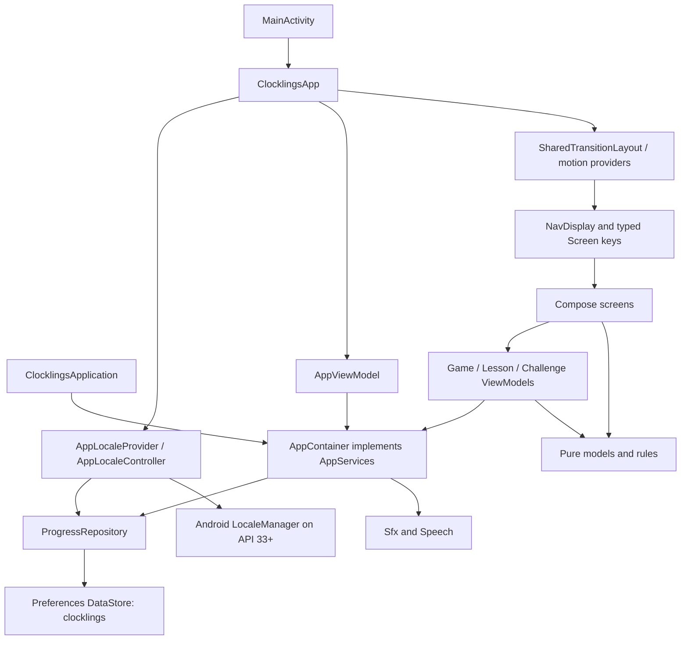
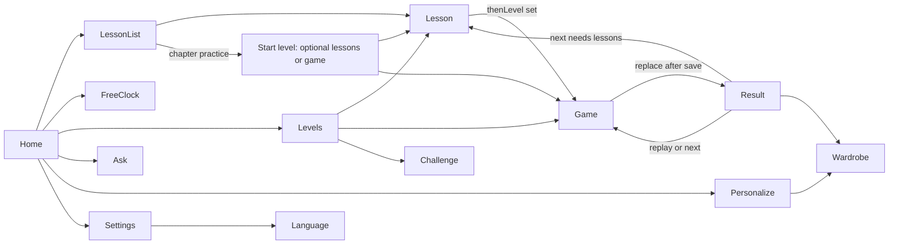

# Clocklings — Technical Reference and Development Handoff

**Repository snapshot:** 5 November 2026 (Europe/Helsinki), branch `codex/localization-settings`, inspected HEAD `2435cc6b6ac1ceacc45dd4bc0d8679c54399ff81` (`2435cc6`). Application, test and configuration files had no tracked local modifications at the start of this update. This documentation task changes only root `PROJECT.md`; the pre-existing untracked `.codex-remote-attachments/` directory is outside its scope. The commit identifies the inspected source, not a newly verified build or remote branch state.

**Purpose:** A repository-specific guide to the complete application: product behavior, screens, architecture, data, rendering, localization, platform boundaries, tests, build tooling, review priorities, and unresolved decisions. It is an orientation reference, not a replacement for inspecting code or an authorization to implement proposals.

**Authority:** Owner instructions and [AGENTS.md](AGENTS.md) govern scope and working rules. Current source governs implemented behavior. [STATUS.md](docs/implementation/STATUS.md) records decisions and dated validation reports; [TESTING_HISTORY.md](TESTING_HISTORY.md) consolidates historical campaigns and their limits through its stated cutoff. Neither is a fresh pass for the current working tree. The [product plan](docs/superpowers/plans/2026-10-20-public-clock-learning-app.md) distinguishes approved requirements from proposals; detailed specifications do not automatically approve features.

**Important scope update:** The owner expanded the release languages on 4 November to **English, Finnish, shared Swedish, German, French, Spain Spanish and Brazilian Portuguese**. The older three-language restriction in the product plan and baseline instructions is superseded by that decision, as recorded in STATUS and implemented in source. The later [seven-language audit](docs/localization/2026-11-04-language-audit.md), including its emulator continuation, contains evidence not consolidated into TESTING_HISTORY or the earlier STATUS entries. Native-speaker review is unverified; it is not a newly imposed release dependency.

### Using this reference for review, tests and UI work

| Question | Start here | Evidence to request or inspect |
| --- | --- | --- |
| What does the app do, and what must a change preserve? | B feature inventory, D screens, E journeys, G stored data | Current implementation and owner decisions; distinguish an implemented behavior from an approved future requirement |
| Is a reviewer finding valid? | R review map, then the owning source and callers | Concrete trigger, affected state/lifecycle, existing guard and relevant test; a possible risk is not a reproduced defect |
| Which tests should cover a change? | N test map and validation boundaries, O commands | Smallest relevant suite and realistic failure path; source test counts, executed tests and passing tests are different facts |
| How should a UI change fit the app? | D design system, M accessibility, S source links | Existing tokens/components, normal layout plus 320 dp, 200% font and their combination, affected languages and states; distinguish Robolectric from device evidence |
| Is it ready to publish? | J privacy, O release configuration, T unresolved work | Exact artifact/commit and current release evidence; historical debug checks or a test-signed profiling APK are insufficient |

When using this file as context for a question, include the relevant code/diff and the current commit if available. Ask for findings tied to actual source and tests, with uncertainty stated explicitly. This file is not a substitute for the code, a full test report or screenshot evidence.

## Contents

- [A. Identity, scope, and evidence](#a-identity-scope-and-evidence)
- [B. Complete feature inventory](#b-complete-feature-inventory)
- [C. Architecture and initialization](#c-architecture-and-initialization)
- [D. UI and UX reference](#d-ui-and-ux-reference)
- [E. Navigation and user journeys](#e-navigation-and-user-journeys)
- [F. State, concurrency, and lifecycle](#f-state-concurrency-and-lifecycle)
- [G. Models, storage, and recovery](#g-models-storage-and-recovery)
- [H. Platform integrations and audio](#h-platform-integrations-and-audio)
- [I. Monetization and entitlements](#i-monetization-and-entitlements)
- [J. Permissions, security, and privacy](#j-permissions-security-and-privacy)
- [K. Stack and dependency configuration](#k-stack-and-dependency-configuration)
- [L. Localization and teaching language](#l-localization-and-teaching-language)
- [M. Accessibility and device compatibility](#m-accessibility-and-device-compatibility)
- [N. Tests and validation evidence](#n-tests-and-validation-evidence)
- [O. Development, CI, and release procedures](#o-development-ci-and-release-procedures)
- [P. Error and edge-case reference](#p-error-and-edge-case-reference)
- [Q. Known limitations and documentation discrepancies](#q-known-limitations-and-documentation-discrepancies)
- [R. Critical code review map](#r-critical-code-review-map)
- [S. Navigable source reference](#s-navigable-source-reference)
- [T. Current development state and unresolved questions](#t-current-development-state-and-unresolved-questions)
- [U. Instructions for future assistants](#u-instructions-for-future-assistants)

## A. Identity, scope, and evidence

### Application identity

| Property | Implemented or documented value | Evidence |
| --- | --- | --- |
| Launcher/app name | Clocklings | `app/src/main/res/values/strings.xml`, manifest |
| Intended Google Play title | Clocklings: Learn to Tell Time | Owner requirements and product plan; not a verified live listing |
| Namespace/application ID | `fi.clocklings` | `app/build.gradle.kts` |
| Version | `versionCode = 1`, `versionName = "1.0"` | `app/build.gradle.kts` |
| Platform | Android, minimum API 26; compile and target API 37 | `app/build.gradle.kts` |
| UI | Kotlin, Jetpack Compose, one activity, portrait declaration, light theme | `MainActivity`, manifest, `ClocklingsTheme` |
| Languages | English, Finnish, shared Swedish, German, French, Spain Spanish (`es-ES`), Brazilian Portuguese (`pt-BR`); device-language option | `AppLanguage`, locale resources/configuration |
| Runtime data | One local progress/settings store; no accounts or separate learner profiles | `ProgressRepository` |
| Release status | Development implementation with historical debug checks and scoped test-signed R8 profiling; publication and production-signed release readiness not established | `STATUS.md`, `TESTING_HISTORY.md` and the scoped evidence described in N; no Play Console evidence inspected |

Clocklings teaches analog time through short demonstrations, multiple-choice reading questions, hand-setting exercises, free clock manipulation, and shared play. Best practice results earn up to fifteen stars that unlock companion clothing. Users can choose nine companions or no companion, change clock artwork, set a companion name, choose 12/24-hour display, and use optional local speech and sound effects.

The intended audience is children learning to tell time, with optional adult/shared participation. The plan's approximate age range is a proposal, not a confirmed Play age declaration. There is no implemented age collection, parental identity, school curriculum mapping, or Teacher Approved flow.

### Evidence categories and investigation limits

- **Implemented:** Derived from inspected production code/configuration. A static trace establishes control flow, not that every device renders or behaves correctly.
- **Historical validation:** Explicitly attributed to dated entries in `STATUS.md` or language-review documentation. Those checks were not rerun merely to create this document.
- **Potential concern:** A concrete code boundary requiring further investigation; not a reproduced defect unless explicitly stated.
- **Planned/unresolved:** Supported by planning/decision documents but not present in the implementation.
- **Unavailable:** Cannot be established from this repository investigation, such as current Play Console configuration or actual speech quality on a physical device.

This update compared production/test changes from the previous reference's stated base `51415f1` through `2435cc6`, inspected the current owning code for changed behavior, rechecked architecture/domain/configuration boundaries and recalculated source/test/resource inventories. The previous reference already described some changes that were then uncommitted; the diff is not a list of entirely new features. Unchanged screen and artwork descriptions are retained as source-oriented reference, not a fresh line-by-line security audit or pixel-by-pixel UI review. Historical claims below are attributed to the inspected decision/testing documents. Their original logs, traces, APKs, screenshots and remote results were not independently revalidated. Private machine configuration, signing material, external dashboards and the original application's workspace were not inspected.

The production tree contains **115 Kotlin files**. JVM tests contain **70 Kotlin files**, of which 65 declare **379 `@Test` methods**; instrumentation contains **27 Kotlin files**, of which 23 declare **131 `@Test` methods**. File totals include helpers; method totals include conditional/opt-in tests and are not passing-test counts. These counts use `app/src/main`, `app/src/test` and `app/src/androidTest`, excluding build output/report snapshots. There are nine companion catalogs with 146 clothing/accessory items, 18 packaged OGG clips, six font weights and seven UI languages. Six Maestro YAML journeys also exist outside the Kotlin source sets. Detailed inventories and evidence boundaries follow below.

Validation for this documentation update is limited to source/inventory checks, local secret scans, resource parity and document link/diff checks; actual results are recorded in N. No Gradle build, JVM test suite, instrumentation suite, Maestro journey, emulator session, vulnerability audit, Sonar source upload or release validation is implied by this reference. No application implementation is changed by this task.

## B. Complete feature inventory

Every implemented feature below uses local state/storage and requires no app-requested dangerous permission. Speech additionally depends on a suitable installed Android TTS voice; its availability is optional. Tests listed are existing coverage, not results from this documentation task. Test paths are mapped in [N](#n-tests-and-validation-evidence).

| Feature and access | Processing and persistence | States, restrictions, recovery | Main implementation and tests |
| --- | --- | --- | --- |
| Launch introduction | Branded vector clock mascot, staggered title, localized greeting and optional recorded INTRO cue; session-level saveable completion | Tap/accessibility skip; underlying UI semantics/focus blocked; reduced motion shows a still image without the cue; not persistent first-install onboarding | `IntroScreen.kt`, `IntroTimeline.kt`, `LogoMascot.kt`; `IntroTimelineTest`, `IntroOverlayTest` |
| Home | Real local time read on entry and every ten seconds while lifecycle is STARTED or above; immediate refresh on returning to STARTED; localized time, companion stage and total stars | Flexible stage between header/menu; compact scroll fallback; `NONE` removes the character while customization remains reachable; waits for initial settings/progress | `HomeScreen.kt`; `HomeTimeTest`, `AppFlowTest`, `PersonalizationFlowTest` |
| Lesson library | Nine authored lessons, pages, demos and quizzes; winding chapter path with five direct practice entries; completion IDs persisted | Day lesson hidden in 12-hour mode; quiz mistakes disable choices; successful persistence unlocks next action, failed save permits answering again | `LessonScreens.kt`, `LessonCatalog.kt`, `LessonViewModel`; lesson/domain/localization tests |
| Automatic pre-level lessons | `introPlan` selects incomplete lessons for a level and optional day lesson | Intro-shown markers saved when starting the route, before completing the lessons; top-bar skip enters game | `Lessons.kt`, `AppViewModel.startLevel`, `Navigator`; `LessonsTest`, `GameViewModelTest` |
| Explore/free clock | Drag hands in five-minute steps, randomize, read words/digits, listen, toggle guides | No scoring; saveable time; 24-hour conversion retains an afternoon representation when enabled | `FreeClockScreen`, `ClockFace`; `AppFlowTest`, `ClockSurfaceStateTest`, `LanguageSettingsTest` |
| Practice level selection | Five path nodes from whole hours to exact minutes; best stars, current marker and lesson shortcuts | All levels immediately available; no sequential lock or mastery gate | `LevelsScreen`, `Levels`; `LevelsTest`, `AppFlowTest` |
| Practice round | Ten distinct tasks alternating READ/SET; two-stage error feedback; best-of-level star update | First wrong answer gives hint; second reveals answer; correct answer advances after delay; final-save failure offers Retry without discarding the round; active round not durably saved | `GameScreen`, `GameViewModel`; `GameViewModelTest`, `ActiveLocaleStateTest` |
| Result/rewards | Three-star display, preserved best, newly unlocked items, companion celebration, replay/next/dress | One to three stars per completed round; aggregate best max 15; previewing new clothes does not equip them | `ResultScreen`, `Progress`, `Wardrobe`; `VisibleUnlocksTest`, `AppFlowTest`, `ComposeStabilityRegressionTest` |
| One-minute challenge | Sixty-second read-only multiple-choice round; best score persisted | Levels 0–3 only; reserved answer-panel height; END save error and Retry; no stars or item unlocks; no persisted active countdown | `ChallengeScreen`, `ChallengeViewModel`; `ChallengeViewModelTest`, `ChallengeScreenTest`, `ActiveLocaleStateTest` |
| Play together | Setter chooses time, hands over hidden-answer question, reveals answer, swaps player number | No recorded answer, score, player name, or correctness judging; time/phase/player are saveable | `AskScreen`; `AppFlowTest`, `LanguageSettingsTest`, `ClockSurfaceStateTest` |
| Companion choice | Doll (stored as HUMAN), cat, dog, robot, dragon, dinosaur, bunny, unicorn, car, none; choice persisted | All choices free; previous names/outfits are retained per species | `AppearanceScreen`, `Personalization`; `PersonalizationFlowTest` |
| Companion color | Four color options per non-human kind; dragon replaces purple with orange; dinosaur replaces green with orange; settings persisted per kind | Human uses its own artwork/clothing colors; `NONE` has no wardrobe | `WardrobeScreen`, `PersonalizationPreferences`; `PersonalizationTest` |
| Clothing and names | 146 items across nine catalogs; star thresholds; per-kind outfit/name persisted | Required human slots cannot be removed; optional slots toggle; name input capped at 16 UTF-16 units without splitting a surrogate pair, then trimmed for saving | `WardrobeScreen`, `NameField`, `Wardrobe`, `CompanionItems`; `WardrobeTest`, `CompanionItemsTest`, `NameFieldEdgeCaseTest`, `PersonalizationStorageTest` |
| Clock styles | Seven named styles plus custom; custom has 48 combinations; persisted settings | All styles share clock geometry, red hour hand, blue minute hand; no unlock cost | `AppearanceScreen`, `ClockThemeArt`, `ClockAppearance`; `PersonalizationFlowTest`, galleries |
| Settings | Language entry, 12/24-hour choice, guides, effects switch, speech status, reset | Pending writes disable affected controls; IOException shown; persisted state drives UI | `SettingsScreen`, `AppViewModel`; `AppSettingsTest`, `SettingsErrorTest` |
| Language choice | Device/default plus seven languages; platform storage on API 33+, DataStore on older Android | Loading/error/retry at initial migration; a known platform choice stays usable during legacy-cleanup failure; failed selection remains retryable; locale changes stop speech | `LanguageScreen`, `AppLocaleController`; controller, locale and active-state tests |
| Reset progress | Confirmation clears progress, names, clothing, best challenge and lesson markers | Preserves display/audio/help/language/appearance settings; no undo/import recovery; IO failure retains dialog/error | `ResetProgressDialog`, `AppViewModel.resetProgress`, repository; `AppSettingsTest`, `LanguageSettingsTest` |
| Optional read-aloud | Local offline-eligible voice reads localized clock/lesson text; engine calls run serially on a background dispatcher | Hidden when unavailable; stale queued requests invalidated by stop/language/refresh/shutdown; stopping an already running engine call is asynchronous | `Speech`, `Texts.kt`; JVM `SpeechTest`, Android `OfflineVoiceTest` |
| Sound effects | Generated POP PCM and 18 recorded intro/feedback/reward/voice clips; resource loading dispatched to IO; foreground and sound-setting gates | Each clip becomes usable once registered and decoded; unloaded cues stay silent without delayed replay; force bypasses the setting but not pause | `AppContainer`, `Sfx`, `Sound`, `ToneSynth`; `AppAudioLifecycleTest`, `SfxTest`, `SoundTest`, `ToneSynthTest` |

Not implemented: account management, authentication, multiple learner profiles, billing, ads, cloud sync, analytics, crash reporting SDK, user-visible history/log, import/export, backup UI, notifications, widgets, everyday timers/routines, achievements beyond current star/clothing progression, or a parent PIN/gate. Absence is based on source/configuration inventory, not on a claim about transitive library internals.

## C. Architecture and initialization

### Modules and layers

[`settings.gradle.kts`](settings.gradle.kts) includes only `:app`. There are no separate feature, domain, data, or shared Android modules. Package separation supplies the boundaries:

| Directory | Responsibility |
| --- | --- |
| `app/src/main/java/fi/clocklings/` | Activity/application, app composition, typed routes, navigator |
| `domain/` beneath that root | Clock mathematics, language rules, task generation, lesson models, progress and wardrobe rules |
| `data/` | Preferences DataStore serialization and compatibility fallbacks |
| `audio/` | Android speech adapter, generated PCM effects, recorded clip playback |
| `ui/` | App state owner, text adapters, screens and screen ViewModels, locale bridge, shared controls, Canvas art and theme |
| `app/src/main/res/` | Seven-language UI resources, fonts, 18 OGG clips, launcher/splash/theme XML, backup and locale declarations |
| `app/src/test/` | JVM domain/repository/ViewModel/math tests, Robolectric Compose/rendering/audio tests (default API 37, some API 33 overrides) and fakes |
| `app/src/androidTest/` | Compose UI, real activity/storage/locale and Android audio-adapter tests |
| `config/`, `tools/`, `.github/`, `.deepsec/` | Development checks and automation, not runtime features |
| `docs/` | Decisions, historical evidence, language review and proposals |

The implementation is a pragmatic Compose/ViewModel/repository design with manual service construction. It has unidirectional state updates in its ViewModel-backed screens, but does not impose a single reducer or a use-case/interactor layer everywhere. Small screens use local Compose state. There is no Hilt/Koin, Room, Retrofit, Firebase, LiveData, or XML-layout screen architecture in the inspected source.



### Initialization trace

1. [`ClocklingsApplication`](app/src/main/java/fi/clocklings/ClocklingsApplication.kt) lazily creates `AppContainer`, using application context and the `Context.preferencesDataStore` delegate named `clocklings`. The protected `preferencesStore()` factory is overridden by `TestClocklingsApplication` for host-side UI tests; production still uses real DataStore.
2. `AppContainer` owns the repository, sound synthesizer/player, speech adapter, and an application-lifetime `SupervisorJob + Dispatchers.Default` scope. It observes sound settings eagerly. `AppServices` is the narrow interface used by ViewModels and test fakes.
3. [`MainActivity.onCreate`](app/src/main/java/fi/clocklings/MainActivity.kt) enables edge-to-edge with transparent light system bars and disables navigation-bar contrast enforcement on API 29+, and calls `setContent { ClocklingsApp(...) }`.
4. [`ClocklingsApp`](app/src/main/java/fi/clocklings/ClocklingsApp.kt) obtains `AppViewModel`, wraps composition in locale and theme providers, and collects settings/progress using `collectAsStateWithLifecycle`. Initial null model values prevent rendering feature content before data is ready.
5. The root provides app state, personalization/current outfit and confetti hosts, creates a saveable Navigation 3 back stack starting at Home, and supplies saveable-state and ViewModel-store entry decorators. `SharedTransitionLayout` surrounds navigation and provides the shared-motion scope. A session introduction overlays the content until complete/skipped.
6. Language effects update speech. Resume refreshes voice availability; changes of top destination stop existing speech. `MainActivity.onResume` opens `AppContainer`'s playback gate. `onPause` closes it before stopping sound and speech. Both new effects and speech requests are ignored while paused; `force` bypasses only the effects setting, not this foreground gate.

The application scope and audio engines are deliberately longer-lived than a destination. A screen ViewModel belongs to its navigation entry. The locale bridge supplies localized resources without replacing the activity's ViewModel/lifecycle owners. These ownership distinctions matter for recreation, navigation, and cleanup.

## D. UI and UX reference

### Screen inventory and composition

All feature screens are Compose functions; there are no XML activity/fragment layouts. The main shared layout is `ScreenScaffold` in [`Layout.kt`](app/src/main/java/fi/clocklings/ui/components/Layout.kt): a safe-inset layout with a pinned top bar, scrollable content and optional pinned bottom bar. The top scroll fade is 28 dp (first 45% opaque); the bottom fade is 16 dp. `ClockFit.NONE`, `FIT` and `KEEP` control whether clocks use normal sizing, shrink to leave room for other content, or retain their previous size. Bottom safe insets are applied by the content or bottom bar as appropriate. Home has its own height-allocation layout. There is no bottom navigation or drawer. Appearance has two local tabs, not independent navigation destinations.

| Route / composable | Visible hierarchy and actions | State owner |
| --- | --- | --- |
| `Screen.Home` / `HomeScreen` | Colored wordmark, total stars and Settings; current clock/words and optional named companion on a sky/ground stage; four Learn, Explore, Practice, Together cards; stage opens customization | Root progress/settings; local current-time loop |
| `Screen.LessonList` / `LessonListScreen` | Back/title; winding lesson/practice path with completion/current markers; day lesson conditional on 24-hour setting | Root progress/settings and localized catalog |
| `Screen.Lesson` / `LessonScreen` | Back or skip; page progress dots; demonstration clock; explanatory panel and changing caption; replay/listen; previous/next or quiz options/feedback | `LessonViewModel` per entry |
| `Screen.Levels` / `LevelsScreen` | Back/title; five path nodes with sample clock, description, best stars and relevant lesson shortcuts; challenge entry | Root progress/settings |
| `Screen.Game` / `GameScreen` | Back/help; ten outcome dots; clock; READ options or SET instruction and Done; companion hint/praise/reveal/Next or save Retry | `GameViewModel` per entry; remembered clock state |
| `Screen.Result` / `ResultScreen` | Result heading; animated three stars; companion; score/best explanation; newly unlocked item previews; replay/next/dress/levels actions | Route snapshot plus current personalization; local celebration state |
| `Screen.FreeClock` / `FreeClockScreen` | Back/help; interactive clock; words and numeric time; companion hand legend (text fallback for NONE); round Listen when possible; pinned random-time button | Saveable time and mode transition state |
| `Screen.Challenge` / `ChallengeScreen` | START score/best/instructions and pinned Start; RUN timer, fitted clock and reserved choices; END headline/score/best, save error and pinned Back + Play again/Retry | `ChallengeViewModel` per entry |
| `Screen.Ask` / `AskScreen` | Player instruction; SET editable clock/random; ASK hidden answer; REVEALED words/digits/listen; pinned phase action; revealed answer scrolls into view before swap resets scroll | Saveable phase, setter number and time |
| `Screen.Personalize` / `AppearanceScreen` | Companion/clock tabs; companion pager or clock grid/zoomed custom-clock preview; wardrobe link; pinned save-error Retry | Root settings; saveable selected tab; local RetryableSave |
| `Screen.Wardrobe` / `WardrobeScreen` | Companion/name field; stars; non-human color choices; slot headings; uniform clothing grid with isolated previews, selection/lock/threshold state; pinned save-error Retry | Root progress/settings; saveable name draft; independent name/color/per-slot retry owners |
| `Screen.Settings` / `SettingsScreen` | Language panel; 12/24-hour radio group/example; guides/effects switches; speech status; reset panel and error text | `AppViewModel.settingsAction`, root settings, locale controller |
| `Screen.Language` / `LanguageScreen` | Device-language option plus seven named language radio rows; pending/failed selection | `AppLocaleController.selection` |

The intro is an overlay, not a route. Reset is a Material 3 `AlertDialog`, not a screen. No implemented bottom sheets, overflow menus, login forms, purchase dialogs, or permission dialogs were found.

### Launch identity and introduction

The adaptive launcher foreground is the branded clock character: six-color rim, white face/limbs, purple eyes and pink smile. `ic_launcher_monochrome.xml` supplies its themed-icon silhouette. API 31+ window styling uses `ic_splash_animated.xml`, the dark purple icon background and a declared 900 ms animation duration. The base pre-31 theme supplies a light window background without a custom splash drawable declaration. These Android resources precede the Compose introduction and have their own platform lifecycle.

[`LogoMascot.kt`](app/src/main/java/fi/clocklings/ui/intro/LogoMascot.kt) reads the actual launcher vector, extracts its nested body group, and animates named `right_hand`/`eyes` groups with the shared companion pose mathematics. This is a branding mascot, not a tenth selectable companion. Changing the vector hierarchy or group names can break the Compose animation even if the standalone launcher drawable still renders. The Compose crop intentionally differs from launcher padding.

`IntroOverlay` shows the mascot, a measured-to-fit staggered Clocklings title and a greeting based on remembered local time/current teaching language. Mascot size is limited by available width and 45% of available height. The timeline fades in the mascot, performs its greeting motion, reveals the title from 1,350 ms and greeting from 1,900 ms, then fades content/background from 2,700 ms to completion at 3,150 ms. The legacy callback name `onTick` now requests `Sound.INTRO` (`clocklings.ogg`), not a synthesized tick. It runs once after the mascot's entry/jump in the normal timeline. Reduced motion shows a still pose for 1,200 ms without that callback. Tap or the accessible skip action ends the overlay; `introDone` is session-saveable, not a persisted first-install preference. An unloaded intro clip is skipped and never replayed just because loading later completes.

### Lesson content and interaction

[`LessonCatalog.kt`](app/src/main/java/fi/clocklings/ui/lesson/LessonCatalog.kt) creates localized lesson content over the pure models in [`Lessons.kt`](app/src/main/java/fi/clocklings/domain/Lessons.kt). Persistent IDs remain Finnish identifiers for compatibility; user-visible titles are resources.

| ID | Topic | Explanation pages | Quiz clock time | Automatic level association |
| --- | --- | ---: | ---: | --- |
| `viisarit` | Hour and minute hands | 3 | 04:00 (identify short red hand) | 0 |
| `kierros` | Full revolution and hour progression | 3 | 03:00 (one-hour concept) | 0 |
| `tasan` | Whole hours | 3 | 09:00 | 0 |
| `puoli` | Half hours and language-specific reference | 4 | 05:30 | 1 |
| `vartti` | Quarter hours | 3 | 06:45 | 2 |
| `ylivaille` | Past/to reasoning | 3 | 04:10 | 2 |
| `viisi` | Five-minute increments | 3 | 08:40 | 3 |
| `minuutit` | Individual minutes | 2 | 03:07 | 4 |
| `vrk` | Day and 24-hour context | 3 | 19:00 | Added when 24-hour mode requires it |

There are 27 explanation pages plus nine quizzes. The demo DSL supports waits, clock moves, highlights, under/over overlays and captions. `DemoStep.Say` updates the caption; it is not automatic TTS. Listen reads lesson text and current caption when available. Replay cancels/restarts the demo and stops speech.

Quiz choices are shuffled; the authored first correct choice is tracked separately from visual order. Wrong answers are disabled and produce a hint. Correct answers produce praise/confetti and start saving completion. While `savePending`, previous/next navigation is disabled. Success permits continuing; `IOException` restores the pre-answer choice state and clears `quizDone`, so answering again retries the save. Save-error copy yields to a later wrong-answer hint. Previous-page navigation otherwise resets page/quiz state. A language change reconstructs localized content and restarts an active explanation demo; an active quiz retains choice ordering and wrong-answer state.

The half-hour demonstration points to the next hour in Finnish, Swedish and German, and to the current hour in English, French, Spanish and Brazilian Portuguese. This is teaching behavior, not just translated labels. German past/to lesson copy distinguishes counting from the full hour from expressions relative to half past, such as `fünf nach halb vier` at 03:35. Spanish and Portuguese 24-hour lesson copy restricts adding twelve to hours 1–11 between noon and midnight. The five-minute counting demo reaches each numbered position before showing its matching caption. Follow the catalog and formatter together when changing content.

### Practice and result behavior

[`Levels.kt`](app/src/main/java/fi/clocklings/domain/Levels.kt) defines five levels with minute steps 60, 30, 15, 5 and 1. A round targets ten distinct times with alternating READ and SET tasks. Task generation weights newly introduced minute positions: half-hour, quarter-hour, non-quarter five-minute, then non-five-minute values. Reading questions target three distinct choices. Confusions include nearby hours, past/to mirrors and swapped-hand interpretations; 24-hour choices may include the other half of the day. `makeTasks` stops after 500 draw attempts and returns the collected list without a fill-to-ten fallback; `optionsFor` limits its random fallback to 300 attempts. Other random helpers use rejection sequences without these guards. The normal ten-task/three-choice contract is tested, but should not be described as a hard guarantee for every injected Random implementation.

`GameViewModel` handles answer state centrally. A first READ error disables that choice and gives a hint; a second reveals the correct answer and exposes Next. SET compares hands modulo twelve hours, so 03:30 and 15:30 are equivalent hand positions. A first error identifies the problematic hand; a second moves the clock to the answer over 1,400 ms and permits Next. Correct answers play OK, choose praise, trigger celebration and advance after 1,500 ms. Repeated disabled/busy input is ignored.

While SET is interactive, `onClockChange` stores the answer both in the ViewModel's comparison value and in `GameUiState.clock` with zero movement duration, preserving the command ID. The screen remembers the command by ID so each drag update does not restart the live clock animation; a recreated composition initializes from the latest retained answer. Callbacks after interaction is disabled are ignored. This is an activity-recreation mechanism, not durable process-death recovery.

Completed-task `DotOutcome` values distinguish FIRST_TRY (green check), WITH_HINT (amber check) and SHOWN (grey ring). The current successful answer is previewed before advancement; the stored outcome is appended once when advancing, so final-save retry does not add another dot. Moving to the next task clears its confetti.

A completed round earns three stars for at most one mistake, two for at most three, otherwise one. Only each level's best result counts toward the total, capped at fifteen. Completion reads prior progress, writes a best-preserving update, then emits result navigation. An `IOException` retains the completed round and exposes `SaveFailed`/Retry; result navigation waits for a successful retry. The result route carries the level, earned stars, previous best and total stars before completion. `ResultScreen` derives the after-total and newly unlocked items from that snapshot. Newly shown clothing appears in a temporary companion celebration; it is not automatically equipped.

There is no persisted question history, response-time history, adaptive mastery model or level locking. See [P](#p-error-and-edge-case-reference) for completion-write failure behavior.

### Challenge and shared play

The challenge uses `START`, `RUN`, `END` state, a monotonic `System.nanoTime` deadline and a sixty-second timer job. It generates READ tasks from levels 0–3, avoiding an immediately repeated time. A correct answer increments score and advances after 380 ms; a wrong answer reveals the answer and advances after 1,300 ms. A busy guard prevents duplicate answers. Ending cancels pending advancement and saves a better best score before presenting END. `savePending` blocks overlapping starts/retries. An `IOException` still reaches END with the completed score, old best and visible retry; the primary action retries persistence before a new run. A successfully stored positive record plays RECORD; other completions use WIN. It has no star/clothing rewards.

`pick` also rejects answers at or after the monotonic deadline even if the timer coroutine has not yet dispatched. The initial best-score read uses `maxOf` so a delayed emission cannot lower an already displayed best. When a result appears to beat the in-memory best, completion re-evaluates the record against the latest progress inside `updateProgress`; an older initial snapshot must not announce a lower score as a record. The initial read remains a one-shot `first()`, not a continuous subscription to later best-score changes. These distinctions are covered by focused deadline-ordering and delayed-read tests.

START shows a dimmed clock (alpha 0.45) and pinned Start. RUN uses `ClockFit.FIT` with a 160 dp minimum clock and no bottom bar. `AnswerRoom.kt` estimates all 144/288 five-minute time labels (12/24-hour mode), ranks candidates by text height, measures six candidates as actual answer rows, and reserves the tallest three rows. Warm-up is spread over roughly 4 ms frame chunks during START; early start/restored RUN has a synchronous fallback. Process-local caches key language, mode, density/font scale, font-weight adjustment and width; no eviction is implemented. These are layout strategies, not measured frame-rate guarantees. END uses `ClockFit.KEEP`, puts its headline before the score and pins Back + Play again/Retry. The primary action is rightmost or bottom when stacked. Confetti uses a clipped score anchor or the visible bottom bar, once per run.

The timer exposes a localized `challenge_time_remaining` content description and `ProgressBarRangeInfo(fraction, 0f..1f)`. The fraction uses the fixed sixty-second duration, so a deadline thirty seconds away yields at most 0.5; it is not renormalized to the time remaining when the composable is first created. `clearAndSetSemantics` replaces child semantics with this progress information; it no longer makes the timer decorative. This is a semantic progress value, not a tested spoken seconds countdown. Finnish, Swedish and Spanish result strings use count-neutral labels so a score of one does not produce a plural-only sentence.

Together uses `SET`, `ASK`, `REVEALED`, starting at 03:00 or 15:00 through `ClockTime.start`, like Explore. The setter selects a five-minute time; the question phase removes time-answer semantics and Listen. Revealing restores words/digits/speech and celebrates. The next action swaps setter 1/2 and returns to setting, retaining the current time. A pinned bottom action advances each phase. Reveal brings the readout clear of the bottom fade; swapping players stops speech and resets scrolling. The app does not hear, grade or store a player's spoken response.

### Personalization and artwork

[`Personalization.kt`](app/src/main/java/fi/clocklings/domain/Personalization.kt) defines `CompanionKind`, `CompanionColor`, `ClockTheme`, `CustomClock` and `Personalization`. Defaults are human companion and rainbow clock. Named themes are Classic, Rainbow, Space, Forest, Ocean, Garden and Workshop, plus Custom. Custom combines four palettes, three frames, two numeral styles and two hand styles (48 combinations); geometry remains unchanged.

Human clothing has 18 items: three free required defaults and fifteen star unlocks. Each of eight non-human catalogs has 16 items: one free item and fifteen unlocks. Across all nine catalogs this is **146 items: 11 free and 135 star unlocks**. Non-human companions start without optional clothing. Human required slots are HAIR, DRESS and SHOES; HEAD/EXTRA are optional. Non-human slots are HEAD/NECK/EXTRA except the car, which uses optional ROOF/FRONT/WHEELS/MODEL. Car models race, fire-engine and rocket unlock at 5, 10 and 15 stars and combine with other slots; they are outfit selections, not automatic growth stages. Clothing is selected by stable item ID, not by resource name or translated title. Stars are thresholds, never spent. The registry and defaults live in [`Wardrobe.kt`](app/src/main/java/fi/clocklings/domain/Wardrobe.kt) and [`CompanionItems.kt`](app/src/main/java/fi/clocklings/domain/CompanionItems.kt).

| Companion / stored kind | Items | Free item IDs | Slot contract |
| --- | ---: | --- | --- |
| Doll / HUMAN | 18 | `hair-letit`, `dress-perus`, `shoes-tossut` | HAIR/DRESS/SHOES required, HEAD/EXTRA optional |
| Cat / CAT | 16 | `cat-neck-scarf` | HEAD/NECK/EXTRA optional |
| Dog / DOG | 16 | `dog-neck-bandana` | HEAD/NECK/EXTRA optional |
| Robot / ROBOT | 16 | `robot-head-antenna` | HEAD/NECK/EXTRA optional |
| Dragon / DRAGON | 16 | `dragon-neck-pendant` | HEAD/NECK/EXTRA optional |
| Dinosaur / DINOSAUR | 16 | `dinosaur-extra-backpack` | HEAD/NECK/EXTRA optional |
| Bunny / BUNNY | 16 | `bunny-neck-ribbon` | HEAD/NECK/EXTRA optional |
| Unicorn / UNICORN | 16 | `unicorn-neck-lei` | HEAD/NECK/EXTRA optional |
| Car / CAR | 16 | `car-front-plate` | ROOF/FRONT/WHEELS/MODEL optional |
| No companion / NONE | 0 | None | No wardrobe |

The wardrobe computes one uniform column count (3/2/1) using all labels, with item text fitting from 14 to 10 sp in 0.5 sp steps. Locked items use grey art at 0.55 alpha, retain the star threshold and have no click action. Selection has a corner marker; the optional-removal hint appears once, with a separate doll wording. Clicking an equipped optional item removes it; required human items remain equipped. Names are entered with `BasicTextField`, word capitalization and an IME Done action. `NameField` caps input at sixteen UTF-16 code units; if that boundary would split a high/low surrogate pair, it cuts at fifteen instead. Saving trims whitespace; there is no separate Save button. The name draft is saveable and is retained after a failed save within its current composition. Name, color and each clothing slot have independent retry owners, so a successful unrelated action cannot erase a failed change. Surrogate-safe truncation is not a grapheme-aware policy: combining marks and multi-code-point emoji remain separate considerations, and the repository imposes no name-length limit. See N for the narrower guarantees of real recreation characterization.

Art is generated in Compose Canvas, not downloaded, stored as 3D models or played as video. `CompanionView` fits a species rig into the requested canvas or item crop. Human art uses a 200×340 design grid; the shared non-human frame (including the car) uses 240×300. `CompanionRig`, `ItemArt`, `ArtPart` and `ItemLayer` attach clothing to animated body/head/wing/hand/antenna transforms. Layering supports behind/front/over-ear/screen art, including ear clipping. Full-character views and cropped wardrobe previews deliberately have different clipping needs. The 76 dp `ItemArtWindow` uses `previewFor` to strip other optional items while preserving required doll clothing. Per-item `crop(item)` overrides and `grownTo` expansion prevent large hats/accessories from being clipped by a slot-only crop.

`CompanionPose`/`CompanionMotion` drive blink, breath, sway, head tilt and species motion. Celebration uses a spin then hop sequence, while reduced motion uses static/immediate state. Shared vinyl rendering uses elliptical unit-matrix gradients with five stops, core/bounce light, highlight/shade tones, shadows and cached brushes; animated pose reads happen in the draw phase. Source-derived appearance is pastel, rounded and shaded; no new visual screenshot review was performed for this document.

The visible human label is Doll / Nukke / Docka, while HUMAN and existing data keys remain stable. Bunny adds floppy-ear motion; unicorn adds horn/mane artwork; car uses a three-quarter body, layered wheel accessories and model backs behind the cabin, with sway/breath/rock motion. All nine kinds have registered art and voices; NONE has neither.

Color options are ORIGINAL/BLUE/GREEN/PURPLE except dragon (ORIGINAL/BLUE/GREEN/ORANGE) and dinosaur (ORIGINAL/BLUE/PURPLE/ORANGE). Unsupported persisted color choices normalize through `styleFor` to ORIGINAL; the codec also writes normalized styles. Robot blue has a distinct body pigment. `SwatchColorsTest` checks CIE76 color separation, not text contrast or color-vision accessibility.

Appearance keeps the companion `PagerState` and settled-page observer at screen scope, outside the companion/clock tab branch. After a failed choice, switching to clock styles and back retains the requested preview and retry. An older committed choice must not scroll the pager back over a newer request. Preview choice and committed personalization can intentionally differ while a save is pending or failed. The observer is synchronized to the committed choice on initialization, then observes new settled pages; it is not continuously driven by older storage emissions. `ScreenshotReviewUiTest` covers delayed writes and the tab-switch/retry path, including no extra selection write on retry.

### Home, learning paths and shared guidance

`rememberHomeTime` reads the local clock on initial composition and polls every 10,000 ms inside `repeatOnLifecycle(STARTED)`. Polling stops below STARTED and reads immediately when that state resumes; this is not an exact wall-clock-minute alarm. `HomeStage` remembers each `ClockCommand` by the displayed time. Passive mini clocks with zero-duration commands render that command's normalized time directly in their hands and semantics, avoiding an extra draw just to synchronize interaction state. Animated or interactive clocks retain the existing `ClockState` path. See N for the limited before/after profiling evidence.

`HomeStage` and `HomeStageMath` allocate the header and menu first, then give remaining height to the clock/companion stage, normally with a 200 dp minimum and stage content capped at 360 dp. Compact layouts use content-height scrolling; NONE centers the remaining group. Background sky/cloud/ground art is non-clickable; the stage content opens Appearance with `pressScale = 1`. The wordmark starts at 28 sp with a density-based 14 dp floor. The four menu cards use two columns only at content width at least 320 dp and font scale at most 1.3.

Learn groups the eight standard lessons into five chapters, each followed by a practice entry; the optional ninth day lesson is last without another practice node. There is no separate visible chapter heading: the first lesson carries chapter context. The first incomplete lesson is current; inserted practice nodes are never marked current; completed items remain accessible. Practice uses the first level below three stars as current. `PathNode` draws the winding pebbles, current pulse and completed checks with explicit state semantics. `CompanionTip` places the currently dressed companion beside guidance; NONE retains text guidance without an empty character slot.

### Shared design system

| Area | Implementation and behavior |
| --- | --- |
| Theme | `ui/theme/Theme.kt`: custom light Material 3 theme; no dark/dynamic-color branch |
| Color | `SkColors`: sky-to-blush section gradient (`#E4F1FF` to `#FFF0F6`) and green `#D7F2DC` Home ground; pale pink `#FFF5FA` base token remains, but the old dotted screen background is gone; dark purple `#3A2453` text, white surfaces, pink line, red `#E64980` hour hand, blue `#228BE6` minute hand; gold/positive/hint tokens |
| Typography | `Type.kt`: Fredoka medium/semibold/bold display and Nunito semibold/bold/extrabold body; `SkType` includes 17 sp body, 22 sp title, 28 sp clock words, 26 sp question, 19 sp lesson, 21 sp button, 34 sp result |
| Spacing | `SkDimens`: 16 dp gutter, 10 dp screen gap, 8/12/16/18 dp recurring gaps, panel/card padding, 2/3 dp borders |
| Shapes | `SkShapes`, `components/Shapes.kt`: rounded cards/buttons/options/item tiles, authored cloud/rainbow geometry |
| Controls | `Buttons.kt`: `SkButton`, chips/options and `DepthSurface` use spring-driven pressed offset/shadow and default 0.96 scale treatment; appearance is not a stock Material button/ripple skin |
| Panels/display | `Panels.kt`, `Display.kt`: content cards, clock words/digits, stars, progress dots, feedback; timer bar is local to `ChallengeScreen.kt` |
| Icons | `Icons.kt`: authored UI icons; launcher icons are separate resource XML |
| Feedback | Hint/praise panels, disabled/selected styling, wrong-answer shake, star pop, confetti and companion celebrations |

The main scaffold computes clock size from available width and a fraction of height. `TopBar` puts its title on a separate row below 320 dp content width or above 1.3 font scale. `SettingsSwitch` moves supporting text below the label/switch row at font scale above 1.3, giving long localized descriptions the full width. Home/appearance grids reduce columns for narrow or large-font layouts; wardrobe uses all-label fitting and color rows follow their own layout rules. `ActionPair` measures labels at half width and stacks when either cannot fit one line. Round buttons are normally 48 dp, with a 64 dp large variant; `FlatPanel` is informational. These thresholds use available content width, which is narrower than device width after insets/padding.

`WordSafeText` can shrink selected titles/tiles/pills to 68% of the nominal size in 0.5 sp steps. Lesson prose wraps. Answer words also use `WordSafeText` fitting and can wrap; the digital value moves below when needed. Wardrobe labels have their own 14–10 sp fit policy. Do not describe the app as universally preserving nominal text size at 200% font scale. Artwork numeral sizes are resolved in the fixed clock drawing grid and scaled with Canvas, not ordinary body-text layout.

### Input, transient states and motion

The clock's pointer input selects a hand by touch position, ignores the center dead zone, follows circular drag and snaps to the active minute step. Hour movement remains continuous with minute position. Accessibility custom actions nudge time without drag. The clock can hide its time description for unanswered questions. Help includes colored sectors, minute markers and 24-hour inner numbers. The renderer enables its explicit past/to guide labels only for English; do not infer that another formatter's past/to grammar automatically enables those labels.

`ClockSpec` uses a 400×400 design coordinate system centered at (200, 200). The full view extends from -34 over 468 units to leave room for outer minute labels; the mini view starts at 12 over 376 units. `ClockFace` layers the themed rim, face/help sectors, lesson underlays, ticks/numbers/day context, hands/pin and lesson overlays. Hands are 86 (hour) and 150 (minute) design units long; the numeral radius is 110. Numerals within 16 degrees of either hand are redrawn above it with a six-unit halo matched to the underlying sectors/help/glows. The redraw explicitly resets to Fill when not stroking to avoid cached text retaining halo paint. The day icon is at y=229, text baseline 260, and 24-hour inner numerals at radius 82. English day-part text changes its arc placement between 12/24-hour modes and fades near hands. Lesson highlight ticks are reinforced. Custom-clock zoom shows the upper rim, 11/12/1 and hand tips; miniature previews force round hands. The hour angle advances continuously at half a degree per minute; the minute angle advances six degrees per minute. Mini clocks omit the full help/day presentation. Theme changes replace rim/motif/numeral/hand styling without changing task mathematics or hand-angle correctness. This shared renderer is used by live Home clocks, lessons, tasks, previews and screenshots, so changes can affect all of them.

Dragging produces haptic ticks on distinct snapped steps; this is separate from the sound-effects switch. Settings radio/switch rows expose roles and whole-row interaction with a 48 dp minimum. Pending setting writes disable controls; read failures may show a locale retry screen before app content. Missing speech removes Listen and explains availability in Settings. No companion is an intentional selection, not an error/empty collection. Quiz and clothing disabled states prevent unsupported actions.

Reset confirmation is local `remember(language)` state. Activity recreation or language change dismisses it. Cancel/dismiss remains possible while a reset write is pending; dismissing the dialog does not cancel an already launched write. Success closes it after persistence; IOException shows error text and permits retry.

[`Motion.kt`](app/src/main/java/fi/clocklings/ui/Motion.kt) observes the system animator-duration scale with a live `ContentObserver`, unregistering on disposal, and centralizes reduced-motion information. Navigation normally combines 300 ms fades and quarter-width slides; predictive back also scales to 0.92. Reduced motion uses an 80 ms fade and disables shared transitions. Companion, clock and level-clock keys coordinate shared motion. The intro timeline is about 3.15 seconds normally and 1.2 seconds in reduced motion; tap skips it. Confetti is decorative, with bounded particle lifetime and clamped alpha; reduced motion omits particle/flight effects. The challenge timer remains a real-time progress display even with reduced motion. These behaviors do not establish full vestibular accessibility or spoken-feedback usability; see [M](#m-accessibility-and-device-compatibility).

## E. Navigation and user journeys

### Typed destination contract

[`Screen.kt`](app/src/main/java/fi/clocklings/Screen.kt) defines serializable `NavKey` implementations and an explicit `ScreenSavedState` polymorphic registration. The complete route payloads are:

| Destination | Payload |
| --- | --- |
| Home, Settings, Language, FreeClock, LessonList, Levels, Challenge, Ask, Wardrobe, Personalize | None |
| Lesson | `queue: List<String>`, `thenLevel: Int?` |
| Game | `level: Int`, `round: Long` |
| Result | `level: Int`, `stars: Int`, `previousBest: Int`, `starsBefore: Int` |

The round identifier is based on `System.nanoTime` to make a new game entry distinct. The lesson queue contains stable IDs; it is not serialized rendered prose. `HomeDestination.kt` still uses inherited enum names (`KOULU`, `VAPAA`, `PELAA`, `KYSY`, `NUKKE`, `SETTINGS`) to map home actions; those names are not visible translations.



### Stack operations and back behavior

[`Navigator.kt`](app/src/main/java/fi/clocklings/Navigator.kt) wraps the mutable back stack. `push` adds entries; `pop` retains the bottom Home; `replace` replaces the top while preserving a root; `popTo` returns to the last matching entry or reconstructs a route above Home. `startLevel` selects lessons or a game based on the supplied queue.

`Navigator.ifCurrent(screen)` executes a callback only when the stack top equals its source route. `ClocklingsApp` applies it to ordinary `go`, toolbar `back`, `playLevel`, lesson leave/start-game, game finish and result replay/dress/levels actions. Once the first action changes the top route, repeated or delayed outgoing-route callbacks are ignored, including their enclosed sounds/writes. System Back still follows `NavDisplay`'s own pop path. Raw `push`/`pop`/`replace` methods are not automatically guarded. This is route-value equality, not time-based debouncing or a unique lifecycle-generation token: a later equal route is not distinguished by the guard alone. `NavigationFlowTest` covers repeated/stale ordinary actions, practice starts, repeated lesson Back and saved navigation restoration; it does not individually exercise every guarded result callback.

- **Fresh launch:** Locale/data initialize, Home becomes available, introduction runs or is skipped. There is no mandatory setup form. Default preferences apply until changed.
- **Learn:** Home → lesson/practice path → lesson or chapter practice (using the same intro-plan/start-level flow as Levels). Previous/next moves within the lesson ViewModel; completing the queue returns to the list unless a level continuation is present.
- **Practice:** Home → levels → optional introductory lessons → game → result. Game-to-result uses replacement so Back does not revive the finished game. Replay/next also replace the result entry; next may first insert required lessons.
- **Lesson skip distinction:** A pre-game lesson's explicit top-bar skip starts its game. System Back uses `NavDisplay`'s ordinary pop instead. These are distinct implemented actions.
- **Dress reward:** Result replaces itself with wardrobe; returning to levels uses `popTo`. Clothing selection changes persistent progress; celebration preview alone does not.
- **Appearance entry:** Home stage enters the payload-free Personalize route, initially on companions. The clock tab is local saveable state; the former `clocks` route argument and Home clock-style shortcut no longer exist. Wardrobe Back returns through the actual stack.
- **Settings/language:** Home → settings → language; selection may recreate activity on modern Android. The navigation stack and per-entry state are saveable; settings reset confirmation intentionally is not.
- **Leaving a screen:** Top destination changes stop speech. Removing a destination clears its ViewModel and cancels its `viewModelScope` work.

There is no authored deep-link graph, external navigation argument parser, browser route, or notification route. Incoming launcher access does not provide arbitrary serialized `Screen` payloads.

### Interruption and restoration contract

Navigation 3 saves destination keys; entry decorators preserve Compose saveable state and ViewModel ownership. This supports activity recreation and retained active ViewModels. It is **not** a complete session snapshot after process death: Game/Lesson/Challenge ViewModels have no `SavedStateHandle` persistence for their active task list, timer or demo position. Restoring a route can create a fresh ViewModel while preserving some saveable UI values. Current tests primarily cover activity/language recreation, not kill-and-restore of every in-flight operation.

## F. State, concurrency, and lifecycle

| State | Owner/lifetime | Update and observation |
| --- | --- | --- |
| Durable progress/settings | `ProgressRepository` / application | DataStore flow with per-collector IO retry, `distinctUntilChanged`, atomic `edit` |
| Root models | `AppViewModel` | Eager `stateIn`, initially null; lifecycle-aware Compose collection |
| Settings write status | `AppViewModel.settingsAction` | Pending guard for Settings/reset; shared IOException failure flag also used by other writes |
| Appearance/wardrobe retry intent | Composition-owned `RetryableSave` | Latest request generation per owner; appearance owner plus wardrobe name/color/each-slot owners; not saveable/durable |
| Language readiness/choice/error | `AppLocaleController` | DataStore or platform locale bridge; serialized pending selection |
| Practice tasks/index/mistakes/reveal | `GameViewModel` / navigation entry | StateFlow and `viewModelScope`; delayed advance and save before result |
| Lesson page/demo/quiz | `LessonViewModel` / entry | Cancellable demo job, immutable UI snapshots, locale update handling |
| Challenge score/deadline/phase | `ChallengeViewModel` / entry | Timer job, next-question job, monotonic deadline, run identity |
| Explore/together time and phase | Screen `rememberSaveable` | Local Compose updates; not a DataStore session |
| Clock raw position/animation | `ClockState` / clock composition | Remembered state and cancellable animation; commands synchronize target |
| Intro/result celebration consumption | Saveable Compose state | Avoid repeated event effects on supported recreation paths |
| Home wall-clock time | `rememberHomeTime` / composition lifecycle | Initial read; ten-second polling only while STARTED or above; immediate read on lifecycle return |
| Audio availability/engine state | `Speech`, `AppContainer` / application | StateFlow; serialized background engine work; generation/revision checks; activity resume/pause gates new playback |

### Update flow and failures

[`AppViewModel.kt`](app/src/main/java/fi/clocklings/ui/AppViewModel.kt) exposes user actions and current-model fallbacks. Its guarded settings write helper rejects another write while pending, performs the repository operation in `viewModelScope`, rethrows cancellation, catches `IOException`, and publishes failure without pretending the preference changed. `setSound`, `setHelp`, `setH24` and reset use this path. Enabling sound can bypass the newly observed sound flag for the immediate confirmation sound.

Other paths now also handle IO failures: `updateSettings` (including help/personalization) and `updateProgress` catch `IOException`, set the shared failure flag and call an optional Boolean result callback. They do not use the Settings pending guard. Non-IO failures and cancellation propagate. Appearance and wardrobe show errors from their own retry owners, not from the shared flag, so unrelated failures do not appear on those screens. Help shortcuts and intro-shown writes have no corresponding local retry presentation. Starting a level returns its lesson plan immediately while the intro marker saves asynchronously; marker-save failure does not block navigation.

`startLevel` merges `it.introShown + plan.introShown` inside the progress transform. It does not replace the latest stored marker set with the earlier planning snapshot, so interleaved level starts preserve the union. This fixes lost markers without changing the existing policy of recording an intro before lesson completion. Appearance and wardrobe error text and Retry are grouped vertically in a `Column` inside the pinned bottom bar, preventing them from overlapping as independent scaffold children.

`RetryableSave` stores a retry closure and request generation. Starting a newer request clears that owner's older error; a late callback can only update retry state if its generation is still current. It does not cancel older writes or provide a transaction across UI and storage. Appearance uses one latest-transform owner. Wardrobe keeps separate name/color owners and a map keyed by slot, remembered for app and companion kind; its pinned Retry handles name, then color, then the first failed slot. Success in one owner cannot erase another owner's failure. Retry closures are not saveable; the name draft is. Game, lesson and challenge own their separate completion recovery described in D/P.

DataStore `edit` transforms the latest stored preferences, which prevents independent updates from blindly replacing stale snapshots when callers use transforms correctly. ViewModel UI state and a DataStore edit are not a cross-layer transaction. For example, result navigation depends on successful completion of a save; no durable pending-result event exists.

### Clock motion and cancellation

[`ClockState.kt`](app/src/main/java/fi/clocklings/ui/clock/ClockState.kt) separates raw floating-point minute position from snapped integer time. `ClockCommand` carries target, duration, exact-duration flag and a unique ID so repeated targets can still represent distinct commands. Period changes normalize state and cancel incompatible animation. A drag cancels animation; a new command replaces prior motion. Circular movement uses the shortest delta; the `exact` flag controls duration rather than selecting another movement path.

Tiny/no-motion commands can settle directly without firing the same completion callback as an actual animation. Callers must not treat every command as guaranteed to emit an animation event. Accessibility nudge actions and pointer interaction share the clock-state machinery. The pointer loop rechecks current interaction eligibility on each event, so disabling interaction also ends a drag that already started. `GameViewModel.onClockChange` independently rejects late changes once its state is non-interactive.

`ClockFace` has a narrow direct-render path for `mini && !interactive && command.ms == 0`: normalized command time drives semantics, hands, numeral coverage and rim calculations without awaiting the state effect. Do not generalize this to interactive/full-size clocks or animated lesson commands. `ClockFaceUpdateTest` verifies the immediate mini update and one draw in its Robolectric setup.

### Lifecycle limitations

`collectAsStateWithLifecycle` pauses UI collection according to lifecycle; it does not pause a ViewModel job. The challenge has no explicit background pause policy, foreground service, alarm, wake lock or saved deadline recovery. Its monotonic deadline supports elapsed-time calculation during an existing process, but device suspension/process termination is not a durable countdown service. App pause stops audio; it does not serialize the current game.

ViewModels and local UI use immutable model replacement. [`config/compose-stability.conf`](config/compose-stability.conf) marks domain types and Kotlin collections as stable for compiler/analyzer purposes. This is an assumption that collections are not mutated after publication, not automatic runtime enforcement.

## G. Models, storage, and recovery

### Significant models

| Model/source | Meaning and invariants |
| --- | --- |
| `ClockTime.kt` functions | Minute normalization, snapping, angle/hand geometry, circular equivalence, drag calculations; no locale prose |
| `Levels.kt` task/level models | READ/SET tasks, minute-step levels, distinct choices and star calculation |
| `Lessons.kt` lesson/page/quiz/demo models | Stable lesson IDs; `Text.Res`, `Text.Plural`, `Text.Time`, `Text.Plain`; demo commands independent of rendering |
| `Progress` in `Progress.kt` | Five best-star entries, challenge best, completed lessons, intro-shown markers, outfits/names |
| `Settings` in `Progress.kt` | Sound/help/24-hour settings and personalization |
| `Outfit`, `Slot`, `Wardrobe` | Stable equipped item IDs; mandatory/default/optional slot rules |
| `CompanionKind`, `CompanionStyle`, `ClockAppearance`, `CustomClock` | Current companion, per-kind colors and clock configuration |
| `AppLanguage`, `TimeLanguage` | Supported language resolution and language-specific time contract |
| `Screen` | Serializable navigation identity/payload; not the full feature state |

### Preferences schema

[`ProgressRepository.kt`](app/src/main/java/fi/clocklings/data/ProgressRepository.kt) is the only app persistence repository. [`PersonalizationPreferences.kt`](app/src/main/java/fi/clocklings/data/PersonalizationPreferences.kt) holds the appearance codec. The DataStore name is `clocklings`; its Android Preferences file is managed by the DataStore delegate, not by a custom file API. No Room database, SQL schema, JSON export, server synchronization or general migration framework exists.

| Preference keys | Type and interpretation | Read default/validation |
| --- | --- | --- |
| `stars_0` … `stars_4` | Int, best result per level | Zero; clamp to 0–3 |
| `challenge_best` | Int | Zero; nonnegative |
| `lessons_done` | String set of lesson IDs | Empty |
| `intro_shown` | String set of level markers and `h24` | Empty; separate from lesson completion |
| `sound`, `help`, `h24` | Boolean | True, true, false respectively |
| `app_language` | String language tag on API 26–32 | Absent means device choice; legacy value handed off/cleared on modern Android |
| `outfit_<slot>` | Human item IDs; lowercase slot suffix | Validate slot/kind; required slots use free defaults |
| `doll_name` | Human custom name | Empty/default display name when absent |
| `outfit_<kind>_<slot>` | Non-human item IDs; lowercase kind/slot | Unknown/incompatible IDs removed; empty string represents removed optional item |
| `companion_name_<kind>` | Non-human name, lowercase kind | Default display name when absent |
| `companion` | `CompanionKind` enum name | HUMAN on invalid/missing value |
| `companion_<KIND>_color` | Color enum, uppercase kind in key | ORIGINAL |
| `clock_theme` | Clock theme enum | RAINBOW |
| `clock_palette`, `clock_frame`, `clock_numerals`, `clock_hands` | Custom enum values | BLUE, ROUND, ROUNDED, ROUND |
| `companion_<KIND>_accessory` | Legacy Boolean compatibility input | Consulted only when no saved outfit keys exist for that kind |

Default model maps omit redundant default values. Item IDs must belong to the correct kind and slot when read. The repository does not enforce a star entitlement check when accepting an otherwise valid outfit ID; unlocking is an application/UI rule. Names are not encrypted or validated for length by the repository. Current name limits belong to the wardrobe field.

### Writes, compatibility and deletion

`updateProgress` and `updateSettings` serialize transformed models inside DataStore `edit`. Best-star updates preserve a higher prior score. A first progress write creates explicit outfit slots, including empty optional entries; this prevents the old accessory Boolean from restoring a removed accessory. Legacy accessory keys can remain on disk but no longer win over explicit outfit keys. Unknown enum values fall back safely to defaults; this is compatibility parsing rather than a versioned migration system. Bunny/unicorn/car use the same per-kind keys, with car-specific slot suffixes. Per-kind color normalization also handles removed dragon-purple/dinosaur-green choices through ORIGINAL; no new datastore or schema-version key was added for these features.

Reset writes a new `Progress()` and clears/replaces progress-owned values: stars, challenge best, completed lessons, intro markers, names and outfits. It preserves sound, help, 12/24-hour choice, language and appearance settings, including selected companion/color/clock. It is not a complete `Preferences.clear()`. There is no undo, export, recycle bin, retention schedule or multi-profile delete operation.

The DataStore read wrapper retries `IOException` after **1,000 ms**, with no attempt limit while that flow remains collected. Before the first successful read it emits empty preferences so defaults can render; after any successful read it emits no replacement defaults on failure, preserving the observer's last known value. A successful resubscription resumes updates. `progress`, `settings` and `legacyLanguage` derive from this cold flow, so the `hasRead` flag/retry lifecycle is per collector, not one shared recovery coordinator. A consumer using `first()` can complete on startup fallback and does not keep retrying after it stops collecting. Non-IO exceptions propagate. There is no read-error UI state exposed by this repository, no corruption-replacement handler and no guarantee that corrupt bytes are repaired or later writes succeed. `StorageReadRecoveryTest` verifies the long-lived root progress/settings subscription with a controllable fake store; it is not a physical storage-failure test.

`legacyLanguageForMigration` is deliberately different: it reads `store.data` directly, without empty-default fallback, so migration cannot confuse an unreadable store with an absent language. `AppLocaleController` handles that error and exposes retry; an already known platform choice can remain ready while cleanup fails. See L for the authority and handoff contract.

### Backup and privacy boundary

The manifest disables backup/full backup and references extraction rules excluding app data from cloud backup and device transfer. There is no application backup/restore UI or import format. Storage relies on Android's app sandbox; there is no app-layer encryption or authentication around local progress. Clearing app data/uninstalling can remove local progress; the application supplies no user recovery channel. Names and progress are not sent to a runtime backend by this code.

## H. Platform integrations and audio

### Runtime integration inventory

| Integration | Data/action | Failure boundary |
| --- | --- | --- |
| Android TextToSpeech | Localized time or lesson text, selected language/voice, playback commands; serialized background engine work | Optional; handled engine/voice failures make speech unavailable; an in-flight blocking engine call can delay queued stop/shutdown |
| Android AudioTrack and SoundPool | One generated POP effect and 18 recorded clips; SoundPool resource loads run on IO | AudioTrack creation/playback is guarded; unloaded/failed clips are skipped. SoundPool construction/load/play are not comprehensively exception-wrapped |
| Android LocaleManager (API 33+) | Application locale selection and legacy handoff | Controller exposes failed/pending state; external changes reconciled on refresh |
| Android Preferences DataStore | Local progress, appearance and settings | Initial IO fallback, later last-known-value retention, one-second read retry while collected; caller-dependent write recovery |
| Android system clock | `LocalTime.now()` for Home and introduction | Device-local time; no time server or calendar integration |

There is no authored runtime HTTP client, API endpoint, Firebase configuration, analytics SDK, remote crash reporting, Google sign-in, Google Play Billing, ad SDK or backend credential. Development integrations such as SonarCloud, GitHub Actions, vulnerability feeds and DeepSec belong to build/review tooling and can communicate externally when invoked; they are not features embedded in the application.

### Speech selection and lifecycle

[`Speech.kt`](app/src/main/java/fi/clocklings/audio/Speech.kt) separates an engine adapter from speech orchestration. Production uses `SupervisorJob` with `Dispatchers.IO.limitedParallelism(1)` for engine creation, configuration, speak, stop, shutdown and callback handling. Engine operations do not suspend and execute serially. A lock protects only short request-state changes; it is not held while calling the engine. Availability is a StateFlow. Initialization callbacks are dispatched to the same scope, including callbacks delivered during engine construction; configuration reads the latest requested language.

`setLanguage` and `refresh` immediately mark availability false and increment configuration revision and request generation. Only the current revision may publish a configuration result. `speak` captures the generation, then rechecks generation/availability/closed state before calling the engine. `stop` and `shutdown` invalidate queued requests immediately; shutdown also marks closed/unavailable before scheduling stop, engine shutdown and scope cancellation. This prevents stale queued text from replaying in the covered cases, but does not interrupt a synchronous engine call already in progress. Stop/shutdown may wait behind it; this is not a timeout/recovery mechanism for a hung TTS service.

An eligible voice must match the supported primary language, report that it does not require a network connection, and not advertise the not-installed feature. Selection prefers an exact locale match, then a deterministic name order. **For `pt-BR`, the voice must also have country `BR`; a `pt-PT` voice is not a fallback**, even though device `pt-PT` selects Brazilian UI content. Both voice selection and speech-rate setup (0.9) must succeed. Other supported languages, including Swedish and Spanish, can consider regional voices of the same primary language; content variants do not change with that choice. `SpeechTest` covers the Brazilian filtering with constructed voice metadata, not installed-engine listening.

Speech uses `TextToSpeech.QUEUE_FLUSH` and unique `clocklings-...` utterance IDs. Errors for the current utterance can disable availability; stale callback identity is considered. Missing voices do not cause the application to choose a mismatched teaching language. Requests made while unavailable are not queued for later replay. There is no microphone input, speech recognition or answer transcription. The effects switch gates Sfx, not TTS; Settings shows speech availability, and reading is explicitly requested through Listen rather than a separate persisted speech-enable preference.

Root lifecycle/locale effects, destination changes, lesson replay and together-player changes stop speech as appropriate. Resume refreshes engine voice availability. The application container gates new `speak` calls on its resumed flag; pause closes that gate and requests stop. Availability and foreground eligibility are separate states. The adapter supports shutdown for owned/test instances; the application container retains its engine across activity recreation. Metadata checks and fake-engine tests do not establish real acoustic output, pronunciation, or offline network behavior of every installed TTS service.

### Sound effects

[`ToneSynth.kt`](app/src/main/java/fi/clocklings/audio/ToneSynth.kt) generates 44.1 kHz, 16-bit mono PCM; its helper supports sine/triangle waves, while the current POP score uses a sine tone. [`Sfx.kt`](app/src/main/java/fi/clocklings/audio/Sfx.kt) prepares static `AudioTrack` instances on a background scope and keeps them by sound. **POP is the only synthesized effect.** Sounds with a `clip` ([`Sound.kt`](app/src/main/java/fi/clocklings/audio/Sound.kt)) use packaged OGG files through SoundPool:

| Sound | Packaged file / trigger |
| --- | --- |
| INTRO | `clocklings.ogg`, normal-motion intro greeting callback |
| OK / BAD | `correct.ogg` / `wrong.ogg`, answer feedback |
| WIN / RECORD | `success.ogg` / `record.ogg`, round completion or challenge record |
| STAR | `star.ogg`, result stars at rates 1, 1.26 and 1.498 |
| UNLOCK | `unlock.ogg`, newly unlocked clothing celebration |
| LESSON_COMPLETE | `lesson_complete.ogg`, leaving an answered lesson quiz |
| EQUIP | `equip.ogg`, putting on an item; removing one retains POP |
| HUMAN, CAT, DOG, ROBOT, DRAGON, DINOSAUR, BUNNY, UNICORN, CAR | `companion_<kind>.ogg`, corresponding companion voice |

There are **19 Sound values: one synthesized effect, nine recorded intro/feedback/reward clips and nine voices**. `companionVoice()` maps kinds to clips (NONE returns null). A new companion voice stops the previous one. Voice requests occur when Appearance selection settles and when the result companion celebrates after its 1.1 s reveal delay, with another 1.2 s delay after an unlock sound. Result star/unlock/voice effects have first-visit consumption state. SoundPool permits four streams, tracks successfully decoded clips, stops an earlier instance of the same sound on replay and keeps companion voices exclusive. Drag ticks are haptics, not a remaining `Sound.TICK` entry.

Historical audio records report most earlier clips near −20 LUFS integrated, the 0.48 s correct clip matched by maximum momentary loudness, and EQUIP near −29.65 LUFS after attenuation. Those are dated preparation measurements, not fresh measurements, evidence for every current asset, or listening in this task. `Clocklings-sounds/` contains development originals/drafts outside Android source sets; the runtime inventory is the **18 files in `app/src/main/res/raw/`**.

SoundPool itself is constructed with `Sfx`, while resource-descriptor opening through `pool.load` runs in a coroutine on the injected dispatcher (production default `Dispatchers.IO`). Each returned sample ID is published into a volatile immutable-map snapshot immediately; successful decoding is tracked separately under a lock. A ready early clip can therefore play while a later clip is still loading. Failed decoding never enters the loaded set. This does not move every sound API call off the caller thread or add comprehensive SoundPool exception handling.

Playback requires `AppContainer.resumed && (force || soundOn.value)`. Enabling effects can force the immediate confirmation through the setting gate, but not through the paused-state gate. `MainActivity.onPause` clears resumed before stopping tracks/streams and speech, so delayed game/challenge callbacks cannot start new sound through the container while backgrounded. `onResume` reopens the gate; missed cues are not queued. `AppAudioLifecycleTest` checks a forced WIN request after pause and after resume using a SoundPool shadow, not acoustic output.

If a track or clip is not ready, the effect is silent; `SfxTest` specifically covers an early INTRO request being skipped, no replay on load completion, and a fresh post-load request playing. `Sfx` has no explicit production release API; the bounded track set has application lifetime. The audio tests release their owned pool/tracks and cancel scopes themselves. Whether production needs a disposal path is a resource-management question, not a demonstrated growing leak. Current clip loudness and audible quality were not remeasured for this documentation task.

## I. Monetization and entitlements

Billing is not implemented. There are no product IDs, purchase tokens, acknowledgements, restoration requests, receipt verification, premium flags, subscription UI or Play Billing dependency. No advertising or payment-related permissions/services were found.

Stars and clothing thresholds are local learning rewards, not financial entitlements. The UI enables items according to the best-star total; no remote authority verifies them. A local valid clothing ID can be decoded independently of stars. Commercial model and any adult purchase control remain product decisions; the current code must not be described as a completed paid/freemium offering.

## J. Permissions, security, and privacy

### Authored manifest surface

Source: [`AndroidManifest.xml`](app/src/main/AndroidManifest.xml), [`data_extraction_rules.xml`](app/src/main/res/xml/data_extraction_rules.xml), [`locales_config.xml`](app/src/main/res/xml/locales_config.xml).

| Declaration | Actual purpose and consequence |
| --- | --- |
| No positive app `uses-permission` requests | No runtime dangerous-permission flow; no app INTERNET, microphone, notifications, storage or location request |
| `${applicationId}.DYNAMIC_RECEIVER_NOT_EXPORTED_PERMISSION` with `tools:node="remove"` | Manifest-merger removal entries for the generated permission/declaration, not a permission grant |
| `<queries>` for `android.intent.action.TTS_SERVICE` | TTS package visibility; not microphone or network permission |
| Exported `MainActivity` with MAIN/LAUNCHER | Public launcher entry point; no other app-authored exported activity/service/provider/receiver |
| `usesCleartextTraffic="false"` | Global cleartext prohibition; no custom runtime network stack found |
| `allowBackup="false"`, `fullBackupContent="false"`, extraction exclusions | App-data backup/transfer policy, not a recovery feature |
| `supportsRtl="false"` | No claimed RTL layout support |
| `localeConfig` | Advertises `en`, `fi`, `sv`, `de`, `fr`, `es-ES`, `pt-BR` application languages |
| Portrait, `adjustResize`, predictive-back opt-in | Window/orientation/back behavior declarations |

This table describes authored source, not a fresh merged release manifest. Dependency manifest contributions and final permission/component inventories require checking the built artifact when releasing. This task did not generate one.

### Security boundaries

- Application identity separates Clocklings from the original private application. There is no source path that intentionally imports that application's preferences, credentials or signing material.
- Local companion names, progress and preferences remain in app-private DataStore. No app-layer encryption, user login or parent gate exists. Reset is available from Settings with confirmation.
- TTS is an external installed Android service. This app filters its advertised voice capability and supplies teaching text; it does not control the service's own permissions or independently prove its behavior.
- Stable item IDs, enum parsing and numeric clamping are integrity checks, not authorization controls against an actor who can modify app-private data.
- `Screen` serializers and R8 rules affect navigation reconstruction. They are not exposed as an arbitrary external deserialization endpoint in the launcher implementation.
- Development tokens/signing properties must stay outside source. `.gitignore` excludes local machine configuration, environment files, build/reports and signing patterns, but ignore rules are not a secret scanner.
- Signing and external analysis are separate authorization boundaries. Never copy original-app keys, upload source through a tool as an incidental documentation step, or infer publication permission from a build request.

Security configuration includes Android security lint, a Semgrep rule against globally enabled cleartext, dependency verification, and scanner settings. Their existence does not establish that the application is secure or that current scans pass. Suppressions and expiry dates are documented under [O](#o-development-ci-and-release-procedures).

## K. Stack and dependency configuration

Versions below are declared in the repository, not assertions that they are the newest releases or a fresh external compatibility certification. Primary sources are [`gradle/libs.versions.toml`](gradle/libs.versions.toml), [`build.gradle.kts`](build.gradle.kts), [`app/build.gradle.kts`](app/build.gradle.kts), and [`gradle-wrapper.properties`](gradle/wrapper/gradle-wrapper.properties).

| Component | Declared version/configuration |
| --- | --- |
| Gradle wrapper | 9.8.2, distribution SHA-256 pinned |
| Android Gradle Plugin | 9.5.0 |
| Kotlin; Compose compiler/serialization plugins | 2.4.21 |
| Java | Source/target 17; CI Temurin 21 |
| Android | minSdk 26, compileSdk/targetSdk 37 |
| Compose BOM | 2026.09.00; UI, graphics, text, foundation, animation, Material 3, tooling and UI tests follow BOM |
| Activity Compose | 1.13.0 |
| Lifecycle Compose/ViewModel/Navigation 3 integration | 2.11.0 |
| Navigation 3 runtime/UI | 1.2.0 |
| Preferences DataStore | 1.3.0 |
| kotlinx serialization core | 1.12.0 |
| kotlinx coroutines test | 1.11.0; main coroutine support comes through dependencies rather than a direct main declaration |
| JUnit | 4.13.2 |
| Robolectric | 4.17; API 37, native graphics, JDK 21 host requirement |
| Guava constraint | 33.7.2-jre in host tests/buildscript; not an app main-runtime dependency |
| AndroidX test ext JUnit / runner / Espresso | 1.3.0 / 1.7.0 / 3.7.0 |
| ktlint Gradle plugin / engine / Compose rules | 14.2.0 / 1.8.0 / 0.6.8 |
| Detekt / Compose rules | 1.23.8 / 0.4.28 |
| Compose stability analyzer | 0.15.0 |
| Android security lint | 1.0.4 |
| OWASP dependency-check | 13.0.0 |
| Sonar Gradle plugin | 7.5.0.8588 |
| Separate DeepSec tooling | deepsec 2.3.9; pnpm 11.20.0 in `.deepsec/package.json` |

AGP supplies built-in Kotlin handling; the root build supplies the chosen Kotlin Gradle plugin classpath version. Do not add a second Android Kotlin plugin casually. Compose and serialization plugin versions are tied to the catalog's Kotlin version.

Repositories are Google and Maven Central, with plugin resolution also using Gradle Plugin Portal. `FAIL_ON_PROJECT_REPOS` prevents module-local repository additions. [`gradle/verification-metadata.xml`](gradle/verification-metadata.xml) enables metadata and signature verification with checksums/trusted keys; [`verification-keyring.keys`](gradle/verification-keyring.keys) is the public verification keyring. These are dependency verification inputs, not signing credentials or a complete transitive dependency version table.

There are debug and release build types, no product flavors, no dynamic feature modules and no custom feature-flag service. Debug enables JVM and instrumentation coverage. JVM tests include Android resources, use a 3 GB heap and required module opens; JaCoCo includes no-location classes with a `fi.clocklings.*` include for host Compose coverage. Release host unit-test creation is also enabled through `HostTestBuilder` in `beforeVariants`, allowing the stability/resource preview workflow. Release enables code minification and resource shrinking. Language bundle splits are disabled so all seven languages stay packaged for offline switching.

[`gradle.properties`](gradle.properties) enables AndroidX, build caching and configuration caching and sets a 4 GB Gradle JVM heap/UTF-8. CI deliberately disables configuration cache for its combined checks. The shared Compose stability configuration covers domain classes and Kotlin collections; generated stability baselines live in `app/stability/` for both variants.

## L. Localization and teaching language

### Resource structure and selection

Each language has `strings.xml`, `personalization.xml`, `companion_items.xml` and `settings.xml`. The current inventory across these four files is **484 default entries** (474 strings, nine plurals, one array) and **483 in each translation** (473 strings, nine plurals, one array); `app_name` is deliberately non-translatable. Across seven languages this is 3,382 resource entries. Counting individual plural branches and array elements instead gives 3,487 text values, as recorded by the language audit. These are different units, not conflicting inventories. The parity tool checks the complete sets rather than trusting counts.

| Content language | `AppLanguage` value/tag | Resource directory | Regional behavior |
| --- | --- | --- | --- |
| English | `ENGLISH`, `en` | `values` | Shared past/to wording; no separate US/UK product modes |
| Finnish | `FINNISH`, `fi` | `values-fi` | Finnish teaching rules |
| Swedish | `SWEDISH`, `sv` | `values-sv` | Shared Swedish for `sv-SE` and `sv-FI` as well as generic `sv` |
| German | `GERMAN`, `de` | `values-de` | One Germany-oriented wording implementation |
| French | `FRENCH`, `fr` | `values-fr` | One France-oriented wording implementation |
| Spain Spanish | `SPANISH`, `es-ES` | `values-es` | Other `es-*` tags resolve to the same Spain Spanish content |
| Brazilian Portuguese | `PORTUGUESE_BRAZIL`, `pt-BR` | `values-pt-rBR` | `pt`, `pt-PT` and `pt-BR` deliberately resolve to Brazilian content |

[`AppLanguage.kt`](app/src/main/java/fi/clocklings/domain/AppLanguage.kt) resolves tags by the lowercased primary subtag before `-`, matching that subtag against supported entries. It is not a general-purpose locale parser or a region-sensitive content selector. `resolveLanguage` picks the first supported language in the locale list, otherwise English. The provider then creates resources for the canonical enum tag. In particular, the app explicitly resolves Portuguese and supplies `pt-BR` resources; do not assume a raw `pt-PT` Android context alone proves the app's content selection. The language picker includes device default plus all seven languages; Android's locale configuration advertises the same canonical tags.

[`AppLocaleController.kt`](app/src/main/java/fi/clocklings/ui/locale/AppLocaleController.kt) has two authority paths:

| Android version | Persistent authority | Compatibility and failure behavior |
| --- | --- | --- |
| API 26–32 | DataStore `app_language` or device default | Selection writes preference; provider creates localized configuration/resources |
| API 33+ | Android `LocaleManager.applicationLocales` | Existing legacy preference imported only when no platform app locale is selected; legacy key cleared; platform read remains authority |

The modern path reads the platform choice first. If it is already explicit, or this controller has already attempted the handoff, the choice becomes ready before legacy cleanup. It then uses the non-fallback `legacyLanguageForMigration.first()` read: an unreadable store must not be treated as an absent preference. With no earlier handoff and no platform choice, a supported legacy tag is imported. The attempt is marked and the platform choice published as ready before removing the old key. A cleanup failure can therefore leave `ready = true` and `failed = true`, allowing the known platform language to remain usable. A later retry must not import over a newer system choice. The attempt marker is controller-local, not a durable migration flag.

When initial migration has no authoritative usable choice and its read fails, readiness remains false and the locale provider presents retry instead of feature content. API 26–32 still uses the fallback-capable legacy flow. Pending/failed selection state is observable. Cancellation is rethrown; IO/runtime failures become failure state. `AppLocaleControllerTest` covers unreadable legacy data, platform authority, failed cleanup and subsequent external choice; these are controlled host-side tests, not minimum-API device evidence.

[`AppLocale.kt`](app/src/main/java/fi/clocklings/ui/locale/AppLocale.kt) overrides `LocalContext`, `LocalConfiguration`, `LocalResources` and explicit language/controller locals while keeping activity ownership intact. UI resource lookup, time formatting and speech language are driven together. Modern Android configuration changes and legacy preference selection have different lifecycle behavior, covered by separate tests.

### Time language is executable teaching logic

[`TimeLanguage.kt`](app/src/main/java/fi/clocklings/domain/TimeLanguage.kt) dispatches to seven separate formatter objects. They generate time words, digital forms, greetings and day context. These phrases are intentionally Kotlin language rules, while ordinary UI copy is Android resources. Clock mathematics remains in `ClockTime.kt`. The interface provides an English-style colon digital default; Finnish and Swedish override it. Resource labels and numeric task values must remain separate from these grammar rules.

| Language | Relevant rule differences |
| --- | --- |
| English | Whole/quarter/half-past forms; minutes before half past refer to current hour, later minutes use to-next-hour; singular/plural minute wording where needed; colon digital form, padded hour in 24-hour mode |
| Finnish | Half references next hour; 21–29 use before-half and 31–39 past-half forms; past/to and partitive minute forms; dot digital separator without forced leading hour zero |
| Swedish | Half references next hour; quarter and near-half constructions; distinguishes hour `ett` from `en minut`; authored exact-minute compounds; dot separator and padded 24-hour hour |
| German | `halb` references next hour; :25/:35 are before/after that half hour; other five-minute points use `nach`/`vor`. Non-five-minute readings use exact `Uhr` wording. Numeric one hour is `ein Uhr`, while references such as `halb eins` use `eins` |
| French | `une heure` versus `heures`, `et quart`, `et demie`, `moins le quart`; contextual `midi/minuit` take `demi`. After :30, only five-minute positions use next-hour `moins`; intervening minutes remain exact current-hour readings |
| Spain Spanish | `la una` versus `las ...`, `y cuarto`, `y media`, next-hour `menos` at five-minute positions after :30; intervening minutes remain exact. Full sentences use `Es`/`Son`; numeric speech handles `veintiuna horas` and minute agreement separately |
| Brazilian Portuguese | Feminine `uma/duas` for hours, `e meia`, next-hour `para` at five-minute positions after :30; exact intervening minutes. Contextual `meio-dia/meia-noite`, direct `É`/`São` and remaining-time `Faltam ... minutos para ...` have separate constructions |

Formatting normalizes minutes over a 24-hour period. No date/calendar/ICU number-format service drives these phrases. The clock sun indicator spans 06:00–17:59; textual day-part boundaries are language-specific and are not sunrise calculations. For example, Spanish uses morning from 06:00 and night from 20:00, while Brazilian Portuguese uses morning from 06:00 and night from 18:00. German/French retain their own earlier-night/morning/evening labels. Exact noon/midnight and greeting boundaries have separate authored rules; do not apply one language's boundaries globally.

Distinguish actual time from the hour named in an analog phrase. `TimeLanguage.referencedDayPart` permits a formatter to attach context to that named hour; German and Spanish override it, while French and Brazilian Portuguese implement their own contextual phrase assembly. French 17:55 therefore names six o'clock with the evening suffix (`six heures moins cinq du soir`), although the actual-time day label at 17:55 is still afternoon. The French boundary regression covers 17:30–18:00. Exact-minute phrases that still name the current hour must not be shifted merely because their minute value exceeds thirty.

`Texts.kt` bridges domain values to Android string/plural resources, hints, digital display, spoken strings and item/lesson labels. `spokenTime` dispatches Spanish and Brazilian Portuguese through their complete `timeSentence` constructions; other languages use `fullWords` inside their localized speech template. Exact midnight/noon in 24-hour mode have dedicated templates; other 24-hour readings combine contextual analog wording with numeric speech. `LessonCatalog` contains language-aware demonstration differences. Any time-language change must check generated practice choices, lesson answers, day labels, speech and accessibility descriptions, not just the Explore readout.

### Maintenance and language evidence

[`tools/check-localization.ps1`](tools/check-localization.ps1) verifies all seven resource sets for key/type parity, duplicates, plural `one`/`other`, array lengths, format-placeholder positions/types/multiplicity and malformed entries. Its only non-translatable exception is `app_name`. `-SelfTest` exercises ten negative/positive checker fixtures in a temporary directory; that is a test of the checker, not of child-facing language correctness. The command's current-task execution is recorded separately in N.

Three complementary records exist: [the original language review](docs/localization/language-review.md), [four-language research](docs/localization/de-fr-es-pt-br-language-research.md), and [the 4 November seven-language audit with continuation](docs/localization/2026-11-04-language-audit.md). Their dated inventories and recommendations are checkpoints, not simultaneous requirements. The audit records review of all 28 text-resource files, 420 generated analog expressions and 182 boundary times, plus 19 corrected resource strings in six languages. Current source retains those corrections and the count-neutral result regression. The final continuation completed previously interrupted lesson-layout and challenge-locale checks; do not report them as still blocked solely from the earlier failed emulator runs.

Automated grammar/resource tests establish consistency and chosen fixtures; they do not replace editorial or listening evidence. Rare Swedish exact-minute wording around :21/:29/:31/:39 remains a limited naturalness claim. The audit also distinguishes optional English spelling consistency, French nonbreaking-space typography and heavier Portuguese phrasing from proven correctness defects. No external language source was freshly revalidated for this technical-documentation task, and no paid/volunteer native-review requirement is introduced by this reference.

RTL is disabled. No RTL test results, additional script/font coverage or language-independent teaching grammar are claimed.

## M. Accessibility and device compatibility

### Implemented support

- Clock semantics expose localized time/theme state and custom increase/decrease actions. Question clocks can expose a generic clock description without leaking an answer. Together's ASK phase and practice READ questions use that distinction.
- Settings use headings, selectable groups, radio/switch roles and whole-row interaction with minimum height. Clothing tiles communicate selection/locking; aggregate stars have a description rather than separate decorative star readings.
- Path nodes expose current/completed state; per-task practice dots distinguish first-try, hint and revealed outcomes visually. Feedback/caption regions use polite live-region semantics where defined. Decorative dots and confetti clear or omit semantics. The challenge timer instead exposes a localized label and a decreasing semantic progress fraction.
- The intro suppresses underlying content semantics and focus until it ends, preventing interaction with covered Home controls.
- `safeDrawingPadding` and edge-to-edge setup handle system bars. Scrollable screens and wrapping/column changes support constrained height/width. The name field uses IME Done; manifest `adjustResize` permits the keyboard to affect layout.
- Reduced-motion handling responds to the system animation-scale setting while the app is running and changes navigation/shared motion, authored animations and companion pose behavior. The timer remains time-based rather than being disabled.

### Boundaries that must remain explicit

This is not a completed TalkBack, contrast, switch-access, keyboard or universal touch-target audit. A comment about keyboard support in clock code does not establish a hardware key-event implementation: inspected clock interaction provides pointer and semantics actions, without an explicit `onKeyEvent` handler. The challenge timer's semantic label/progress now has a host regression across seven languages and four width/font cells. Source keeps its frame/deadline calculation independent of animator scale; the separate reduced-motion test checks clock sizing, not spoken timer behavior. Actual screen-reader announcement cadence and spoken seconds have not been listened to or certified.

The visual palette is centralized but no new measured contrast report was produced. `WordSafeText` shrink behavior and Canvas-scaled numerals need to be considered separately from prose scaling. Portrait is requested; no dedicated landscape/two-pane tablet UI exists. Device policy/large-screen treatment of orientation and actual tablet layouts were not newly verified.

For any changed UI, the project requires **320 dp width**, **200% font scale**, and **their combination**, in addition to normal layout. Consider all seven languages; shared text/layout changes must not silently retain an EN/FI/SV-only matrix. Device evidence must be reported separately from source/test-code inspection. Use only an explicitly identified dedicated test emulator; do not install or test on physical devices or unrelated running emulators.

| Layout cell | Purpose | What to record |
| --- | --- | --- |
| Normal width, 100% font | Baseline hierarchy, action reachability and intended fit | Exact dp width/height, locale, state and system insets |
| 320 dp, 100% font | Narrow-screen wrapping, grids and clock sizing | Whole words, visible/clipped content and scroll reachability |
| Normal width, 200% font | Large-text behavior independently of narrow width | Titles, labels, error text, action stacking and semantics |
| 320 dp, 200% font | Combined constraint | No overlapping error/Retry; reachable primary actions, long answers, dialogs and name/IME flow when affected |

These four cells are a validation plan, not a claim of universal existing coverage. Select the relevant states: pending/failed/retried saves, 12/24-hour mode, companion/NONE, longest translated wording, locked/unlocked items, quiz feedback, challenge START/RUN/END and reduced motion. Expand by risk rather than multiplying every unrelated state. Clocklings currently uses its authored light theme even under system dark mode; a new dark theme is not implicitly authorized by UI review. Preserve centralized tokens, the pink primary action and the prohibition on decorative colored left-edge stripes and round separators between words/values.

`STATUS.md` records historical API 26/33/37 and large-text/narrow-width work. It also limits TalkBack evidence to a bounded Settings/back focus smoke check, not full spoken traversal. The separate 1–2 November performance report records an English Home matrix on API 36 with a test-signed R8 build; see N. Real speech listening, complete native-language review, physical-device and production-signed release UI evidence remain unproven here.

## N. Tests and validation evidence

### Existing JVM suites

Paths in this table are relative to [`app/src/test/java/fi/clocklings/`](app/src/test/java/fi/clocklings). There are **65 test-bearing Kotlin files with 379 declared `@Test` methods**, plus five helpers (70 files total). Tests use JUnit 4, coroutine-test virtual time and Robolectric where applicable. Counts describe source declarations, not execution or assertion coverage. A test method may loop over several languages/layout cells; those iterations are not additional declared methods. The formerly untracked audio/storage regression files are now committed source.

| Files | Main assertions and boundaries |
| --- | --- |
| `domain/ClockTimeTest.kt` | Wrapping, snapping, shortest circular motion, angles, hand selection/drag, nearest half-day, hand equivalence and easing |
| `domain/LevelsTest.kt`, `domain/HintsTest.kt` | Ten unique tasks, three distinct choices, minute distributions/confusions, star thresholds, hint selection |
| `domain/LessonsTest.kt` | Automatic lesson queues, completed/intro markers and 24-hour additions |
| `domain/ProgressTest.kt`, `domain/WardrobeTest.kt`, `domain/CompanionItemsTest.kt` | Best-star accumulation, reset/default models, required/optional clothing rules, item registry/thresholds |
| `domain/EnglishTimeTest.kt`, `FinnishTimeTest.kt`, `SwedishTimeTest.kt`, `TimeLanguageTest.kt`, `AppLanguageTest.kt` | Language fixtures, normalized periods, full-period distinctness, choice generation, supported locale resolution |
| `domain/GermanTimeTest.kt`, `FrenchTimeTest.kt`, `SpanishTimeTest.kt`, `BrazilianPortugueseTimeTest.kt` | New-language analog/numeric grammar, normalized/all-minute readings, contextual boundaries and language-specific agreement; French named-hour evening regression |
| `data/ProgressRepositoryTest.kt`, `data/PersonalizationTest.kt` | Preference round trips/defaults/clamping, independent updates, legacy accessory handling, reset and invalid values |
| `ui/AppSettingsTest.kt` | Pending setting writes, IOException failure/retry, reset success sequencing and interleaved intro-marker union |
| `ui/StorageReadRecoveryTest.kt` | Startup read failure recovers into live progress/settings; later failure retains last known values and resumes updates; controllable fake DataStore and virtual time |
| `ui/locale/AppLocaleControllerTest.kt` | Legacy selection, modern handoff, unreadable legacy migration, usable platform choice despite cleanup failure, platform errors, retry and external selection authority |
| `ui/game/GameViewModelTest.kt`, `VisibleUnlocksTest.kt` | Error progression, delayed completion, best stars, twelve-hour equivalence, retained SET answer matching the submitted value and companion-specific unlock visibility; command-ID preservation and the non-interactive value guard are source behavior, not separate assertions established by these tests |
| `ui/lesson/LessonViewModelTest.kt`, `LessonCatalogTest.kt` | Demo lifecycle, quiz state, locale changes, authored content alignment |
| `ui/challenge/ChallengeViewModelTest.kt` | Deadline ordering even before timer dispatch, scoring, exact 380 ms advance, repeated input, retained deadline and delayed stored-best load/record correctness |
| `ui/ItemNamesTest.kt` | Stable item registry to resource-name mapping |
| `ui/clock/RingRevealTest.kt`, `ui/intro/IntroTimelineTest.kt` | Drawing reveal math and intro timing/reduced motion |
| `ui/companion/CompanionMotionTest.kt`, `ui/components/ConfettiMathTest.kt`, `ui/art/VinylTonesTest.kt` | Pure pose/particle/shading behavior; not final visual quality |
| `audio/ToneSynthTest.kt`, `SoundTest.kt` | Generated sample properties, recorded/synthesized sound and companion-voice mapping; not audible-device output |
| `audio/SpeechTest.kt` | Queued request invalidation, latest-language initialization, blocked engine versus caller/request lock, voice/rate/speak/stop failures, stale errors, refresh, shutdown and Brazilian-only offline voice selection; fake engine/constructed metadata with Robolectric API 33, not an installed voice |
| `audio/SfxTest.kt` | Blocking SoundPool shadow verifies resource opening is dispatched, a ready earlier clip plays before a later load finishes, and failed clips remain silent; API 33 host test with explicit owned-resource cleanup |
| `audio/AppAudioLifecycleTest.kt` | Container pause rejects even a forced WIN cue; resume permits it; API 33 SoundPool shadow, not real listening or direct speech-gate coverage |
| `ui/companion/NameFieldEdgeCaseTest.kt` | Existing sixteen-unit name boundaries and surrogate-pair-safe emoji truncation |
| `domain/CompanionColorOptionsTest.kt` | Per-kind color choices and unsupported-color normalization |
| `ui/LocalAppFlowTest.kt`, `ScreenInteractionTest.kt`, `ScreenshotReviewUiTest.kt` | Host-side Compose journeys, responsive controls and screenshot-review regressions; all-seven-language error/Retry non-overlap, delayed companion saves and tab-switch/retry preview consistency |
| `ui/ExpandedLocaleContentTest.kt` | Android resource adapters for new-language speech, French evening context, Spanish/Portuguese sentence agreement, midnight/noon units, Portuguese regional selection and count-neutral one-answer results |
| `ui/NavigationFlowTest.kt` | Repeated/stale navigation callbacks, repeated lesson Back and double practice starts from Learn/Levels; ordinary navigation/practice cases loop over 411/320 dp × 100%/200% in English; StateRestorationTester restores Language and both Back steps, not a real process kill |
| `ui/ChallengeInteractionTest.kt`, `ui/challenge/AnswerRoomCostTest.kt`, `RunOptionReservationTest.kt` | Challenge phase actions, seven-language layout loops, timer label/fraction, separate reduced-motion clock sizing, warm-cache/early-start measurement work and answer-space reservation across candidate labels/configurations; not a device performance benchmark |
| `ui/PersistenceFailureTest.kt` | Fault-injected game final-save retry, lesson re-answer, challenge END/retry and duplicate guards; cancellation remains cancellation |
| `ui/ReviewRegressionTest.kt`, `RetryableSaveTest.kt` | Pinned errors at narrow/large text in EN/FI/SV; failed name survives color change; independent color/slot retries survive unrelated success; unrelated errors stay out of Appearance; quiz retry/hint priority and stale callbacks |
| `ui/CompanionRenderingTest.kt`, `ui/companion/CropFitTest.kt`, `ui/art/SwatchColorsTest.kt`, `ui/appearance/ZoomWindowTest.kt` | Distinct rendered items/colors, crop expansion, CIE76 swatch separation and custom-clock zoom bounds; not full visual acceptance |
| `ui/clock/ClockDayPartLayoutTest.kt`, `ClockFaceHaloRenderTest.kt`, `ClockFaceUpdateTest.kt`, `NumeralCoverTest.kt`, `DragTickTest.kt` | Day text/hand overlap, rendered halo regression, immediate mini-clock update in one draw, numeral coverage math and snapped drag feedback |
| `ui/components/ActionPairTest.kt`, `SurfaceAccessibilityTest.kt`, `ConfettiStateTest.kt` | Stacked actions, informational versus interactive surfaces, confetti event/anchor clearing |
| `ui/home/HomeStageMathTest.kt`, `HomeTimeTest.kt`, `ui/theme/LedgeColorTest.kt` | Stage sizing/placement, stopped-lifecycle polling suppression and immediate return refresh, depth-color calculation |

`app/src/test/resources/robolectric.properties` selects SDK 37, `en-rUS-w411dp-h914dp-xhdpi`, native graphics and `TestClocklingsApplication` by default. Class-level `@Config` overrides exist: `SpeechTest`, `SfxTest` and `AppAudioLifecycleTest` select API 33. The test application overrides `preferencesStore()` with an in-memory store because host filesystem replacement behavior is a different boundary from Android UI tests. JDK 21 is required for the default API 37 runtime.

Helpers: `TestClocklingsApplication.kt` supplies the application; `ui/TestLocales.kt` supplies locale contexts; `data/InMemoryPreferencesStore.kt` serializes updates using a mutex and StateFlow; `ui/FakeServices.kt` records sound/speech/language calls; `ui/MainDispatcherRule.kt` replaces Main with a test dispatcher. The in-memory store avoids native/filesystem behavior and does not prove Android DataStore durability or Windows file-rename semantics.

### Existing Android and Compose suites

Paths are relative to [`app/src/androidTest/java/fi/clocklings/`](app/src/androidTest/java/fi/clocklings). AndroidJUnitRunner, Compose UI tests and ActivityScenario provide the runtime harness. There are **23 test-bearing files with 131 declared `@Test` methods**, plus four helpers (27 files total). Of those methods, 36 belong to the opt-in screenshot-review-6 gallery and are not an unconditional default test run. Intro motion tests have mutually exclusive animation-setting assumptions; the retry recreation test requires API 33+. A source-method total is therefore not the expected number of passing methods on every run.

| Files | Main assertions and limitations |
| --- | --- |
| `AppFlowTest.kt` | Learn/practice/results/dressing, all-level access, Explore/Together, Home and companion flows |
| `ActiveLocaleStateTest.kt` | Real-activity language changes during practice/result/unfinished quiz/challenge; added SET-clock recreation test preserves the adjusted value and can submit it correctly |
| `LanguageSettingsTest.kt` | Selection persistence, roles, reset, external locale changes, hidden answers and layout; bounded JUnit timeout |
| `LocalizationContentTest.kt`, `EnglishContentTest.kt` | Independent fixtures for 63 lesson answers across seven languages, language adapters, half-hour reference, near-half grammar, Swedish/Portuguese regions and locale lists |
| `ClockSurfaceStateTest.kt` | Representative localized clock surfaces and answer-hidden semantics; exact-minute answers and eight lesson states across all languages, including corrected German hand/past-to content |
| `LocaleReadFailureTest.kt`, `SettingsErrorTest.kt` | IO default startup/non-IO propagation, stale error clearing and failed-reset feedback using controlled stores |
| `PersonalizationStorageTest.kt` | Actual Preferences DataStore close/reopen round trip for appearance, stars, names and clothing; a corrupt owned protobuf fixture returns read defaults but rejects writes. This class does not test reset or repair the corrupt file |
| `RetryActivityRecreationTest.kt` | API 33+ actual Activity and locale replacement after a synthetic failed name write; asserts committed name stays unchanged, records draft/error/retry observations, and writes `edge-retry-recreation.txt` under app external files. It does not assert durable restoration of retry closures |
| `PersonalizationFlowTest.kt` | Companion choice, Home propagation, persisted clock appearance/custom controls |
| `ChallengeScreenTest.kt` | Presented challenge phases/options/replay, including synthetic state setup |
| `ComposeStabilityRegressionTest.kt` | Recreation does not replay consumed celebration effects; confetti-anchor update behavior |
| `IntroOverlayTest.kt` | One greeting cue/finish, skip and covered-content semantics, animated mascot versus static reduced-motion image, launcher/system-splash resource assertions; normal/reduced-motion cases skip under the opposite setting |
| `LintRegressionTest.kt` | Resource/composition/result-action/drag regressions |
| `CompanionArtCoverageTest.kt` | Catalog-to-art mapping, species registry coverage and dispatch |
| `GalleryTest.kt`, `PersonalizationGalleryTest.kt`, `ScreenshotReviewGalleryTest.kt`, `ScreenshotReview6GalleryTest.kt` | Artwork/theme/wardrobe/result/responsive-state captures and selected measurements; screenshot production is not an automatic pixel-golden comparison |
| `NativeFeelUiTest.kt` | Native-feel controls, screen layout and interaction regressions |
| `SaveFailureUiTest.kt` | Synthetic save-failure states and retry callbacks rendered through feature screens; does not force a real disk-full/storage failure |
| `audio/OfflineVoiceTest.kt` | Three tests of voice-eligibility filtering and regional selection using constructed Voice objects; not real installed-voice discovery or listening. `SpeechTest` is now in the JVM source set |

`LocaleTestEnvironment.kt` seeds the test application's repository, sets/restores platform language and supports pre-33 recreation. `EnglishLocaleRule.kt` establishes English before activity launch and restores the prior legacy/platform selection afterward, so English-only tests do not depend on a previous language test's state. These tests mutate test-app data; they must not run against an unrelated installation. `LocalizationScreenshots.kt` only writes images when the instrumentation argument `screenshotPrefix` is nonblank. It sanitizes filenames and writes under app external files `localization/`, recycles the bitmap, and otherwise produces no screenshot files. The resource helper creates localized configuration contexts rather than changing the entire device language. `TestScroll.kt` handles test scrolling. `ScreenshotReview6GalleryTest` requires the explicit `cell` instrumentation argument and skips without it; callers configure the matching device width/font cell. It writes captures and `measure.txt` beneath app external files `review6/<cell>`. Its 36 methods must not be counted as ordinary executed passes merely because they exist.

### Maestro journeys and fixture side effects

The six flows in [`.maestro/edge-cases/`](.maestro/edge-cases) are external UI journeys for `fi.clocklings`, not Gradle/JUnit tests and not part of the configured CI job. They use visible English text/semantics and synthetic fixtures; their comments specify layout/language assumptions. A successful `launchApp` with `clearState: false` is force-stop/relaunch evidence, not Android saved-state process-death restoration.

| Flow | Scope and fixture impact |
| --- | --- |
| `navigation.yaml` | Home destinations, Settings/Language and Back; retains data |
| `learning-navigation.yaml` | Authored Two hands lesson, known wrong/right answers and completion; leaves a committed lesson marker |
| `repeated-navigation.yaml` | Exactly twenty Home destination/Back cycles; English normal-size fixture |
| `together.yaml` | Ten 12-hour turns, hidden question answer/Listen and reveal/role swap; expects the initial 3:00 time |
| `personalization.yaml` | **Clears the dedicated test app's data**, then saves Cat/Blue/name Luna and verifies relaunch persistence |
| `settings-persistence.yaml` | Runs personalization first (therefore also clears data), checks 24-hour and FI/EN language persistence, cancels then confirms progress reset, and finishes in English/12-hour mode |

The settings flow's `15:00` assertion proves that the 24-hour setting survived restart: Explore selects that default afternoon time. It does not prove a previously dragged Explore time was durably saved. These flows must only run on explicitly selected dedicated test infrastructure; executing the whole directory can erase that app's fixture data. Recorded Maestro results and the unexplained first missed Together Swap followed by a successful unchanged rerun are in TESTING_HISTORY. None ran in this documentation task.

### Historical evidence versus this task

| Evidence | What it supports | What it does not support |
| --- | --- | --- |
| `TESTING_HISTORY.md`, October platform/localization campaigns | Reports API 26/33/37 coverage; the 26 October complete device suite passed 83/83. Earlier language/content/UI checks have their own declared matrices | A current complete device suite, all newer methods or a production-signed release |
| `TESTING_HISTORY.md`, 1 November UI/ktlint work | Reports 306/306 JVM tests, 45/45 requested device tests, 16 capture invocations/186 reviewed screenshots; separate formatting work reports 307 JVM tests and clean ktlint | These are separate snapshots, not additive totals or an all-screen/all-language current matrix |
| `TESTING_HISTORY.md`, 2 November edge-case campaign | Records five reproduced/corrected defects: challenge deadline/record races, mid-drag disabling, surrogate truncation and Swedish Settings at 320 dp/200%. Reports 343/343 JVM tests after fixes, then 13/13 targeted tests after the final drag-loop adjustment; 12/12 correction device executions on API 36 | Proposed/blocked cases in the ledger were not executed; API 26/33/37 were unavailable for this campaign; no current-working-tree full-suite pass follows |
| `TESTING_HISTORY.md`, Home performance | Reports 17 focused JVM tests, two test-signed R8 builds and bounded English Home minute-update measurements; details below | Production signing, general smoothness or complete application performance certification |
| `TESTING_HISTORY.md`, dated quality/security records | Reports 2 November lint and Sonar gate success, and 3 November combined security CLEAN with scoped exceptions/advisories; CodeQL remained blocked | Current dashboard state, a fresh numeric coverage percentage, comprehensive Kotlin security coverage or absence of vulnerabilities |
| `STATUS.md`, PR #9 review, 3 November | Reports focused SfxTest, debug app/test builds, ktlint/Detekt/lint/stability; standalone settings-persistence Maestro pass, real locale recreation and splash resource checks on dedicated API 36 | Early intro cue may still be silent by design; resource assertions are not all-cell visual acceptance; no complete device/JVM suite in this scoped review |
| `STATUS.md`, logo work, 3 November | Reports 341 JVM passes during implementation, then five focused timeline passes after final timing changes; builds/ktlint/Detekt/stability; 25 applicable device passes and five conditional skips over normal/narrow/large-font/combined/reduced-motion cells on API 36, plus final launcher-resource retest | The 341/343 totals belong to different recorded snapshots and must not be merged into a current result. Physical devices, minimum-API launch and production release were not tested by that work |
| `STATUS.md`, language expansion and dependency follow-up, 4 November | Reports 375 JVM passes, debug app/test builds, ktlint/Detekt/lint/stability, seven-language parity and ten checker self-tests; expansion also reports dedicated API 36 localization/settings/layout/save-failure checks | The later source has additional tests/corrections. 375 is a historical executed count, not the current 379-method inventory or proof of a final full-suite run |
| `STATUS.md`, PR #10 review and follow-up, 4 November | Reports 16 focused JVM passes for companion preview/timer/error layout, then 11 focused passes for French context and the seven-language save-error matrix; builds/static/stability checks passed | Scoped host checks; no full suite, device execution or listening in those corrections |
| `STATUS.md`, PR #10 bundled CLI follow-up, 4 November | Reports 11 DeepSec tooling tests, including real CLI discovery/exclusion with Kotlin/Java fixtures, without AI processing | Not Android execution, a vulnerability scan of the application, or proof that bundled dependency vulnerabilities are absent |
| Seven-language audit and continuation, 4 November | Reports 89 targeted JVM passes in 13 classes, app/test builds and ktlint; seven content methods; settings/reset and lesson/answer layouts across all seven languages at 360/320 dp and 100%/200%; EN-to-FI challenge deadline/recreation pass | Earlier combined emulator runs crashed and are not full passes. Continuation closed the named blocked tests, not an all-screen device suite, edited-item layout acceptance, TalkBack or acoustic review |
| Current source at `2435cc6` | 379 JVM and 131 Android test methods exist, including storage/audio/navigation/SET-clock, migration, expanded-language and preview regressions | Presence is not execution; no fresh build, suite or exact-tree CI result was verified by this documentation task |
| This documentation task | Source/inventory review, required deterministic secret scans, localization parity and document link/diff checks | Gradle, emulator, release, vulnerability audit, Sonar upload or a newly executed owner `lc`/`sc` pass |

The owner's `lc` and `sc` checks must not be declared passed without reports. The historical sources inspected for this update are [TESTING_HISTORY.md](TESTING_HISTORY.md), [STATUS.md](docs/implementation/STATUS.md) and [the seven-language audit](docs/localization/2026-11-04-language-audit.md). The testing-history cutoff does not automatically include later logo, language or PR-review work. Its consolidated conclusions do not require old ignored artifacts to exist in a fresh clone; original logs/images/traces were not freshly revalidated here. Read every result with its date, source snapshot and scope, not as a blanket release certificate.

The language audit's final continuation used the dedicated API 36 `ClocklingsReview20261030` AVD at historical serial `emulator-5586` with host graphics. Four lesson/answer layout invocations (360/320 dp, 100%/200%, each covering seven languages) and one EN-to-FI challenge invocation returned `OK (1 test)` each. Earlier software-graphics attempts ended in native emulator crashes (`0xc0000005`); the successful retry does not establish their root cause or turn the earlier combined runs into passes. The audit separately reports visual inspection of seven Home screens and the English language picker at 320 dp/200%; it did not visually verify the corrected accessory names. Do not generalize these observations to every screen, locale/state combination or physical GPU.

The Home performance report used dedicated `ClocklingsReview20261030`, serial `emulator-5580`, API 36, with a minified, non-debuggable release-variant APK made profileable and signed with a local test key. It reports English Home checks for cat/NONE at approximately 411 dp/100%, 320 dp/100%, approximately 411 dp/200% and 320 dp/200%. In the three measured no-companion minute updates, drawn frames fell from six to three, while three App Deadline Missed events remained. Cat animation still produced long frames; the report does not establish a general speedup or the cause of animation spikes. It identifies base commit `25e6129` plus then-existing working-tree changes, not exact final HEAD equivalence. Production signing was not configured by that work. The AVD name/serial is historical evidence, not permission to reuse or reset a currently running emulator.

### Gaps and choosing validation

Process death is distinct from ActivityScenario recreation and host-side StateRestorationTester; active-game/challenge durable recovery is not a supported complete contract. TESTING_HISTORY records bounded force-stop/relaunch preservation of durable preferences and separately documents unverified process-death session behavior. Real TTS voices, actual audio, complete TalkBack narration, physical-device interaction, native editorial language review and production-signed release behavior remain limited/unverified. The scoped test-signed R8 Home evidence does not cover every minified navigation/restore path. Gallery tests do not establish visual acceptability or contrast by themselves. No live API/billing tests are needed for absent runtime features.

For a scoped change, run the relevant existing pure/ViewModel tests first; add meaningful regression coverage when behavior changes. Use real DataStore/UI tests for changes crossing those boundaries. Broaden to the required device/font/language matrix for UI work. Do not rerun unrelated expensive suites merely to make a documentation-only change appear more validated.

| Changed behavior | Useful first checks | Additional boundary when relevant |
| --- | --- | --- |
| Clock/time wording or teaching | ClockTime, all affected language formatters, Levels/Hints, LessonCatalog and ExpandedLocaleContent tests | Lessons, READ choices, SET equivalence, actual versus named-hour context, complete speech sentences and hidden-answer semantics across affected languages; shared changes consider all seven |
| Navigation or lifecycle | NavigationFlowTest, HomeTimeTest, GameViewModelTest, ChallengeViewModelTest, AppAudioLifecycleTest | Real activity recreation/Back/locale switching, retained adjusted SET answer and delayed effects while paused; process death needs separate evidence |
| Settings/progress/customization reads or writes | Repository, StorageReadRecovery, AppSettings, PersistenceFailure, RetryableSave, ReviewRegression, ScreenshotReviewUi and locale-controller tests | Startup versus later read failure; migration read versus defaults; long-lived versus first-only consumers; actual DataStore reopen, intro-marker union, independent retries, tab switches and delayed preview writes; mock IO failure is not a disk-full test |
| Shared layout, text or artwork | Relevant ScreenInteraction/ScreenshotReview, ActionPair, clock/rendering tests | Dedicated-emulator rendering at normal size, 320 dp, 200% and 320 dp + 200%; all affected languages, NONE/companion, 12/24-hour and loading/error/result states |
| Speech or effects | SpeechTest, SfxTest, SoundTest, ToneSynthTest, AppAudioLifecycleTest; OfflineVoiceTest for eligibility | Actual engine listening, pause/return/language changes, slow-load intro silence and clip quality are distinct from fakes/shadows |
| Branding/intro | IntroTimelineTest and IntroOverlayTest | Vector group contract, launcher/system-splash versus Compose rendering, skip/covered semantics, normal and reduced-motion paths, all required width/font cells |

Report which cells/classes actually ran, with build/commit, locale, width, font scale and device/API where applicable. Do not infer Finnish/Swedish coverage from the English-only NavigationFlowTest or the Home profiling matrix. Device testing remains limited to the explicitly identified dedicated emulator under current project rules.

### Checks performed for this documentation update

This section records only the **5 November 2026 documentation update**. Deterministic secret scans passed for the workspace files before reading and for the edited document. Source/resource counts were recalculated from current files, and changed behavior descriptions were compared with their owners and focused test source. The seven-language `tools/check-localization.ps1` parity check passed. All **178 distinct local Markdown targets** and **21 distinct internal anchor targets** resolved; all **88 test-bearing Kotlin filenames** appear in the test map. `git diff --check -- PROJECT.md` passed. Checker self-tests were not rerun. These checks validate the reference and resource structure, not application behavior.

No Gradle task, Kotlin test, instrumentation test, Maestro journey, emulator, audio listening session, screenshot review or external analysis upload ran for this update. Only `PROJECT.md` is the deliverable. No new screenshots, APK copies, reports, scratch files or background services are required. Existing attachments and other pre-existing files are preserved.

## O. Development, CI, and release procedures

### Local prerequisites and commands

Run Gradle from this repository only and use `--no-daemon`. Use JDK 21 for the API 37 Robolectric tests (application bytecode still targets Java 17) and an installed Android SDK with API 37. `local.properties`/SDK installation paths are machine-local and intentionally not documented as transferable settings. The wrapper pins Gradle; do not substitute a global Gradle installation. Android Studio is usable, but no specific locally installed IDE version was verified.

The following commands are supported by the inspected project configuration. They are instructions, not a record that they ran during this task:

```powershell
# From the Clocklings repository root
.\gradlew.bat --no-daemon :app:testDebugUnitTest :app:assembleDebug

# Example targeted JVM suite
.\gradlew.bat --no-daemon :app:testDebugUnitTest --tests "fi.clocklings.ui.game.GameViewModelTest"

# Checks used by the repository's GitHub Actions workflow
.\gradlew.bat --no-daemon --no-configuration-cache --continue :app:testDebugUnitTest :app:assembleDebug :app:ktlintCheck :app:detekt :app:lintDebug

# Resource structural validation; optional checker self-test
.\tools\check-localization.ps1
.\tools\check-localization.ps1 -SelfTest
```

Build output normally appears under `app/build/outputs/apk/debug/`; JVM reports under `app/build/reports/tests/`. Output paths are generated artifacts, not committed source or evidence that a build succeeded. To run/debug the app, choose the identified dedicated emulator in the IDE or constrain adb/Gradle to its serial; never use an unqualified device install when multiple devices may exist.

Instrumentation is device-mutating. Before running it, identify the dedicated AVD/serial, ensure it is Clocklings test infrastructure, and constrain selection. The current Sonar workflow obtains coverage from JVM tests and owns no AVD. Do not infer that every running emulator is dedicated or that an emulator with a similar name can be reset.

```powershell
# Only after identifying the dedicated emulator serial for this task
$env:ANDROID_SERIAL = '<verified dedicated emulator serial>'
.\gradlew.bat --no-daemon :app:connectedDebugAndroidTest

# Example targeted class
.\gradlew.bat --no-daemon :app:connectedDebugAndroidTest '-Pandroid.testInstrumentationRunnerArguments.class=fi.clocklings.LanguageSettingsTest'
```

Restore the prior `ANDROID_SERIAL` value after task-local use. Narrow-width/font changes must similarly be restored on the dedicated emulator. The Sonar wrapper manages its own environment restoration; ad-hoc commands do not. Stop only temporary processes/AVDs started for the current task when no longer needed.

### CI and common check wrappers

[`android-checks.yml`](.github/workflows/android-checks.yml) runs on pushes, pull requests and manual dispatch. It grants read-only contents access, cancels superseded runs by workflow/event/ref, uses SHA-pinned setup actions and disables persisted checkout credentials. Its Android SDK setup requests `platform-tools` and `platforms;android-37.0`; the Gradle step executes the combined task set above with Temurin 21.

The workflow does not run instrumentation, localization parity, Compose stability, external security suites, Sonar, or signed release publication. Those are separate checks, not implied by a green workflow. [`dependabot.yml`](.github/dependabot.yml) configures weekly Gradle updates with a seven-day cooldown; its Compose Detekt rule ignore reflects the existing Detekt 1.x compatibility policy.

Most short PowerShell scripts are delegates to external `C:\Dev\Android-check\tools\InvokeProjectCheck.ps1`, with project name `clocklings`. They fail if the shared helper is absent. This external repository was not inspected or modified here; a fresh clone cannot assume these wrappers are standalone.

| Wrapper | Shared check |
| --- | --- |
| `tools/ac.ps1`, `bc.ps1`, `tc.ps1` | android-check, build-check, test-check |
| `tools/lc.ps1`, `sc.ps1` | lint-check and security-check; owner-run checks |
| `tools/cr.ps1`, `cs.ps1` | compose-rules and compose-stability |
| `tools/db.ps1`, `dc.ps1` | dependabot-check and dependency-check |
| `tools/ds.ps1`, `ga.ps1`, `ms.ps1` | deep-sec, google-android-security, mobsf-scan |
| `tools/os.ps1`, `pc.ps1`, `ql.ps1`, `ss.ps1` | osv-scan, pmd-check, codeql-check, secret-scan |

[`config/android-check.json`](config/android-check.json) identifies source sets/variants and build/test/lint/stability/security task mapping. Do not treat a wrapper name as proof that its external checker ran successfully.

### Static analysis, stability and security tools

- Ktlint and Compose rules produce plain/Checkstyle reports and fail on findings. Detekt reads [`config/detekt.yml`](config/detekt.yml), includes main/unit/instrumentation sources, targets JVM 17, and emits XML/HTML/SARIF. [`lint.xml`](lint.xml) holds Android lint decisions; its specific `NewerVersionAvailable` exception keeps Compose Detekt rules at compatible 0.4.28 rather than the suggested 0.6.8.
- The Compose compiler and stability analyzer share [`compose-stability.conf`](config/compose-stability.conf). Checked-in `app/stability/` baselines must be reconciled with actual immutable state usage, not blindly regenerated to suppress a change.
- Dependency-check scans debug/release runtime classpaths, writes HTML/JSON under `reports/`, and fails at CVSS 7. OSS Index is disabled. `DEPENDENCY_CHECK_AUTO_UPDATE` controls feed refresh (default true), `DEPENDENCY_CHECK_DATA_DIRECTORY` chooses the database directory (otherwise `.gradle/dependency-check-data`), and optional `NVD_API_KEY` supplies credentials. Values must never be included in docs/logs.
- [`dependency-check-suppressions.xml`](config/dependency-check-suppressions.xml) contains specific server-side GitHub CVE false-positive suppression for the stability analyzer artifact, expiring 2027-01-13. [`check-exceptions.json`](config/check-exceptions.json) records a MobSF targetSdk interpretation exception expiring 2027-01-20; current targetSdk is 37. These are scoped exceptions, not proof that all vulnerabilities are absent.
- [`config/semgrep/clocklings-security.yml`](config/semgrep/clocklings-security.yml) detects global `usesCleartextTraffic="true"` in the app manifest. It is not a comprehensive Android security policy.

### Sonar workflow

The root Gradle `sonar` configuration reads [`sonar-project.properties`](sonar-project.properties), depends on debug assembly and JVM unit-test coverage, and imports `app/build/reports/coverage/test/debug/report.xml` through the app module. It does not require instrumentation or a connected device.

[`tools/sonar.ps1`](tools/sonar.ps1) is the repository's controlled entry point. It supports `-PlanOnly` and requires `-AllowExternalUpload` for the real upload. It checks credential presence (`SONAR_TOKEN` or `systemProp.sonar.token`) without printing the credential. It neither starts nor manages an emulator; connected-device coverage remains a separate workflow.

The wrapper runs Gradle with `--no-daemon`, plain console output and quality-gate waiting. It streams logs, emits periodic heartbeat, applies a configurable timeout (default 3,600 seconds), handles its process tree, restores environment state and checks a fresh matching `build/sonar/report-task.txt` receipt. It must not be invoked for a source upload without the corresponding user authorization.

[`tools/test-sonar.ps1`](tools/test-sonar.ps1) uses fake Gradle fixtures for success, failure, timeout/child cleanup and missing-receipt scenarios. Those wrapper tests do not require a real upload or emulator. Historical execution results are recorded in `STATUS.md`; none were rerun here.

### DeepSec development workspace

[`.deepsec/package.json`](.deepsec/package.json), [`deepsec.config.ts`](.deepsec/deepsec.config.ts), the pnpm workspace/lockfile and tests form a separate Node development workspace. Scripts scan/process/revalidate/export security work; priority files include manifest/resource XML/data/audio. It is not a second Android application module.

Pinned patches adapt Vercel Sandbox's record validation to Zod 4 in both ESM/CommonJS, and adjust DeepSec's Windows environment allowlist/case handling and sandbox selection. [`sandbox-zod.test.mjs`](.deepsec/tests/sandbox-zod.test.mjs) covers the validator integration. `qs` is overridden to 6.17.0 in the lockfile/workspace; `qs-comma.test.mjs` covers the pinned parser behavior. External agent/security execution and its credentials were not invoked/inspected in this task.

The workspace now also pins `@hono/node-server` 2.1.6, minimatch 11.0.4 and glob 14.0.3, among other overrides listed in [pnpm-workspace.yaml](.deepsec/pnpm-workspace.yaml). [glob-compatibility.test.mjs](.deepsec/tests/glob-compatibility.test.mjs) resolves the agent's real dependency path, tests exclusions/case-insensitive model patterns and package discovery, and cancels during directory traversal to check that child reads do not continue. Because DeepSec also bundles matching code, a separate real-CLI regression scans owned Kotlin/Java fixtures before/after a Java exclusion. Dependency-level import tests alone do not validate bundled code. The tooling suite is eleven tests in the recorded 4 November run; neither that result nor a clean package audit proves bundled vulnerability absence or current remote alert closure.

For tooling work, the declared local test entry point is `pnpm --dir .deepsec test`; use the pinned workspace dependencies. `deepsec:scan` discovers local records, while `deepsec:process`, `deepsec:revalidate` and the combined `deepsec:report` invoke agent analysis. Do not run processing or source-uploading scans merely to validate documentation. This reference does not authorize an external analysis run.

### Release-sensitive configuration

Release minifies with `proguard-android-optimize.txt`, shrinks resources and uses [`app/proguard-rules.pro`](app/proguard-rules.pro) to retain needed serialization machinery, including generated serializers and companion serializer access. A release build must verify navigation restoration after shrinking; debug UI evidence alone does not prove that.

Release signing is conditional on the Gradle property `CLOCKLINGS_KEYSTORE`; when present, the build requires `CLOCKLINGS_KEYSTORE_PASSWORD`, `CLOCKLINGS_KEY_ALIAS`, and `CLOCKLINGS_KEY_PASSWORD`. Only names are documented. No values or files were read. The repository decision record says release signing remains unconfigured pending separate authorization; this task did not inspect external machine properties to prove their absence.

Do not configure signing, create keys, copy original-app keys or publish as a side effect of preparing documentation. After separate authorization and configuration, standard project variant tasks include `:app:assembleRelease` and `:app:bundleRelease`; their existence is not a release approval. No Play upload workflow, verified live listing, production rollout, store asset completion, data-safety declaration or final target-audience declaration was established here.

## P. Error and edge-case reference

| Trigger | Actual code path and user outcome | Recovery/evidence boundary |
| --- | --- | --- |
| Initial DataStore `IOException` | Repository logs, emits defaults and retries after one second while collected | Root collectors reconnect; a `first()` consumer can finish on fallback. No disk-repair/write-success guarantee; `LocaleReadFailureTest`, `StorageReadRecoveryTest` |
| DataStore `IOException` after a successful read | No new defaults emitted; retry after one second | Last observed progress/settings remain visible until recovery; fake-store regression covers reconnection |
| Non-IO store read failure | Repository rethrows | Not a general catch-all; class-level reassuring comments must not be interpreted literally |
| Setting/reset write IOException | `AppViewModel` guarded write sets failed and clears pending | Visible Settings/dialog error, persisted setting unchanged, retry possible; `AppSettingsTest` |
| User changes settings rapidly | Pending guard rejects another guarded write | UI disables related controls; not all other repository callers share this guard |
| Failed reset then reopen screen/dialog | Explicit `clearSettingsError` on entry/open | Stale errors cleared when not pending; `SettingsErrorTest` |
| Language selection or initial handoff fails | `AppLocaleController` records failure; unknown initial migration state gates content, but an established platform choice stays ready during legacy-cleanup failure | Direct migration read distinguishes unreadable data from absent data; handoff retry avoids overwriting newer platform choice |
| Device selects unsupported language | `resolveLanguage` searches remaining supported locales, then English | Primary-tag matching; shared Swedish and Brazilian content for every `pt-*` tag; locale-list/resource-adapter tests |
| TTS voice missing/not installed/network-only, or only Portuguese voices outside Brazil exist | Eligibility filtering leaves unavailable | Text learning remains usable; Listen omitted and Settings explains; no forced download or European Portuguese voice fallback |
| TTS engine callback/init/speak error | Serialized background work handles engine state; configuration revision/current utterance determine whether results still apply | Queued text is invalidated by stop/language/refresh/shutdown; an already blocking call can delay engine stop; fake-engine evidence is not real voice quality |
| Sound track not ready/fails | Unloaded clip is skipped; AudioTrack creation/playback is guarded | SoundPool calls are not blanket guarded; no sound-dependent learning completion |
| Earlier clip ready while a later resource load blocks | IO loading publishes sample IDs incrementally; play requires both an ID and successful decode | Earlier clip can play without waiting for the entire load loop; SfxTest uses a blocking SoundPool shadow |
| Double or stale navigation callback | `Navigator.ifCurrent` gates ordinary actions and wired lesson/game/result transitions | Suppression depends on route equality after the first transition; raw operations/system Back and later equal-route re-entry are separate boundaries |
| Delayed sound/speech request after pause | Container foreground gate rejects new playback, including forced effects | Resume reopens the gate; no replay queue. SoundPool shadow covers WIN; actual TTS stop timing remains a separate boundary |
| Home resumes after backgrounding | Lifecycle-controlled polling reads immediately at STARTED | No background Home polling; not an exact minute-boundary scheduler or a persisted clock service |
| First/second practice mistake | `GameViewModel` hint then reveal; disabled/busy states suppress repeats | Explicit Next after reveal; correctness of hand setting uses modulo twelve hours |
| Interaction disabled during a drag | ClockFace rechecks interactivity for each pointer event; game also rejects non-interactive value callbacks | Mid-drag regression exists; does not imply a hardware-keyboard contract |
| Recreate an adjusted SET task | Retained ViewModel carries the latest value in `clock`; new composition initializes from it while ordinary drags keep command identity | `GameViewModelTest` and `ActiveLocaleStateTest`; not a persisted session after process death |
| Game completion save IOException | Completed round stays visible with `SaveFailed` and Retry; no result event yet | Retry writes before navigation without duplicating final outcome; fault-injection tests exist, not rerun here |
| New challenge best save IOException | END still displays score, old best and error; primary action retries; savePending guards duplicate work | Successful retry updates best before replay becomes available; fault-injection/interaction tests exist |
| Challenge answer arrives after deadline but before timer dispatch | `pick` compares current monotonic time with deadline and ignores the answer | Answer-first and timer-first ordering tests exist; no late score/answer cue |
| Initial challenge-best read arrives late | Initial update preserves the larger displayed value; candidate records are rechecked inside persisted progress update | Delayed stored-best regression exists; initial read is not a continuous best subscription |
| Lesson completion save IOException | Quiz reverts to unanswered/prior choice state; save error displayed; Next remains gated | Answer again retries; later hint supersedes older save error |
| Name/color/clothing/appearance save IOException | Callback records failure in its local RetryableSave owner; pinned Retry remains visible | Wardrobe preserves independent name/color/per-slot failures; closures are composition-owned, not durable queued edits |
| Help shortcut / intro marker IOException | AppViewModel catches IO and sets shared failure flag; intro navigation continues | No local Help/intro retry UI consumes that flag; non-IO exceptions still propagate |
| New request overtakes prior callback | RetryableSave generation ignores stale completion for UI retry state | Does not cancel older writes; independent owners preserve unrelated failed intents |
| Failed companion choice followed by clock-tab visit and Retry | Screen-scoped pager keeps the requested preview; retry commits the request without an extra pager selection write | ScreenshotReviewUiTest covers tab switches and four width/font cells; full process-death recovery remains separate |
| Interleaved pre-level intro-marker updates | Progress transform unions stored and planned markers | AppSettingsTest covers preservation; intro shown still does not mean lesson completed |
| Timer semantics inspected with reduced motion | Source retains label/progress and deadline-based fraction independently of animator scale | Host label/fraction regression and separate reduced-motion clock-sizing coverage; combined audible behavior is unverified |
| Unknown appearance enum/item ID | Codec defaults enum or rejects incompatible item | Defaults/required slots recover; valid locked item IDs are not checked against stars in repository |
| Name crosses the sixteen-unit limit at an emoji | Field backs off one UTF-16 unit rather than cutting a surrogate pair | Focused ordinary/emoji-boundary tests; not full grapheme handling or repository enforcement |
| Re-enter pre-level tutorial after interruption | Intro marker may already be saved before tutorial completion | Marker means automatic intro shown/started, not mastery; completed lesson marker is separate |
| Activity recreation/language change during a game | Saved route + retained entry ViewModel; resource adapters update | Targeted tests exist; not equivalent to process-death restoration |
| Process killed during active game/challenge/lesson | Route can restore, full ViewModel session cannot | New session state may be constructed; no durable checkpoint/transaction journal |
| Back during lesson queue | Top-bar skip and system Back take different routes | Intentional implementation difference to assess before changing either |
| Repeated celebration after supported recreation | Saveable consumption state prevents tested repeats | Existing regression tests cover selected events, not every kill/restore combination |
| Locale change during reset confirmation | Dialog's remembered state is keyed to language/non-saveable | Confirmation dismissed; pending write cancellation is not implied |
| Narrow width/large fonts | Scroll, wrapping, grid/top-bar changes and selected text autosizing | Must render 320 dp, 200% and combined cases; source logic alone proves no layout pass |

No connectivity error UI exists because the app has no authored runtime network feature. No purchase/authentication retry flow exists because those features are absent. Do not add generic “offline mode” or payment recovery documentation as though it were implemented.

## Q. Known limitations and documentation discrepancies

### Confirmed implementation limitations

These describe boundaries visible in source, not necessarily deviations from approved requirements.

1. **Active sessions are not durably checkpointed.** `GameViewModel`, `LessonViewModel` and `ChallengeViewModel` have no SavedStateHandle/session persistence. Saveable route identity and activity recreation coverage do not establish process-death continuity.
2. **Save retries have explicit lifetime/scope limits.** Game, lesson, challenge, Appearance and wardrobe now handle IO failures with feature-specific recovery. Wardrobe failures are independent per name/color/slot; they are not a durable pending-write queue. Help shortcuts and intro markers still lack a local retry UI, although IO is caught. Non-IO failures are not universally swallowed. See F/P before assuming either complete loss of error handling or universal recovery.
3. **Timer semantics are implemented; listening evidence is narrower.** The timer has a localized description and progress fraction, including with reduced motion. Exact spoken-second announcements and TalkBack cadence are unverified. The previous missing-semantics finding is obsolete.
4. **Appearance and progression validation have different scopes.** `ProgressRepository` validates item identity/kind/slot but not the user's star threshold; names have a UI-only length limit. This is not a remote entitlement/security bypass because there is no such backend entitlement system.
5. **Audio resources are application-lived.** `Sfx` stops but does not expose explicit track release; `AppContainer` retains speech/sound across activity recreation. Bounded application lifetime and actual resource behavior should be considered before labeling a leak.
6. **Answer-height caches are process-local without eviction.** Keys include language/mode/density/font/bold/width; repeated configurations can add entries. No measured unbounded-memory incident or frame-time benchmark was established.
7. **All layouts are built from portrait-oriented single-column screen structure.** There is no dedicated landscape/tablet pane, dark theme, RTL design or full hardware-key handling contract. These are scope/verification limits, not automatically approved new work.

### Existing documentation/comment discrepancies

| Evidence | Correct interpretation at this snapshot |
| --- | --- |
| Product plan and baseline instructions describe exactly three release languages | STATUS records the owner's 4 November expansion to seven, implemented in AppLanguage/resources/configuration. Do not remove the four added languages or present them as unapproved future work |
| STATUS decision summary lists the six companions approved on 21 October | Later entries and source add bunny, unicorn and car; the actual inventory is nine companions plus NONE. Treat the early row as a dated decision, not the whole current registry |
| STATUS versus TESTING_HISTORY versus language audit | STATUS is updated through 4 November PR #10 tooling review; TESTING_HISTORY consolidates older campaigns; the separate 4 November language audit includes later wording fixes and a successful emulator continuation. None is an automatic current CI result |
| `config/detekt.yml` comment mentions Compose Detekt rules 0.4.23 | Version catalog declares 0.4.28 |
| `res/values/colors.xml` refers to `ui/theme/Color.kt` | Current Compose palette owner is `ui/theme/SkColors.kt` |
| `domain/Hints.kt` comment refers to `ui/HintText.kt` | Current localized hint/text adapter is `ui/Texts.kt` |
| Repository read-error description suggests errors never crash the app | Implementation catches IOException, rethrows non-IO errors; write handling varies by caller |
| Dated documents say changes are uncommitted, or list Finnish/Swedish as remaining work | These describe the state at the time of writing. The inspected application/test/configuration snapshot is committed at `2435cc6` and implements seven languages. Remote state was not queried |
| Older plan/current-state sections describe a smaller companion or clock inventory | Current code has nine companions plus none, 146 clothing/accessory items and seven named clock styles plus custom |
| New-companion design initially describes silent new kinds until clips arrive | Bunny, unicorn and car now have packaged clips and voice mappings; silence is not the current implemented contract |
| Language-review history contains older resource totals | Current counts are 484 default/483 per translation; 3,382 entries differ from 3,487 individual text values. Do not sum historical inventories |
| Previous PROJECT.md reported 345 JVM/130 instrumentation methods and three UI languages | Current declarations are 379/131 and seven UI languages. These are source counts, not executed results. Audio remains 18 recorded clips plus synthesized POP; INTRO is recorded |
| Previous PROJECT.md said the timer had no semantic progress | Current TimerBar supplies a localized label and ProgressBarRangeInfo. Actual TalkBack listening remains unverified |
| Earlier language-audit attempts show interrupted lesson/challenge tests | The same document's continuation records four successful lesson-layout runs and one successful challenge-language run using host graphics; do not leave those named tests marked blocked |
| Older read-error/navigation descriptions | Reads now retry while collected, retaining known data after later failure; lesson/game/result callbacks now also use `Navigator.ifCurrent`. Do not reuse superseded behavior as a current finding |
| Plans specify profiles, everyday time tools, commercial choices and other possibilities | They are not implemented merely because their behavior is described in detail |

Other files were not edited to reconcile these discrepancies. This update replaces the previous reference's 3 November snapshot based on `51415f1` with inspected source at `2435cc6`, while retaining dated evidence as historical. Absence of TODO markers is not evidence of completed product work; decisions and verification gaps live in the dated records.

### Concerns requiring further verification

- Existing fault-injection tests now cover game-result, lesson-completion, challenge-best and appearance recovery; the previous blanket missing-recovery finding is obsolete. Real storage exhaustion and process death during pending save/retry remain different, unverified boundaries.
- Verify process kill/relaunch semantics before promising uninterrupted games or countdowns. Do not infer this from activity recreation tests.
- Complete actual speech listening and spoken TalkBack flows if required for release; existing engine fakes/voice metadata/focus smoke checks are narrower evidence.
- Confirm rare Swedish exact-minute naturalness and contextual teaching copy at the agreed review standard; fixtures prove consistency, not editorial consensus.
- Recheck release shrinking/navigation, manifest merging, signing, installed artifact contents and final store declarations when release work is authorized.
- Review public artwork quality and the documented human head-motion decision with the owner. Historical subjective art observations are not automatically current defects or permission to redesign.

## R. Critical code review map

Use this table to begin a focused review, then trace callers and tests. It identifies review surfaces, not an assertion of defects in every row.

| Review area | Entry points and dependencies | Existing evidence / question to resolve |
| --- | --- | --- |
| Startup and readiness | `ClocklingsApplication`, `ClocklingsApp`, `AppViewModel`, `AppLocaleProvider` | `LocaleReadFailureTest`, `StorageReadRecoveryTest`, controller tests; distinguish long-lived collectors from `first()` fallback consumers and actual locale errors |
| Navigation/serialization | `Screen`, `ScreenSavedState`, `Navigator.ifCurrent`, root `NavDisplay`, ProGuard rules | `NavigationFlowTest`, `AppFlowTest`, `ActiveLocaleStateTest`; wired guards versus raw operations, equal-route re-entry, back/skip, recreation and process death |
| Coroutine ownership | Three screen ViewModels, app scope, `ClockState` animations | VM tests, motion tests; cancellation when replaced, stale callbacks, delay and timer races |
| Progress integrity | `ProgressRepository.updateProgress`, `Progress.withLevelResult`, game completion | Repository/game tests; latest-value transform, prior snapshot, save before route event, fault injection |
| Settings/reset | `AppViewModel` guarded writes, `SettingsScreen`, `ResetProgressDialog` | `AppSettingsTest`, `SettingsErrorTest`, `LanguageSettingsTest`; pending/dismiss/retry semantics and data retained |
| Locale authority | `AppLocaleController`, `AppLocale.kt`, platform bridge, legacy preference | Controller/active-locale/content tests; external platform changes during migration/retry |
| Teaching correctness | `ClockTime`, `Levels`, `Hints`, seven time formatters, `Texts`, `LessonCatalog` | Domain language/generator/catalog/ExpandedLocaleContent tests; half-hour reference, exact versus five-minute forms, actual versus named-hour context, sentence agreement and distinct answer options |
| Input and answer leakage | `ClockFace`, `ClockState`, `GameScreen`, `AskScreen`, `ReadOptions` | Surface/flow/lint tests; gestures, snapping, semantics actions, hidden-answer states |
| Audio/resource ownership | `Speech`, engine adapter, `Sfx`, `ToneSynth`, container pause/resume | Speech/Sfx/voice/tone/AppAudioLifecycle tests; foreground gate versus preference/force, blocking stop boundary, incremental clip readiness, actual listening and resource lifetime |
| Launch branding | `IntroScreen`, `IntroTimeline`, `LogoMascot`, launcher/splash vectors and themes | Intro tests; vector group assumptions, fitting at 320 dp/200%, motion assumptions/skip counts, silent slow-load cue and separation from selectable companions |
| Appearance persistence and retry | `PersonalizationPreferences`, `Wardrobe`, `CompanionItems`, `AppearanceScreen`, `WardrobeScreen`, `RetryableSave` | Repository/storage/art/flow, ScreenshotReviewUi, PersistenceFailure, ReviewRegression and RetryableSave tests; stable IDs, reset, per-slot isolation, stale commits, tab-switch preview, retry lifetime and locked-item assumptions |
| Challenge layout/cache | `AnswerRoom`, `ChallengeScreen`, `ClockFit`, `ActionPair` | AnswerRoomCost/RunOptionReservation/interaction tests; warm-up versus early start, width/font keys, END size retention and unmeasured device frame pacing |
| Home/learning path | `rememberHomeTime` in `HomeScreen.kt`, `HomeStage`, `HomeStageMath`, `PathNode`, `LessonListScreen`, `LevelsScreen` | HomeTime/stage math/navigation/layout tests; lifecycle return, constrained height, NONE, current markers, direct chapter-practice navigation |
| Drawing performance | `ClockFace`, `ClockThemeArt`, `CompanionView`, `ItemArtWindow`, rig/pose/shading caches, confetti | ClockFaceUpdate/math/stability/gallery tests and scoped historical Home profiling; direct mini versus animated/interactive paths, draw-phase reads, allocation/cache growth, clipping and remaining frame-time spikes |
| Accessibility/layout | `Layout`, `Buttons`, `Display`, `CompanionTip`, `PathNode`, `SettingsScreen`, themes/text adapters | Locale/layout/intro tests; 320 dp/200% combined, focus, live regions, timer semantics, contrast |
| Security/privacy | Manifest, backup rules, store, TTS query, dependency declarations | Source and scanner config; merged-release components, permissions and real external service boundary |
| Release/toolchain | App/root Gradle, catalog, wrapper, verification metadata, serializers, CI | Historical reports include scoped test-signed R8 Home checks; production-signed artifact, minified navigation/restore and current check reports still needed for release claims |
| Developer tool safety | `tools/sonar.ps1`, wrappers, `.deepsec` patches and config | Sonar wrapper tests; task-owned process cleanup, upload authorization, external helper availability |

Authentication, billing and cloud authorization are absent; do not spend a review inventing purchase/account flows. If the product later adds them, update the architecture and threat boundaries explicitly.

### Preparing a useful review or test question

This document can supply application context, but a reliable review still needs the exact code under discussion. Include the inspected commit/diff, intended behavior, affected screen/state, reproduction or failure output, and the relevant tests. If those are missing, request verification rather than assuming this snapshot still describes the code. Use current source links in S to collect a focused context packet.

| Task | Context to include | Useful result to request |
| --- | --- | --- |
| Code review | Diff and owning callers, state/lifecycle ownership, persistence transform, relevant tests and stated scope | Reproducible or source-proven findings with path/symbol, trigger, impact, existing-guard analysis and a focused regression; separate uncertainty and optional refactoring |
| Test design | Behavior contract, initial stored values, action sequence, expected final values, injected failures and existing fixtures | Smallest useful cases that fail for the defect and pass for the fix; identify what requires real DataStore, activity recreation, process death or device rendering |
| UI/layout review | Affected screen/state, actual locale/text, dp dimensions/font scale, screenshot if available, existing tokens and interaction semantics | Specific clipping/overlap/reachability/word-boundary/feedback/focus findings; preserve the visual design and check the four layout cells in M |
| Localization review | Resource key/template, formatter inputs and outputs, lesson numeric example, contextual versus numeric speech, locale-selection rule | Independent expected wording/meaning and consistent teaching reference; distinguish verified error, acceptable variant and editorial preference |
| Bug investigation | Exact commit/build, emulator/API/configuration, actions, actual versus expected outcome and reproduction frequency | Evidence chain from trigger to owning state/write/callback, targeted reproduction and validation limits; keep emulator/tool failures separate from app defects |

Examples that can be adapted without authorizing unrelated work:

> Review the supplied diff against PROJECT.md and the current implementation. Verify each suspected defect in its owning source and callers. Report the trigger, user-visible or data-integrity effect, existing protection, and a focused regression test. Do not edit files or turn optional refactors into defects.

> Design focused tests for the supplied behavior change. Separate pure rules, ViewModel interleavings, real persistence and device UI evidence. Include failure/retry and lifecycle cases only where the changed behavior crosses those boundaries. For changed UI, specify normal size, 320 dp, 200% font and their combination, with affected languages and states.

> Review the supplied Clocklings screen using its existing light theme, typography and components. Check hierarchy, text correctness, action reachability, feedback, semantics and motion. Identify exact layout/state failures and verify long translations at the required sizes. Do not infer a new product feature or redesign requirement from a general design preference.

For language assertions, avoid generating the expected string through the formatter being tested. For persistence, assert both displayed state and committed state when they can differ. For delayed callbacks, control completion order rather than adding arbitrary sleeps. A synthetic IOException proves that recovery branch, not real disk exhaustion. A screenshot-producing test is not a visual pass until the relevant rendered result is inspected. Match the requested evidence to the claim being made.

## S. Navigable source reference

All links below are repository-relative. File names and symbols refer to this snapshot. The maps group connected files rather than treating directory location as proof of behavior.

### Application, domain and persistence

| Sources | Symbols/responsibility |
| --- | --- |
| [MainActivity.kt](app/src/main/java/fi/clocklings/MainActivity.kt), [ClocklingsApplication.kt](app/src/main/java/fi/clocklings/ClocklingsApplication.kt) | `MainActivity`, `ClocklingsApplication`, `AppContainer`, `AppServices`: Android ownership, service construction, resume/pause playback gate |
| [ClocklingsApp.kt](app/src/main/java/fi/clocklings/ClocklingsApp.kt), [Screen.kt](app/src/main/java/fi/clocklings/Screen.kt), [Navigator.kt](app/src/main/java/fi/clocklings/Navigator.kt) | `ClocklingsApp`, `Screen`, `ScreenSavedState`, `Navigator`: composition, destination serialization and flow |
| [AppViewModel.kt](app/src/main/java/fi/clocklings/ui/AppViewModel.kt), [RetryableSave.kt](app/src/main/java/fi/clocklings/ui/RetryableSave.kt) | Root state/actions, guarded Settings writes and callback-based mutations; composition-owned retry intent/generation |
| [ClockTime.kt](app/src/main/java/fi/clocklings/domain/ClockTime.kt), [Levels.kt](app/src/main/java/fi/clocklings/domain/Levels.kt), [Hints.kt](app/src/main/java/fi/clocklings/domain/Hints.kt) | `ClockTime`, `Levels`, hint types/rules: mathematics, tasks, errors and score rules |
| [Lessons.kt](app/src/main/java/fi/clocklings/domain/Lessons.kt), [Progress.kt](app/src/main/java/fi/clocklings/domain/Progress.kt) | Lesson/demo/text models, `introPlan`, `Progress`, `Settings`: learning/retention contracts |
| [Wardrobe.kt](app/src/main/java/fi/clocklings/domain/Wardrobe.kt), [CompanionItems.kt](app/src/main/java/fi/clocklings/domain/CompanionItems.kt) | `Wardrobe`, `Outfit`, `Slot`, item catalogs and star thresholds |
| [Personalization.kt](app/src/main/java/fi/clocklings/domain/Personalization.kt) | `Personalization`, `CompanionKind`, `ClockAppearance`, `CustomClock` and choice enums |
| [ProgressRepository.kt](app/src/main/java/fi/clocklings/data/ProgressRepository.kt), [PersonalizationPreferences.kt](app/src/main/java/fi/clocklings/data/PersonalizationPreferences.kt) | DataStore flow/edit codec, per-collector read retry, defaults, legacy keys and reset persistence |
| [AppLanguage.kt](app/src/main/java/fi/clocklings/domain/AppLanguage.kt), [TimeLanguage.kt](app/src/main/java/fi/clocklings/domain/TimeLanguage.kt) | Supported-language resolution and formatter interface/factory |
| [EnglishTime.kt](app/src/main/java/fi/clocklings/domain/EnglishTime.kt), [FinnishTime.kt](app/src/main/java/fi/clocklings/domain/FinnishTime.kt), [SwedishTime.kt](app/src/main/java/fi/clocklings/domain/SwedishTime.kt) | Language-specific time words, numeric forms, day context and greeting rules |
| [GermanTime.kt](app/src/main/java/fi/clocklings/domain/GermanTime.kt), [FrenchTime.kt](app/src/main/java/fi/clocklings/domain/FrenchTime.kt), [SpanishTime.kt](app/src/main/java/fi/clocklings/domain/SpanishTime.kt), [BrazilianPortugueseTime.kt](app/src/main/java/fi/clocklings/domain/BrazilianPortugueseTime.kt) | Added-language grammar, next-hour context, exact-minute readings and Spanish/Portuguese complete-sentence agreement |
| [Texts.kt](app/src/main/java/fi/clocklings/ui/Texts.kt), [AppLocale.kt](app/src/main/java/fi/clocklings/ui/locale/AppLocale.kt), [AppLocaleController.kt](app/src/main/java/fi/clocklings/ui/locale/AppLocaleController.kt) | Android resource/text bridge, locale locals/provider and platform/DataStore locale authority |
| [Speech.kt](app/src/main/java/fi/clocklings/audio/Speech.kt), [Sfx.kt](app/src/main/java/fi/clocklings/audio/Sfx.kt), [Sound.kt](app/src/main/java/fi/clocklings/audio/Sound.kt), [ToneSynth.kt](app/src/main/java/fi/clocklings/audio/ToneSynth.kt) | Background speech orchestration/generation checks, IO clip loading/readiness, `Sound` effects and PCM generation |

### Feature screens and ViewModels

| Sources | Responsibility |
| --- | --- |
| [HomeScreen.kt](app/src/main/java/fi/clocklings/ui/home/HomeScreen.kt), [HomeDestination.kt](app/src/main/java/fi/clocklings/ui/home/HomeDestination.kt) | `HomeScreen`, `rememberHomeTime`, home destination mapping, lifecycle-controlled current time and companion/menu actions |
| [HomeStage.kt](app/src/main/java/fi/clocklings/ui/home/HomeStage.kt), [HomeStageMath.kt](app/src/main/java/fi/clocklings/ui/home/HomeStageMath.kt) | Flexible stage sizing, clock/companion arrangement and compact fallback |
| [IntroScreen.kt](app/src/main/java/fi/clocklings/ui/intro/IntroScreen.kt), [IntroTimeline.kt](app/src/main/java/fi/clocklings/ui/intro/IntroTimeline.kt), [LogoMascot.kt](app/src/main/java/fi/clocklings/ui/intro/LogoMascot.kt) | `IntroOverlay`, `IntroTimeline`, `LogoMascot`: shared launcher-vector animation, fitted title, cue/skip and covered-content semantics |
| [LessonScreens.kt](app/src/main/java/fi/clocklings/ui/lesson/LessonScreens.kt), [LessonViewModel.kt](app/src/main/java/fi/clocklings/ui/lesson/LessonViewModel.kt), [LessonCatalog.kt](app/src/main/java/fi/clocklings/ui/lesson/LessonCatalog.kt) | `LessonListScreen`, `LessonScreen`, `LessonViewModel`: pages, localized authored demos, quizzes |
| [LevelsScreen.kt](app/src/main/java/fi/clocklings/ui/levels/LevelsScreen.kt) | `LevelsScreen`: five levels, best stars, lesson shortcuts, challenge entry |
| [GameScreen.kt](app/src/main/java/fi/clocklings/ui/game/GameScreen.kt), [GameViewModel.kt](app/src/main/java/fi/clocklings/ui/game/GameViewModel.kt), [ResultScreen.kt](app/src/main/java/fi/clocklings/ui/game/ResultScreen.kt) | `GameScreen`, `GameViewModel`, `ResultScreen`: round state, feedback, persistence, result rewards/navigation |
| [FreeClockScreen.kt](app/src/main/java/fi/clocklings/ui/freeclock/FreeClockScreen.kt), [AskScreen.kt](app/src/main/java/fi/clocklings/ui/ask/AskScreen.kt) | `FreeClockScreen`, `AskScreen`: local saveable exploration/shared-play state |
| [ChallengeScreen.kt](app/src/main/java/fi/clocklings/ui/challenge/ChallengeScreen.kt), [ChallengeViewModel.kt](app/src/main/java/fi/clocklings/ui/challenge/ChallengeViewModel.kt) | `ChallengeScreen`, `ChallengeViewModel`, `ChallengeUiState`, `ChallengePhase`: deadline/scoring/phase |
| [AnswerRoom.kt](app/src/main/java/fi/clocklings/ui/challenge/AnswerRoom.kt) | Candidate ranking, actual row measurement and process-local height reservation caches |
| [AppearanceScreen.kt](app/src/main/java/fi/clocklings/ui/appearance/AppearanceScreen.kt), [AppearanceNames.kt](app/src/main/java/fi/clocklings/ui/appearance/AppearanceNames.kt), [PersonalizationLocal.kt](app/src/main/java/fi/clocklings/ui/appearance/PersonalizationLocal.kt) | `AppearanceScreen`, translated choice names, `LocalPersonalization` |
| [WardrobeScreen.kt](app/src/main/java/fi/clocklings/ui/companion/WardrobeScreen.kt), [NameField.kt](app/src/main/java/fi/clocklings/ui/companion/NameField.kt) | Naming with surrogate-safe limit, colors, slots, unlock/selection UI and independent retry owners |
| [SettingsScreen.kt](app/src/main/java/fi/clocklings/ui/settings/SettingsScreen.kt), [SettingsRows.kt](app/src/main/java/fi/clocklings/ui/settings/SettingsRows.kt) | `SettingsScreen`, `LanguageScreen`, `ResetProgressDialog`: settings, adaptive rows and destructive confirmation |

### Shared UI, clock and artwork

| Sources | Responsibility |
| --- | --- |
| [Layout.kt](app/src/main/java/fi/clocklings/ui/components/Layout.kt), [Buttons.kt](app/src/main/java/fi/clocklings/ui/components/Buttons.kt) | `ScreenScaffold`, `TopBar`, shared layout sizing, `SkButton` and depth/selection controls |
| [Panels.kt](app/src/main/java/fi/clocklings/ui/components/Panels.kt), [Display.kt](app/src/main/java/fi/clocklings/ui/components/Display.kt), [ReadOptions.kt](app/src/main/java/fi/clocklings/ui/components/ReadOptions.kt) | Panels, words/digits/stars/outcome dots/feedback, shared reading options |
| [PathNode.kt](app/src/main/java/fi/clocklings/ui/components/PathNode.kt), [CompanionTip.kt](app/src/main/java/fi/clocklings/ui/components/CompanionTip.kt) | Winding learning/practice paths and equipped-character guidance with NONE fallback |
| [ItemArtWindow.kt](app/src/main/java/fi/clocklings/ui/companion/ItemArtWindow.kt) | Isolated item previews, crop fitting and wardrobe artwork windows |
| [Icons.kt](app/src/main/java/fi/clocklings/ui/components/Icons.kt), [Shapes.kt](app/src/main/java/fi/clocklings/ui/components/Shapes.kt) | Authored UI icon/shape drawing |
| [Confetti.kt](app/src/main/java/fi/clocklings/ui/components/Confetti.kt), [ConfettiMath.kt](app/src/main/java/fi/clocklings/ui/components/ConfettiMath.kt), [Motion.kt](app/src/main/java/fi/clocklings/ui/Motion.kt) | Confetti host/effects, bounded particle math and reduced motion |
| [ClockFace.kt](app/src/main/java/fi/clocklings/ui/clock/ClockFace.kt), [ClockState.kt](app/src/main/java/fi/clocklings/ui/clock/ClockState.kt), [ClockSpec.kt](app/src/main/java/fi/clocklings/ui/clock/ClockSpec.kt), [ClockThemeArt.kt](app/src/main/java/fi/clocklings/ui/clock/ClockThemeArt.kt) | `ClockFace`, `ClockState`, `ClockCommand`: Canvas geometry/layers, interaction, overlays, theme rims |
| [CompanionView.kt](app/src/main/java/fi/clocklings/ui/companion/CompanionView.kt), [CompanionPose.kt](app/src/main/java/fi/clocklings/ui/companion/CompanionPose.kt), [CompanionRig.kt](app/src/main/java/fi/clocklings/ui/companion/CompanionRig.kt) | `CompanionView`, pose/motion, `CompanionRig`/`AnimalRig`, item layers, species dispatch and transforms |
| [CatRig.kt](app/src/main/java/fi/clocklings/ui/companion/CatRig.kt), [CatItems.kt](app/src/main/java/fi/clocklings/ui/companion/CatItems.kt) | Cat body/crops and its sixteen item artworks |
| [DogRig.kt](app/src/main/java/fi/clocklings/ui/companion/DogRig.kt), [DogItems.kt](app/src/main/java/fi/clocklings/ui/companion/DogItems.kt) | Dog body/crops and item artworks |
| [RobotRig.kt](app/src/main/java/fi/clocklings/ui/companion/RobotRig.kt), [RobotItems.kt](app/src/main/java/fi/clocklings/ui/companion/RobotItems.kt) | Robot body, antenna/screen behavior and item artworks |
| [DragonRig.kt](app/src/main/java/fi/clocklings/ui/companion/DragonRig.kt), [DragonItems.kt](app/src/main/java/fi/clocklings/ui/companion/DragonItems.kt) | Dragon wings/body and attached item artworks |
| [DinosaurRig.kt](app/src/main/java/fi/clocklings/ui/companion/DinosaurRig.kt), [DinosaurItems.kt](app/src/main/java/fi/clocklings/ui/companion/DinosaurItems.kt) | Dinosaur body and item artworks |
| [BunnyRig.kt](app/src/main/java/fi/clocklings/ui/companion/BunnyRig.kt), [BunnyItems.kt](app/src/main/java/fi/clocklings/ui/companion/BunnyItems.kt) | Bunny body/ears and sixteen item artworks |
| [UnicornRig.kt](app/src/main/java/fi/clocklings/ui/companion/UnicornRig.kt), [UnicornItems.kt](app/src/main/java/fi/clocklings/ui/companion/UnicornItems.kt) | Unicorn body/horn/mane and sixteen item artworks |
| [CarRig.kt](app/src/main/java/fi/clocklings/ui/companion/CarRig.kt), [CarItems.kt](app/src/main/java/fi/clocklings/ui/companion/CarItems.kt) | Car perspective, wheel/model layers and sixteen accessory/model artworks |
| [DollRig.kt](app/src/main/java/fi/clocklings/ui/doll/DollRig.kt), [DollParts.kt](app/src/main/java/fi/clocklings/ui/doll/DollParts.kt), [ItemArtKit.kt](app/src/main/java/fi/clocklings/ui/companion/ItemArtKit.kt) | Human rig/clothing parts and common item drawing utilities |
| [VinylShading.kt](app/src/main/java/fi/clocklings/ui/art/VinylShading.kt), [ArtTones.kt](app/src/main/java/fi/clocklings/ui/art/ArtTones.kt) | `VinylTones`, shared lighting, highlights, shadows and cached art tones |
| [Theme.kt](app/src/main/java/fi/clocklings/ui/theme/Theme.kt), [Type.kt](app/src/main/java/fi/clocklings/ui/theme/Type.kt) | `ClocklingsTheme`, font families, `SkType` |
| [SkColors.kt](app/src/main/java/fi/clocklings/ui/theme/SkColors.kt), [SkDollColors.kt](app/src/main/java/fi/clocklings/ui/theme/SkDollColors.kt), [PersonalizationColors.kt](app/src/main/java/fi/clocklings/ui/theme/PersonalizationColors.kt) | Central UI/human/companion/clock palette tokens |
| [SkDimens.kt](app/src/main/java/fi/clocklings/ui/theme/SkDimens.kt), [SkShapes.kt](app/src/main/java/fi/clocklings/ui/theme/SkShapes.kt) | Dimensions and reusable shapes |

### Resources, configuration and decision records

| Sources | Why they matter |
| --- | --- |
| [English/default](app/src/main/res/values), [Finnish](app/src/main/res/values-fi), [Swedish](app/src/main/res/values-sv), [German](app/src/main/res/values-de), [French](app/src/main/res/values-fr), [Spanish](app/src/main/res/values-es), [Brazilian Portuguese](app/src/main/res/values-pt-rBR) | UI copy, plurals, arrays, personalization/item labels; default resources also hold theme/color XML |
| [Packaged audio](app/src/main/res/raw), [Audio source material](Clocklings-sounds) | Eighteen runtime OGG clips versus development originals/drafts outside Android source sets |
| [Fonts](app/src/main/res/font), [Assets](app/src/main/assets) | Six bundled TTF weights and accompanying OFL license texts; no downloaded font service |
| [Launcher foreground](app/src/main/res/drawable/ic_launcher_foreground.xml), [monochrome](app/src/main/res/drawable/ic_launcher_monochrome.xml), [adaptive icon](app/src/main/res/mipmap-anydpi/ic_launcher.xml), [animated splash](app/src/main/res/drawable/ic_splash_animated.xml) | Branded vector artwork; Compose LogoMascot depends on the launcher's nested/named groups; separate from wardrobe/clock-theme art |
| [Base themes](app/src/main/res/values/themes.xml), [API 31 themes](app/src/main/res/values-v31/themes.xml) | Android window/splash theme before Compose content |
| [Manifest](app/src/main/AndroidManifest.xml), [extraction rules](app/src/main/res/xml/data_extraction_rules.xml), [locale config](app/src/main/res/xml/locales_config.xml) | Identity, components, platform language and backup/security declarations |
| [Settings Gradle](settings.gradle.kts), [root Gradle](build.gradle.kts), [app Gradle](app/build.gradle.kts), [catalog](gradle/libs.versions.toml) | Module boundaries, dependency/plugin versions, release and quality-tool setup |
| [Wrapper properties](gradle/wrapper/gradle-wrapper.properties), [Gradle properties](gradle.properties), [ProGuard rules](app/proguard-rules.pro), [stability baselines](app/stability) | Reproducibility/runtime serialization/stability assumptions |
| [Quality configuration](config), [tools](tools), [CI](.github/workflows/android-checks.yml), [DeepSec](.deepsec) | Build/check entry points and external tooling boundaries described in O |
| [STATUS.md](docs/implementation/STATUS.md) | Dated implementation decisions and validation evidence, including superseded checkpoints |
| [TESTING_HISTORY.md](TESTING_HISTORY.md), [edge-case test plan](docs/superpowers/plans/2026-11-02-code-and-emulator-edge-case-test-plan.md) | Consolidated observed results/gaps versus proposed case inventory; a plan is not an executed-test report |
| [Maestro journeys](.maestro/edge-cases) | Six English synthetic-data UI flows with explicit fixture/reset side effects, detailed in N |
| [Original language review](docs/localization/language-review.md), [four-language research](docs/localization/de-fr-es-pt-br-language-research.md), [seven-language audit and continuation](docs/localization/2026-11-04-language-audit.md) | Grammar decisions/fixtures, later resource corrections, completed scoped emulator runs and editorial/listening evidence boundaries |
| [Product plan](docs/superpowers/plans/2026-10-20-public-clock-learning-app.md), [comparison plan](docs/play-store-app-plan-claude.md) | Product proposals and comparison context; not a completed-feature checklist |
| [Wardrobe plan](docs/superpowers/plans/2026-10-22-companion-wardrobes.md), [wardrobe design](docs/superpowers/specs/2026-10-22-companion-wardrobes-design.md), [localization/settings plan](docs/superpowers/plans/2026-10-24-localization-and-settings.md) | Feature-specific decisions; reconcile with later implementation/status |
| [New companions plan](docs/superpowers/plans/2026-10-28-new-companions.md), [design](docs/superpowers/specs/2026-10-28-new-companions-design.md), [screenshot correction plan](docs/superpowers/plans/2026-10-27-screenshot-review-fixes.md) | Later character/art and UI decisions; current code supersedes staging statements such as missing voices |
| [JVM tests](app/src/test/java/fi/clocklings), [Robolectric configuration](app/src/test/resources/robolectric.properties), [Android tests](app/src/androidTest/java/fi/clocklings) | Full source inventories mapped in N; helper/fake and capture boundaries |
| [Source snapshot](docs/implementation/source-snapshot.json) | Historical import provenance/hashes; not proof that current files still equal imported source |

## T. Current development state and unresolved questions

The inspected source at `2435cc6` contains seven-language settings and teaching flows, nine companion wardrobes/voices, clock themes, chapter/practice paths, flexible Home/pinned-action layouts, shared motion and per-slot save recovery. It includes the earlier navigation/audio/read-recovery/SET-clock corrections as committed code. Changes since the prior reference include four language implementations, migration reads that preserve platform authority, interleaved intro-marker preservation, timer progress semantics, non-overlapping retry bars, companion preview preservation across tab switches, French named-hour context, count-neutral challenge results and corrected teaching/item copy. The separate DeepSec workspace also has updated dependency overrides and real bundled-CLI regression coverage. This documentation task records those changes; it does not implement or rerun them.

The owner requires completion of all agreed features and all seven currently selected languages before publication. There is no authorized MVP release or automatic commitment to every activity in the product proposal. Current code implements a concrete inventory; deciding the final public inventory is a separate product decision.

| Question / remaining area | Repository-supported status |
| --- | --- |
| Final activity inventory | Plans include additional learning/everyday-time ideas; owner selection remains authoritative |
| Learner profiles and session/reward policy | Current implementation has one progress store and best-star clothing thresholds; broader profile/reward designs are not implemented |
| Everyday timers, routines, widgets | Proposed options, no implementation in the inspected source |
| Commercial model and adult controls | Unresolved product choices; no billing/ads/parent gate |
| Data transfer/recovery | No app export/import/backup UI; platform backup/transfer disabled by configuration |
| Artwork acceptance/human head motion | New kinds, isolated item previews, shading and crop corrections are implemented. Historical visual observations and the separate human head-motion choice are not automatic approval for further redesign |
| Persistence recovery | IO read subscriptions now retry; write failure UX exists for completion/customization. Pending retry/session state is not durable; first-only fallback consumers, Help/intro feedback and actual storage failure have narrower guarantees |
| Validation of current source | 379 JVM and 131 instrumentation methods plus six Maestro flows inventoried; documentation checks only in this task. Historical full/targeted suites and the completed language-audit emulator continuation are scoped in N; no fresh build/application tests or current remote CI result verified |
| Home performance | Historical test-signed R8 emulator report shows one draw per no-companion minute update after the correction; deadline misses and companion-animation spikes remain. No universal smoothness or physical-device speedup claim |
| Language confidence | Seven resource sets, seven formatters, independent lesson fixtures and a complete text audit exist; native-speaker acceptance, real TTS pronunciation, rare Swedish wording naturalness and full-screen visual acceptance remain unverified. These gaps do not authorize new mandatory external-review gates |
| Spoken accessibility and audio | Historical limited focus/metadata evidence; no complete real listening/TalkBack certification |
| Process-death experience | Full active-session continuity absent; intended product promise needs an explicit decision before redesign |
| Release signing and artifact validation | Separate authorization required for production signing. Historical Home checks used a test-signed minified profiling APK; no production-signed release or full minified navigation/restore certification |
| Play readiness | Final audience/commercial/privacy/store requirements and Console state unavailable; do not infer publication readiness from debug checks |
| Current security/quality dashboards | Not queried; only repository configuration and dated reports available |

No external service, Play Console, physical device, remote CI status or current Sonar dashboard was accessed during this investigation. Those unknowns are evidence limits, not fabricated blockers to writing this reference.

## U. Instructions for future assistants

1. Follow the current required deterministic secret pre-read protocol (`sonar analyze secrets <file>`) before reading workspace files; stop if a secret is reported. As specified in `AGENTS.md`, offline workers may reuse a successful coordinating-agent check for the exact unchanged files when given the checked scope, Git revision and successful result. Files outside that scope or changed after the check require a new successful scan. Read `AGENTS.md`, this document and the current decision/evidence entries in `docs/implementation/STATUS.md`. Use the product plan to understand proposals and authority, not to infer permission to implement everything in it.
2. Inspect the current branch, working tree and actual owning source before recommending or changing behavior. The snapshot above will age. Source wins when this reference and implementation disagree; document the discrepancy rather than inventing a reconciliation.
3. Work only within Clocklings. The original private application's repository, settings, signing material and installed data are outside this project's write scope. Preserve existing uncommitted work.
4. Preserve the existing Compose/Navigation 3/manual-services/DataStore architecture and behavior unless the requested change requires otherwise. Do the smallest work that fully completes and proves the requested outcome; do not add unrelated migrations, frameworks, cleanup or dependency upgrades.
5. Trace connected functionality before editing. A time-format change affects lessons, reading choices, challenge height reservation, speech and semantics; a reward change affects persistence, result previews, wardrobe locks and reset; a save change affects per-operation/per-slot retry ownership and late callbacks; a locale change affects Android authority, active navigation and TTS.
6. Identify affected source files and meaningful existing tests. Distinguish pure logic tests, mocked persistence, real DataStore, activity recreation, process death, rendered UI and real acoustic evidence. None substitutes automatically for the others.
7. Consider every language in the current required-language list in `docs/implementation/STATUS.md`, accessibility, clock/companion themes, persistence compatibility and API 26 versus API 33+ locale behavior. For UI changes explicitly cover normal, 320 dp, 200% font scale and their combination on the dedicated emulator.
8. Run Gradle from this repository with `--no-daemon`. Track task-owned processes and stop them when done; never terminate unrelated Java/Node/emulator/IDE processes by name. Do not claim owner-run `lc`/`sc` success without their reports.
9. Do not guess release status, tool outcomes, bug reproduction or native-language correctness. Label static inference, historical evidence, current execution and unavailable information separately. Treat automated reviewer findings as claims to verify.
10. Commit/push only on explicit request, on a `codex/` feature branch and within authorized changes. Inspect staged diff and outgoing commits. Never create/open/submit/merge a PR; the owner does that manually. Never push to protected integration branches. Commit messages must follow current owner/app instructions (Finnish at this snapshot).
11. Do not expose credentials, inspect original signing material, or invoke external source uploads as incidental validation. Respect the Sonar upload boundary and any other explicit authorization limits.
12. Track task-created output and processes. Remove only positively identified disposable artifacts/processes owned by the current task; preserve existing reports, shared caches and concurrent work.
13. Update `PROJECT.md` when implementation changes materially affect its feature inventory, state/persistence contract, dependencies, UI, tests or release instructions. Keep dated test evidence distinct from current executable behavior. This reference is a navigation aid for reviewing code, not proof that future code or devices behave as described.
